# 知几排盘算法的文本校勘与可复现验证

## 摘要

本文以知几的 23 个公开体系入口为审查总体，使用古籍规则手算、外部星历比对、边界样本和程序回归，研究排盘结果在何种口径下可复现。已识别的差异包括历算时间边界、循环编号、输入归一化及文本规则分歧。通过固定输入并单独改变一种规则，可以量化异说的影响，例如夜盘福点相差约 42.71°，大六壬换将会改变课体与三传。本稿报告已复核案例及尚缺独立参照的部分。

## 方法

每例记录日期与时区、规则版本、直接输出字段和预期依据。古籍算例用于检验规则复现，现代历表用于校验交节，外部星历用于比较角度，离散构造用独立算式核验。对于异法，固定其他参数分别计算。软件回归衡量实现是否满足这些约定，案例范围限于所测输入与字段。

完整回归启用了本文列出的 Fate-Bench 快照，126 个文件中的 843 项测试全部通过，本地生产构建及其 TypeScript 检查通过。依赖修订脚本用五个锁定版本的原始包验证了首次应用和重复应用。分项案例说明外部校验所覆盖的输入和字段。

## 太乙入局的周期边界

《太乙金鏡式經》卷一给出积年与周期推算的背景。实现采用从一开始编号的七十二局。在所选元纪周期内取余后，再用从一开始的七十二局编号，整除时得到第七十二局。

| 输入（年计、阳遁、周期 360，自动定局） | 旧实现 | 修订后 |
| --- | --- | --- |
| 1971 | 零局，太乙一宫 | 七十二局，太乙九宫 |
| 1972 | 一局 | 一局 |

复现命令为 `npx vitest run src/lib/taiyi/chart.test.ts`。这个案例检验周期边界，元纪参数和不同传本的积年纪元仍需分别对照。[《太乙金鏡式經》卷一](https://zh.wikisource.org/wiki/太乙金鏡式經_(四庫全書本)/卷01)

同卷〈推上元积年〉保留了两套置元说。王希明采用开元十二年甲子（724）积 1,937,281 算，网站也采用此值。卷内所引旧说记 40,801 算，并写作开元十五年甲子，但该年按干支顺推为丁卯。若按年号字面取 727 年，再回推至 724 年，旧说为 40,798 算。固定网站的 360 年与 72 局取余规则，两套数分别得到第 49 局和第 46 局。若把旧说的甲子当作 724 年，则旧数也得第 49 局。此处的差异取决于怎样处理同一句中的年号与干支冲突，不能把第 46 局视为旧说的确定盘面。[《太乙金镜式经》四库本卷一](https://www.shidianguji.com/book/SK1615/chapter/1l9lir71oidda)

卷一岁计条的周纪法为 360，并依次用 72、24 取余，网站原说明误把 365 归给古籍。保留 365 作为界面实验参数。同取 724 年积 1,937,281 算，360 余 121，站内编号为第 49 局。365 余 226，站内编号为第 10 局。两项只比较取余参数，其余条件一致。[《太乙金镜式经》卷一](https://zh.wikisource.org/wiki/太乙金鏡式經_(四庫全書本)/卷01)

卷二和卷三另以 1,561 和 30,001 算标记同一开元甲子。两数与 1,937,281 相差的数均为 360 的整倍数，所以在此取余口径下，三者都落第 49 局。积年起点不同不一定改变局号，关键是相差值能否被所用周期整除。测试用同一入口比较了三个积年。

## 奇门定元与节气交接

资料库旧版上元表误抄了己巳至癸酉五日，和中元表重复，也把定元符头与排值符使用的时柱甲旬首混称。已将重复段改为己卯至癸未，并注明定元以甲、己为每组五日之首。六十日回归检验的对象是排盘实现，资料库勘误使读者看到的表和实际规则一致。

《奇門旨歸》卷二收录的《煙波釣叟歌》同时提到五日换元和超神接气。需要以同一时区、同一节气时刻与相邻符头为输入，分别对照文本口径和网站实际排盘，记录遁别、元、局及值符值使。先验证两种规则的定义，再判断差异来自代码、流派还是版本。[《奇門旨歸》卷二](https://ctext.org/wiki.pl?chapter=788235&if=en&remap=gb)

二十四节气局数表共 72 项，逐项和《武备志》的阳遁、阴遁歌对照。70 项一致，另外两项是同一节气的中、下元对调。处暑在《武备志》传录作 1、7、4，《奇门旨归》卷一作 1、4、7，网站采用后者。固定中元符头甲申并指定处暑，网站取阴遁四局，地盘戊在四宫。用手动局数复算《武备志》的七局，地盘戊改在七宫。测试使用三个符头日遍历二十四节气，核验全部 72 项采用的数字及遁别。[《武备志》](https://ctext.org/wiki.pl?chapter=1324023&if=en) [《奇门旨归》卷一](https://ctext.org/wiki.pl?chapter=360446&if=en)

手动设置的节气、遁别与局数需要分开处理。以 2026-01-05 上海正午手动指定夏至、阳遁为例，上元局数沿用夏至表中的九局，只反转布盘方向。旧引擎在阳遁表找不到夏至时会回退到当日节气的局数。修订后保留所选节气的局数，并保留手动覆盖局数的优先级。这是站内参数的组合语义，和古籍自然定遁的常规盘分开记录。

## 谐波相位的本命角

第 n 谐波将黄经乘以 n 后按 360° 归一。若谐波盘两点合相，本命角差应接近 360°/n 的某个整数倍。旧实现只显示第一个倍数，所以 H1 合相会显示 360°，H5 双五分相会显示 72°。修订后按本命最短角距选择最近的倍数。1990-05-20 08:30（上海）复现例中，H2 真交点的谐波容许度为 0°，对应本命 180°。这项校验只涉及角度换算。[谐波盘术语](https://www.astro.com/astrowiki/en/Harmonic_Chart)

## 八字反查在立春交接处漏解

输入为上海时区 2024-02-04，查询申时四柱。香港天文台年历给出的立春时间为 16:27（UTC+8），依赖库计算到秒为 16:27:07。输入精确到分钟时，16:27:00 仍为癸卯、乙丑、戊戌、庚申，16:28:00 切为甲辰、丙寅、戊戌、庚申。旧反查每小时采一个点，遗漏后者。修复后的两个结果窗口分别为 15:00–16:27 和 16:28–16:59。用 `npx vitest run src/lib/bazi/reverse.test.ts` 复现。[香港天文台 2024 年年历](https://www.hko.gov.hk/tc/gts/astron2024/files/HKO_almanac_2024.pdf)

《奇門遁甲秘笈大全》所收《金函玉鏡》卷六的超神接气条给出一种具体异法：二至与甲日错开时，仍可沿用上一遁的顺逆，等到下一甲日再换遁。现有引擎按交节时刻取节气，以日柱定元，没有这段延迟。因此冬至已交而下一甲日未到的时段，两种口径可给出不同遁别。对照应固定历法与时区，记录实际交节时刻、下一甲日及各自盘面。现有十四个奇门快照只记录引擎输出，无法独立证明古籍规则已实现。[《金函玉鏡》卷六](https://ctext.org/wiki.pl?chapter=477359&if=en)

## 印度占星 D60 的偶数宫算例

R. Santhanam 所译《Bṛhat Parāśara Horā Śāstra》第六章第 33 节的译注（印刷页 83–84）以摩羯座 13°25′ 的金星为例，得到双鱼座。旧实现对偶数宫起点另加六宫，得到处女座。修订后得到双鱼座。偶数宫神名次序反转属于另一套索引，不应用于星座落点。此处校验的是该译注所示算法。复现命令为 `npx vitest run src/lib/vedic/chart.test.ts`。

## 紫微斗数真太阳时跨日

农历甲辰年正月初一 00:15，东经 105°，采用真太阳时和午夜换日。校正后落在公历 2024-02-09 23 时段，即上一农历月。旧路径保留原农历正月并使用校正后的时辰，混用了两套时间。修订后界面和服务端统一使用校正后的日期与时辰。按《紫微斗数全书》安身命例，正月起寅，子时命身同落生月宫，因此该例修订后命宫与身宫同在丑。此案例可用 `npx vitest run src/lib/ziwei/chart.test.ts` 复现。

## 七政四余的历法口径

紫气旧值以月球黄经减 90°，因此随月球大约一月绕行。古典记载的紫气约 28 年一周，两者连周期也不同。已从排盘、落宿、导出和解读口径移除该代用值。名称与未算原因保留在出处和界面中。古籍周期不足以单独确定黄经；虽然已找到历史历表锚点，其度制与现代坐标转换仍需核验，详见后文。[《革象新书》卷二](https://zh.wikisource.org/wiki/革象新書_(四庫全書本)/卷2)

《清史稿》卷四十五记汤若望新法把罗睺定为白道正交、计都定为中交。网站沿用另一约定，罗睺为降交，计都为升交。固定上海民用时 1990-05-20 09:30（当时采用夏令时），两点黄经为 131.10° 与 311.10°。若仅交换这两种命名，罗睺与计都互换黄经和落宿，两个交点本身的位置保持相同。该卷也直接记录紫气删改的理由。[《清史稿》卷四十五](https://zh.wikisource.org/zh-hans/清史稿/卷45)

《清史稿·時憲志一》记载觜、参次序有异，也记载紫气被删。网站以 1684 口径取参前觜后；紫气的历史锚点和坐标转换尚未完成独立核验，故不计算。复核时应分别记录宿界表版本与紫气未计算的原因。直接比较最终宿名会把底表选择和程序误差混在一起。[《清史稿·時憲志一》](https://ctext.org/wiki.pl?chapter=835769&if=en&remap=gb)

## 民用时间转 UTC 的夏令时案例

秋季重复钟时统一取第一次出现。柏林 2024-10-27 02:30 对应 00:30 UTC，纽约 2024-11-03 01:30 对应 05:30 UTC。旧实现的选择依赖初始 UTC 试值，在柏林会取后一次。用户输入目前只有当地钟面和时区，无法区分第二次出现。两例与春季不存在钟时一起纳入 `src/lib/qimen/timezone.test.ts`。

纽约当地时间 2024-03-10 01:59 的偏移为 UTC−05，03:00 已变为 UTC−04，02:30 不存在。旧历算转换用未经校正的 UTC 猜测时刻查偏移，使 03:00 晚算一小时，并接受不存在的 02:30。修复后占星共享入口使用同一个本地时间解析器，校正后重新检查偏移和墙钟读数。[IANA 时区数据库说明](https://data.iana.org/time-zones/tzdb/tz-how-to.html)

### 闰月与壬干化科的对照

《紫微斗數全書》卷二安身命例将闰月整体按次月起算，网站依赖的 iztro 在启用闰月修正时按十五日分段。因此，同一闰月初一的子时，前者按次月定命身宫，后者按本月定命身宫。另一个差异是壬干化科。该书的壬干四化表取天府化科，网站当前紫微与飞星表采用左辅化科。这两项差异应在案例表中分列，避免拿一种口径的预期结果判定另一种算法出错。两种壬干规则及产品输出见下文案例。[《紫微斗數全書》卷二](https://zh.wikisource.org/zh-hant/紫微斗數全書/卷二)

## 人类图的类型、权威与策略

以 Jovian Archive 的规则作为现代体系的参考。仅有 25–51 通道时，类型为投射者，权威应归为意志力权威，旧代码误判为环境型。仅有 21–45 通道时，类型为显示者，策略应先告知再行动，旧文案把顺序写反。两例分别检查规则分支与用户可见的行动顺序。[意志力投射权威](https://jovianarchive.com/pages/ego-projected-authority-in-human-design-willpower-and-invitations) · [人类图术语](https://jovianarchive.com/pages/human-design-dictionary)

### 八字的输入等价性与年柱派生字段

同一出生时刻分别用公历与农历输入，东经 105° 的真太阳时跨日案例现在得到相同四柱。另以 2024-02-05 12:00 检查春节换年口径。此时已过立春、尚未到春节，春节口径年柱仍为癸卯。修订后年柱对应的纳音为金箔金、五行为水木，汇总十神也来自同一柱。两个案例可通过 `npx vitest run src/lib/bazi/chart.test.ts` 复现。

八字原先直接比较当地钟面与固定 UTC+08:00 的节气。以同一立春后时刻为例，上海 2024-02-04 16:28 取甲辰、丙寅，纽约 03:28 错取癸卯、乙丑。修订后两地均得甲辰、丙寅，日时柱仍按所选钟时计算。胎元与起运间隔使用同一个交节参考，起运日期则以用户所选钟时为起点。反查使用固定 UTC+08:00 的民用钟时，回填也使用同一时间口径。用例见 src/lib/bazi/chart.test.ts。

春节换年的大运算例使用上海 2024-02-05 12:00 的男命。两种设置的月柱均为丙寅。立春口径年干为阳甲，顺排首运丁卯。春节口径年干仍为阴癸，逆排首运乙丑。旧版的起运方向只读立春年干，因此两个设置都顺排。修订后的方向和交节取向均由所选年柱阴阳决定。

《渊海子平》卷一把巳、酉、丑三个月的月德定在庚。旧表漏了整个金局，导致这三个月无论四柱是否见庚都不会标月德。以 2024-01-17、05-16、09-13 上海正午为例，月柱分别为乙丑、己巳、癸酉，日柱同为庚辰。修订后三例日柱都标出月德。另有传录的《三命通会》卷三在推导处写入庚，汇总却写癸，本文按《渊海子平》的直接表和推导相互印证。[《渊海子平》论月德贵人](https://www.donglishuzhai.net/chapter/12775.html) [《三命通会》卷三](https://ctext.org/wiki.pl?chapter=117077&if=gb)

人类图本命盘采用统一的民用时间解析器。纽约 2024-11-03 01:30 在夏令时回拨时出现两次，对应 05:30 UTC 和 06:30 UTC。排盘采用前一次，与同一瞬间的上海输入逐项相符，后一次的人格月亮激活不同。流日也保留秒数。以锁定引擎复算，2026-03-03 12:01:00 和 12:01:59 UTC 的月亮都在第 64 门第 2 爻第 6 色，音调从 1 变为 2。旧实现截去秒数，两次均显示 1。此例检查时间传递，门位与音调的绝对精度另计。

两次太阳求根以出生太阳黄经向后回退 88° 为条件。用锁定的 Astronomy Engine，在 2026-01-01 00:00 UTC 与 2026-07-01 00:00 UTC 分别反求到 2025-10-05 13:30:02 UTC 和 2026-03-31 22:12:39 UTC，时间差约 87.43748 日与 91.07454 日，两例弧差残差均小于 0.00001°。因此固定减去 88 个日历日会改变夏季样本的设计盘。用依赖的 findDesignJD、createAstronomyEngine 和日差常数 2440587.5 可复算。以 Swiss Ephemeris 2.10.03 的 Moshier 模式独立计算地心视太阳黄经，在出生儒略日之前 100 至 80 日间对同一弧差二分 40 次，两个解分别为 2025-10-05 13:29:38.718 UTC 与 2026-03-31 22:13:22.738 UTC。产品解分别晚约 23.26 秒、早约 43.25 秒。小弧差残差衡量同一星历上的数值收敛，独立星历之间的差值才衡量这两个样本的时间一致性。[Jovian Archive 的计算说明](https://jovianarchive.com/pages/human-design-dictionary)

档案的另一篇网页把白羊 10° 举为第 25 门。锁定引擎的圆周顺序则在白羊 9.5° 进入第 21 门，白羊 10° 为第 21 门第 1 爻；白羊 2° 才在第 25 门。该网页例句和站内轮盘表存在可复算冲突，Ra Uru Hu 1991 年著、1992 年印行的《The Human Design System》Rave I Ching Astrological Index 第 34 页给出第 21 门第 1 爻的白羊区间 9°30′ 至 10°26′15″，并把第 25 门终点列为白羊 3°52′30″。原始索引支持站内落门与爻位，网页示例与原始索引冲突。[Jovian Archive 的落门示例](https://jovianarchive.com/pages/gates-and-hexagrams-in-human-design) [Ra Uru Hu 原始索引扫描，第 73 张](https://www.barlenoble.nl/_downloads/e766a7aa93e8612f0556f063c8a180e3#page=73)

在相同两例的人格盘及各引擎独立求得的设计盘中，再将北交点黄经按同一轮盘换算。按一月人格、一月设计、七月人格、七月设计的顺序，产品真交点为 340.95786°、348.25327°、330.87444°、338.76759°；Moshier 真交点为 340.95366°、348.25585°、330.87027°、338.76914°。四例门、爻、色和调一致，一月设计盘第 22 门第 2 爻第 3 色第 1 调的基从 1 变为 2。改用 Moshier 平交点后，一月人格与设计分别从第 37、22 门变为第 63、63 门，七月两例门号不变而爻变。因此导出应保留真交点口径，精细层级的误差也需单列。

## 历史历算的 ΔT 与角分进位

早期年份还暴露了三个日期传递问题。农历 0099 年六月初一转出公历 0099-07-07，输出须保留四位年份供排盘读取。八字在 0099-07-07 00:15 的前后 30 分钟核验，分别与 0099-07-06 23:45、0099-07-07 00:45 的直接排盘一致。奇门从 0096-01-31 开始按月生成三盘，得到 1 月 31 日、2 月 29 日和 3 月 31 日。旧代码对年份 0–99 使用 JavaScript 的 `Date.UTC`，会把这些值当作 1900–1999。此组测试检验日期表示及算术，所用古代日期仍按程序的历法模型计算。

按 Espenak–Meeus 公布的分段多项式，1800 年的 ΔT 从旧实现约 −18.72 秒修正为 13.72 秒，1860 年从 −14.88 秒修正为 7.62 秒。1941–1961 区间的三次项符号也已纠正，1960 年为约 33.103 秒。这里的数值是多项式估算。复现命令为 `npx vitest run src/lib/vedic/chart.test.ts`。[NASA 分段公式](https://eclipse.gsfc.nasa.gov/SEcat5/deltatpoly.html)

汉堡占星显示黄经时，角分四舍五入到 60 应向度数进位。10.999° 显示为白羊 11°00′，29.999° 为金牛 0°00′，359.999° 回到白羊 0°00′。三例覆盖普通进位、换星座和跨整周。复现命令为 `npx vitest run src/lib/uranian/chart.test.ts`。

西洋星盘沿用天体实际星座，在宫内角度舍入将达到 30.00° 时显示该星座的最后一个两位小数刻度 29.99°，导出的黄经仍保留六位小数。2026-03-20 14:36:05 UTC 的太阳黄经约 359.997895°，旧版显示双鱼 30°，修订后显示双鱼 29.99°。相同的显示处理覆盖天体、宫头及阿拉伯点。

汉堡盘的折叠坐标采用左闭右开区间。输入 89.9999998° 在 90° 盘舍入到六位小数后，旧实现返回盘面上界 90°，修订后归回同一射线的 0°。22.5° 盘同样处理。350° 与 10° 的近中点为 0°，对轴 180° 折叠后也为 0°，两种表达给出同一占据轴。用例见 `src/lib/uranian/chart.test.ts`。

谐波盘的星座和宫内度数现在从同一个舍入后的显示坐标计算，角距仍使用原精度。这样舍入到 30.00° 时会显示为下一星座的 0.00°。用例对同一档案扫描全部 36 阶，检查星座内度数区间。

### 汉堡虚星的两套轨道模型

先逐项核对网站 Matrix 表和 Astrolog 的 matrix.cpp，八点的历元相位、世纪角速度和半长轴共 24 个数值均一致。再将网站 Matrix 轨道与 Swiss Ephemeris 2.10.3.2 的 Neely 修订轨道分别求八点地心回归黄经。输入 UT 儒略日 2415020.5、2451545、2460000、2488069.5，参考调用为 `swisseph.calc_ut(jd, planet, swisseph.FLG_MOSEPH)`，对象编号 40–47，角差取最短弧。四个时点的八点最大差依次为 0.56895°、0.15118°、0.18795°、0.91482°。末点的 Cupido 为 20.31340° 对 21.22822°，Hades 为 180.98230° 对 180.47370°。Swiss 表给 Cupido 非零离心率与倾角，网站的 Matrix 要素将其取为圆形黄道面轨道。网站 aber 项使用高斯常数与瞬时轨道要素构造速度，未对含时间多项式的坐标作全导数。两套参考输出也各自包含表观位置修正，故上述角差不能全部归因于轨道根数。这里量化的是两个约定模型之间的差异，不以虚点作为实测天体，也不将这四组抽样当作整个时间域的误差上界。[Astrodienst 虚星要素表](https://www.astro.com/swisseph-download/doc/swephprg.pdf) [Astrolog 对 Matrix 计算模式的说明](https://magitech.com/astrolog/ftp/astrolog.htm) [Astrolog matrix.cpp](https://github.com/CruiserOne/Astrolog/blob/master/matrix.cpp#L127-L134)

同模型另以 Python 复数平面独立复算。以牛顿法求地球偏近点角，再以近日点角旋转地球椭圆坐标。从 Cupido 的圆轨道复坐标减去地球坐标，取复数辐角。四个时点的几何黄经分别为 104.7174047899°、243.9373875006°、276.3822042060°、20.3132695488°，与 TypeScript 在 0.00000005° 容差内吻合。此对照隔离了光行时修正，验证目标为地心几何坐标。另在 JD 2488069.5 独立复算全部八点，八项几何黄经均通过同一容差。样本已写入 `src/lib/uranian/chart.test.ts`。

人类图再取 Ra Uru Hu 原书 Johannes 例的明列角度。人格太阳巨蟹 29°34′ 对应 56 门，对跖的地球对应 60 门。将太阳回退 88° 到金牛 1°34′，设计太阳与地球分别为 3 门、50 门。四项均由网站所用轮盘复现。另从 21 门第一爻的白羊 9°30′ 起，以 56′15″ 为步长逐一采样各爻中点，384 个门爻组合各出现一次，且每门爻序均从一至六。384 个左边界均归入新爻，前移 10⁻⁷ 度均归上一爻。另按每爻六色、每色六音、每音五基，遍历全轮 69,120 个最细区间的中点，核对色、音、基序。这个遍历检验分区与爻序，门号的历史对照仍以原书的具体条目为准。此例固定书中黄经，独立于历史出生地的时区重建。[Ra Uru Hu，Johannes 算例](https://www.barlenoble.nl/_downloads/e766a7aa93e8612f0556f063c8a180e3#page=30)

## 八字神煞的传本与复算

《渊海子平》〈又地支藏遁歌〉逐一列十二支所藏干。以歌中藏干的**集合**为独立预期，对连续六十日、十二时辰的 720 张八字产品盘核查四柱，覆盖十个日主与十二个支的 120 种组合；同时独立按五行生克及阴阳关系复算每个藏干的十神，均与输出一致。歌诀的叙述次序不必然是本气、中气、余气的顺序，本项不以集合一致证明权重或司令天数已被校验。例如上海 1990-02-28 12:00 为甲子日，寅月藏甲、丙、戊，对甲日依次为比肩、食神、偏财；子日支藏癸，为正印。[《渊海子平》藏遁歌](https://www.mczwl.cn/guji/yuanhai/yhzp-03) [《渊海子平》以甲为例与五行生克](https://www.chinese-classics.org/read/shushu/mingli/yuan-hai-zi-ping/001)

年界另以 2024-02-05 上海正午对照：立春口径年柱甲辰，藏戊、乙、癸；春节口径仍为癸卯，藏乙。两种年界均跟随所选年支换藏干，不能把不同年界得到的结果误判为同一盘的算法矛盾。为了让所有民用时刻有效，720 盘选用 2024 年；1990 年上海在夏令时切换日存在不存在的本地钟面时间，不能将其强行解析为普通时刻。

八字旺衰沙盒此前检查三合、三会时，错误地要求三字组合与四柱数量相等，导致完整组合在正常四柱盘中永远不能被计入。现改为判断三支是否全部出现：四组三合与四组三会均覆盖完整、缺支、重复支及关闭试算的测试。例如上海 2024-09-29 00:00 为甲辰、癸酉、丙申、戊子，辰申子齐全；开启沙盒组合项后列出申子辰水局并增加模型权重，关闭时不计入。默认正式审计本就不计该可选项，结果不受此次修改影响。

《三命通会》记申子辰等四组三合与寅卯辰等四方组合，另论天干化气时又列出月令、干支等条件。因此组合齐备和合化成功不是同一个命题：沙盒改称“合会试算”，明示其固定权重可将半合及完整组合叠加，不能作为实际化气已经成立的古籍结论。这里的 0.75、1.5 等数值是产品试算假设，非从古籍推导出的量化权重。[《三命通会》论支元三合](https://www.mczwl.cn/guji/sanming/smth-02-023) [同书属象篇四方](https://www.chenshupaipan.com/books/2/1283.html) [同书论十干化气](https://www.chenshupaipan.com/books/2/377.html)

进一步检查独立的四柱关系分析，发现其三支判断只检查每一支是否属于某组合，没有检查三支互不重复，故如“辰辰子”也会被错误记为三合。上海 2024-10-07 00:00 的甲辰、癸酉、甲辰、甲子盘实际缺申，旧规则会把年、日、时的辰辰子误报；修订后不报三合或三会。对照 2024-09-29 的申子辰完整例，两盘分别锁入回归，并逐项检查四组三合、四组三会的重复与缺支边界。此前五合、六合文本还直接写“合化为”，但该模块只识别一对字，并未核验化气条件；现改为显示传统对应五行及待核条件。三合或三会的成员齐备与有条件的实际化气仍须分开看。

四柱关系还需保留柱位而非仅比较字面。上海 2016-08-10 08:00 的四柱为丙申、丙申、甲子、戊辰：年、日、时与月、日、时各构成一条申子辰柱位组合。旧去重仅按“申子辰”字串去重，丢失后者；现按三个不同柱位保留两条关系记录，但不据此断言出现两个互不相干的化局。统计摘要同步按“合会、冲、刑害破、其他”关系类型计数，不再按吉凶色调充当类型；同一对柱的地支六冲与天克地冲可分别出现，但六冲柱对只计一次。上述处理是记录与计数约定，不能仅由条目数推出现实吉凶。三合成员见[《三命通会·论支元三合》](https://www.mczwl.cn/guji/sanming/smth-02-023)。

六破也需注明体系差别。《六壬大全》〈破〉同时列寅亥、巳申相破，且指出这两组又是六合；《三命通会》卷三〈破煞〉列卯午、丑辰、子酉、未戌四对，另称寅申巳亥四生支不取。两条分别出自六壬取课与命理神煞，不宜直接断言某本抄错或无条件互换。网站现按六对地支关系表保留结构标记，对寅亥、巳申同时展示六合及《三命通会》不取四生支的异法，而不将单一结构标记直接视作现实凶象。上海 2022-07-01 21:00 的壬寅、丙午、乙卯、丁亥盘中，年时两支寅亥即展示这一区别；十二支两两有序组合共 144 项已核对六破表及并见六合的两对。[《六壬大全》〈破〉](https://libokang.com/classics/liuren/六壬大全/) [《三命通会》〈破煞〉](https://www.mczwl.cn/guji/sanming/smth-03-029)

天克地冲存在取法宽窄：以天干五行相克、地支六冲为宽义，若要求天干同时属于甲庚、乙辛、丙壬、丁癸四冲，则为较窄范围。《协纪辨方书》论相主举甲子见庚午，支持后一范围中的具体例；《渊海子平》整理本的评述将甲申与戊寅称天克地冲，属前者而非四干冲，这里不把后人评述误作原书原句。旧程序只按四干冲检测却未标明口径，且双人合盘跳过两个人日柱的复合判断。现统一按宽义检出，逐项注明是否同时属于四干冲，并在双人合盘纳入日柱对照。以上海正午实际日柱比较，2024-10-27 甲子对 10-21 戊午为宽义成立、四干冲不成立；对 11-02 庚午两种范围均成立；对 10-09 丙午则天干相生、宽义也不成立。六十甲子两两共 3600 个有序柱对独立复核五行相克与六冲。双人合盘涉及既有固定计分，补入的关系可能改变该试算分数，分数并未由古籍或现实验证确定。[《协纪辨方书》论相主](https://www.shidianguji.com/book/SK1619/chapter/1l9lm18lh4d2a) [《渊海子平》整理本评述](https://vr-d.com/pdf-file/命理/故宫珍本丛刊_精选整理本_渊海子平_徐子平著.pdf)

半合另有“缺中神”的结构。现行八组半合要求有三合的中支；本次另按申辰、亥未、寅戌、巳丑四组检测空缺的子、卯、午、酉，标作“虚拱”，当该中支已出现在任一柱时不报虚拱。例如上海 2024-09-29 正午盘的辰与申夹缺子，列“虚拱子”；同日 00:00 时支为子，三支已齐，不再列此虚拱。这只是明确标出所缺成员，不凭两支自动认定三合化局、格局成败或吉凶。《三命通会》说明三合需三支，并另记虚拱类用法；把生支和墓支配成这四组拱合属于后世具体取法，不能直接冒称该书逐一明列四组。[《古今图书集成》引《三命通会》支元三合](https://zh.wikisource.org/zh-hans/欽定古今圖書集成/博物彙編/藝術典/第598卷) [《三命通会》卷六虚拱](https://zh.wikisource.org/wiki/三命通會_(四庫全書本)/卷06) [拱合四组的后世例表](https://www.ncc.to/soft/download/900/documents/BookProg_CS.pdf)

核对 AI 导出时发现，之前“六破”摘要由另一份表独立生成，只给干支和柱位，没有把四生支取舍的文本异说传给 AI；天克地冲的宽窄说明也只在面板关系详情。现将六破改为使用同一关系结果，并在结构化文本和 JSON 保留其说明；新虚拱与天克地冲说明同样随结构化导出。产品盘、导出和 AI 输入因而能看见相同的口径边界。

《三命通会》〈论羊刃〉同时讨论禄前一辰的广义羊刃与子平五阳干才取阳刃的判法。本站八字采用后者。旧表还把乙日寅支列为羊刃，这既不符合五阳干法，也不同于同篇列举的乙木正位辰。上海时间 2026-02-10 正午为乙卯日、寅月，旧表在月柱报羊刃，修订后不报。前一日 06:00 为甲寅日卯时，甲见卯仍报羊刃。两例用于核验八字神煞标注与禄命工作台共用的查表规则。[《三命通会》〈论羊刃〉](https://www.shidianguji.com/book/SK1610/chapter/1kutiho2qupsj)

《渊海子平》天德口诀有四个方位代称。按附注将坤、乾、艮、巽分别落实为申、亥、寅、巳，卯、午、酉、子四月因此比较柱的地支；其他八个月比较天干。十二组受控柱输入逐一复核，与当前规则相符。[《渊海子平》〈论天德贵人〉](https://www.donglishuzhai.net/chapter/12777.html)

文昌采用《命理探原》的食神临官法，复用十干禄表，并依原书保留丙、丁的土食神例外（丙取申、丁取酉）。乙的食神为丁，丁禄在午，因此上海 2026-02-10 乙卯日正午命中文昌，22:00 亥时不命中。《三命通会》〈论学堂词馆〉另列文昌歌，乙取亥，则这两时辰的结果恰好互换。当前结果采用食神临官法，十干逐项测试也与原有站内查表吻合。[《命理探原》卷三](https://luckclub.cn/bazi/009/004/) [《三命通会》卷三](https://www.shidianguji.com/book/NGJ89241199902970167139/chapter/1lvorewczyu5y)

三合派生神煞从四组三合序列独立验算。将星取中位，华盖取墓库，驿马取生位的对冲，咸池取生位下一支。四组三合的十二个基支各对四项，共四十八条吻合查表。例如巳酉丑取将星酉、华盖丑、驿马亥、咸池午。《命理探原》引将星的另一段把巳酉丑写作见丑，紧接着引《三命通会》则明确取中位酉，本站从后者。[《三命通会》〈论将星华盖〉](https://www.shidianguji.com/book/SK1610/chapter/1m8rrfw2pczlr) [《命理探原》卷三](https://luckclub.cn/bazi/009/004/)

天乙取《三命通会》牛羊口诀，以八字日干同时查两支。该书同篇另载紫虚局的活禄贵人，庚与壬取兔蛇，起法和用途均不同。2026-02-15 上海庚日，02:00 丑时在站内为天乙，10:00 巳时不报；若按活禄贵人的查支对照，丑与巳的归属相反。此比较只针对时支对应，不把活禄贵人的其他条件合并入普通天乙。[《三命通会》〈论天乙贵人〉](https://www.shidianguji.com/book/SK1610/chapter/1kf5v6v49r605)

## 网站入口与审查覆盖

网站的 MODE_OPTIONS 注册 23 个入口。按下表记录本稿的证据级别，局部案例不代表整个入口已经验证。

| 入口 | 已核验字段 | 剩余核验 |
| --- | --- | --- |
| 奇门 | 立春年柱、六十日定元、七十二节气局数、九星与八门旺衰、飞鸟跌穴、三奇得使、三诈及龙虎鬼遁条件、升殿游禄及五假盘层、取用限制与旺衰模型、96盘一致性 | 八门逐节异法、全格局及各传本置闰 |
| 太乙神数 | 724 年积年、入局边界、《南齐书》十一条岁计落宫、三处格局差异、《图书集成》将位回归、《太乙秘书》阳局25–72可读字段对照及史文异例定位 | 阳60局缺文、各局格局及八门直事 |
| 大六壬 | 伏吟、元首、重审、昴星、返吟井栏射、别责、八专、遥克、比用、涉害、春分换将 | 各课式全量校勘、神将异法 |
| 八字 | 交节反查、跨日、天德、月德、羊刃、文昌、天乙、四组三合神煞、十干禄、换年、起运方向及子时跨日折算、六十日旬空及晚子时旬界 | 起运细分异法与解读规则 |
| 紫微 | 闰月、跨日、命身宫、18辅杂星120盘独立安星、十四主星相对排列、天府十二宫定位、魁钺异文、重排本147个日表位置、明刊本四局120格与水局29格、贪火同命庙旺与会照分列 | 其他安星表与流派口径、明刊水局廿一日字迹与传本谱系 |
| 紫微飞星 | 十干四化、壬干异说、同宫离心向心、钦天来因宫十干与跨时辰回归 | 转忌链进一步串联的流派对照 |
| 三盘联合 | 农历出生盘与独立公历问事时间 | 跨盘组合解释 |
| 人生 K 线 | 大运排列方向、共用主盘节气/年界/日界、跨时区与起运偏移、太岁自刑、本命日标签作用域、五阳干羊刃、学堂词馆纳音支位、福星年干歌诀及版本分歧、勾绞24盘分组与年界、天厨禄位十干与飞刃派生口径、红艳与流霞影印十干表 | 权重外部效度、其余运年神煞与贵格取用条件 |
| 星盘 | 星历抽样、冥王星坐标历元、三套宫制的十二宫头、高纬及夜盘福点 | 宫制更广抽样与其他派生点 |
| 吠陀分盘 | 十六分盘的星座归属、108 个宿足边界、Lahiri 岁差抽样 | 分盘星位之外的守护神与其他传本 |
| 七政四余 | 康熙十二次、觜参异说、二十八宿宽、牛柳距星版本案例、牛宿27′原扫描、太阴庙旺三例、清代紫气模型和1911年九条样本 | 星曜庙旺体系逐项校勘、紫气跨年代原表及宿界版本、现代恒星位置逐项回推 |
| 泛音星盘 | 谐波角与本命角换算 | 容许度异说 |
| 汉堡学派 | 折叠角、角分、跨零中点、Matrix 与 Swiss 八虚星四时点对照、同模型八点几何复算 | 光行时修正的独立复算与更长时域 |
| 人类图 | 七类权威及优先级、显化者策略、原书日地门号、384 门爻区间、69,120 色音基中点、88° 设计时点与交点抽样 | 各门原书全部具体角度逐项转录核对与其他行星星历 |
| 皇极经世 | 周期层级、周至宋历史历表及世序交接 | 其他历表传本 |
| 玛雅历法 | 长纪历相关系数、帕伦克及博南帕克铭文、九日编号 G1/G7/G9、十三月历无时间日 | 更多 G 字形铭文 |
| 中医运气 | 岁会、天符、同天符、同岁会、客气序列、六步节令日期、《医宗金鉴》五运分段、四组百刻交司序列、寅初起算原文及等时钟面换算 | 地方真太阳钟时的历史标定 |
| 塔罗牌 | 可复现抽取、22 张大牌编号、56 张小牌花色与位阶、三张大牌牌义 | 全牌义对照 |
| 卢恩符文 | 抽取、Fehu、Uruz及七项词义来源分层、九界图示来源 | 其余符文词源与现代牌义的逐条来源 |
| 神圣几何 | 欧几里得双圆构造、圆弧弦长、格点计数与导出边界 | 其他图案的历史来源归属 |
| 赫尔墨斯卡巴拉 | 连接符分词、标准字值与连字、Atbash 原文、四种 Milui 拼写、Kidmi全表及两种平方案例 | 其余数值法的传本核对 |
| 第四道 | 长除法、邬斯宾斯基原文与九型图连线 | 其他文本版本 |
| 阿卡西 · 全息 | 全息熵单位、整数频点重建与离散孔径 | 复杂重建条件下的误差 |

七政四余用《清史稿》卷二十八的康熙甲子黄道十二次表作独立校验。以冬至点 270° 为星纪初，每隔 30° 取下一次初度，程序判出的宿名与史表 12 项全部一致。鹑首初度 90° 是两版分歧的案例，康熙表列觜，乾隆表列参。史书引《仪象考成》说明改用参宿中三星的东星作距星，以恢复觜前参后。这项改动涉及选取哪颗距星，岁差校正只能处理历元变化。用例见 `src/lib/qizheng/chart.test.ts`。[《清史稿》卷二十八](https://zh.wikisource.org/zh-hans/清史稿/卷28)

七政导出区分星历所用民用时间与命宫取时。以 UTC 2026-03-03 06:30、东经 15° 为例，切换至真太阳时后命宫时辰从卯转辰，命宫退一支，七政及三余的黄经逐项不变。由此可从导出的两个时刻分别复算盘面字段。

人类图属于现代体系，权威规则以创始者档案为参照。用人工门集合隔离星历误差，逐次在意志力通道 21–45 的基础上加入脾通道 48–16、骶骨通道 5–15、情绪通道 35–36，所得权威依次为意志力、脾、骶骨、情绪。另以空集合、61–24、1–8 分别复现月亮、环境和自我投射三类。此实验核验的是规则分类，行星落门需要单独检查。用例见 `src/lib/human-design/chart.test.ts`。[Jovian Archive 的权威规则](https://jovianarchive.com/pages/what-is-inner-authority-in-human-design)

固定半径 1 m 的贝肯斯坦界对照要求参考半径容纳系统。太阳质量的史瓦西半径约 2.95 km，超过该参考半径，页面与导出均省略这一比较。地球质量的史瓦西半径约 8.87 mm，仍给出固定半径公式的结果。另以太阳质量取参考半径 R＝2GM/c²，此时两公式代数上给出相同的 4πGM²/(ħc ln 2) 比特，程序按常量截位精度通过该一致性检查。全息演示统一记录有效输入。点源数 2.6 实际取 3，1000 取上限 9，非有限点源数取 1。非有限孔径比例回退为完整孔径，避免导出参数与实际重建不符。另用单点源校验傅里叶幅值。取 64 个采样、频率 8/64、参考光振幅 3。移除直流后，干涉项是振幅 6 的余弦，未归一化离散傅里叶变换的正频率峰应为 192，测试重现该结果。请求保留 30% 时实际保留 19 个采样，峰宽倍率按 64/19 计算，显示 3.37。旧计算取 1/0.30，显示 3.33。另以八个非对称复数样本直接求和计算 DFT，FFT 的全部八个频点实部、虚部均在 5×10⁻¹³ 容差内吻合。长度不匹配或长度非二的幂的输入在改写数组前被拒绝。可用 `src/lib/akasha/chart.test.ts` 复现。

### 同输入的紫微口径对照

公开 Fate-Bench 数据也呈现换日口径差异。以提交 `0a6e47c2f9efc927cc6a9f46e001768a2898175c` 复跑产品计算，69 个可比样本的八字四柱均在默认口径下重现。紫微比较命主、身主、五行局及十二宫主星，66 例符合产品默认的子正换日，`mlb_case_9` 与 `mlb_case_28` 仅在子初换日下吻合。`mlb_case_31` 在两种设置下均与导出值有差异，前次审计已记录该例的两份来源互相冲突。这两个换日差例在旧版语料中已有相同数据。独立脚本沿用 iztro 默认的子初换日，所以其 68 例一致不能直接作为产品默认口径的结果。[Fate-Bench 数据快照](https://github.com/shunshi-ai/fate-bench/tree/0a6e47c2f9efc927cc6a9f46e001768a2898175c/data)

| 日期（子时） | 网站规则 | 《紫微斗数全书》规则 |
| --- | --- | --- |
| 2023-03-22，闰二月初一 | 命身同在卯 | 命身同在辰 |
| 2023-04-06，闰二月十六 | 命身同在辰 | 命身同在辰 |
| 2022-08-01，壬寅年 | 左辅在戌宫化科 | 同一星曜布局上，天府在卯宫化科 |

逐干校对《紫微斗数全书》〈安禄权科忌四星变化诀〉与网站飞化表，甲至癸共四十项，三十九项相同。唯一差别是壬干化科。《全书》取天府，《新刻纂集紫微斗数捷览》卷一取左辅，网站沿用《捷览》这一项。以 2022-06-01 上海时间 12:00 为例，产品生年飞化依次落天梁、紫微、左辅、武曲，命盘星曜也将科标在左辅。用同一星曜布局套用《全书》四化表时，化科改落天府。可执行用例位于 `src/lib/ziwei-flying/chart.test.ts`。[《紫微斗数全书》全览](https://zh.wikisource.org/zh-hant/紫微斗數全書/全覽) [《新刻纂集紫微斗数捷览》卷一](https://tianjihq.com/zh-TW/learn/books/ziwei-jielan/23)

### 紫微飞星的自化方向案例

采用上海 1990-05-20 08:30 男命，子女宫干乙，天机在子女宫，按乙干天机化禄得离心自化禄。对宫田宅干己，文曲也在子女宫，按己干文曲化忌得田宅向子女的向心化忌。两条路径同时成立，前者的起点与落点同宫，后者从对宫起算，不能合并为同一个自化标志。同盘按网站的自化禄转忌规则，从子女乙宫天机自化禄起，用同一乙干转出太阴忌，落太阴所在的疾厄宫。该回归例固定了起点、用干与落点。此处用现代北派教材核对方向术语，十干化星表仍按上节的古籍异文单独核对。[《北派河洛紫微斗数纵横录》自化体系简论](https://vr-d.com/pdf-file/%E7%B4%AB%E5%BE%AE%E6%96%97%E6%95%B0%2F%E5%8C%97%E6%B4%BE%E6%B2%B3%E6%B4%9B%E7%B4%AB%E5%BE%AE%E6%96%97%E6%95%B0%E7%B5%9C%E6%A9%AB%E5%BD%95.pdf)

### 来因宫的同干候选

钦天取法排除子、丑，再取与生年同干的宫位。用上海时区2020至2029年每年6月1日中午复算，按庚至己的顺序，唯一支位依次为辰、卯、寅、亥、戌、酉、申、未、午、巳。旧代码却优先六内宫，且把六外候选改称年干宫，无法由所查取法支持。现已改用排除子丑的支位规则，宫职的六内六外属性分别保留。2024甲年案例戌宫为兄弟，仍应标来因宫。另对2021辛年、2022壬年各十二个时辰回归，来因支位分别固定卯、寅，随命宫位置改变的宫职不会影响这一支位。[星林学苑来因宫取法及十干表](https://www.108s.tw/article/info/45) [钦天紫微来因宫取法](https://www.sophie.com.tw/laiyin/)

## 玛雅长纪历的相关系数

同一公历日 2012-12-21 的儒略日数为 2456283。减去网站使用的 584283 得 1872000 日，即 13.0.0.0.0；改用 584286 则得 1871997 日，即 12.19.19.17.17。这里固定日期，只改变纪元映射参数。蒂卡尔门楣的 AMS 碳十四研究支持 GMT 的年代范围，其年代分辨率不足以凭该研究单独裁决三日差异。[Kennett 等，2013](https://www.nature.com/articles/srep01597) · [Martin 与 Skidmore，2012](https://www.precolumbia.org/pari/journal/archive/PARI1302.pdf)

帕伦克石棺铭文的两个历日提供了对传统历法内部换算的检验。以 584283 将铭文长纪历换算成前推格里历，再将该日期输入产品，0603-03-24 得 9.8.9.13.0、8 Ajaw、13 Pop，0683-08-29 得 9.12.11.5.18、6 Etzʼnabʼ、11 Yax。两例的卓尔金与哈布历均符合铭文释读。这一方法用同一常数来回转换，检验的是长纪历与两种循环历的相位关系。用例见 `src/lib/maya/chart.test.ts`。[Lounsbury 的石棺铭文释读](https://www.mesoweb.com/pari/publications/RT02/Lounsbury1974-OCR.pdf) [帕伦克铭文互校](https://www.scielo.org.mx/scielo.php?pid=S0185-25742008000300008&script=sci_arttext)

帕伦克第十九神庙平台 B4 则提供九日循环的例证。长纪历 12.10.1.13.2 相对创世纪元早 71,378 日，按网站的周期运算得到 G1，与 Stuart 对 B4 的释读一致。术语「夜之主」沿用比较研究命名，铭文的九日编号和各字形的意义是两项不同的问题。[Stuart，第十九神庙铭文](https://latinamericanstudies.org/palenque/Temple-19-Palenque.pdf)
博南帕克碑补充两个正积日案例。Mathews 释读的第 2 碑即位日 9.17.5.8.9 为 G7，第 3 碑 9.17.15.0.0 明记 G9，网站经 GMT 584283，以向前延伸的格里高利历 0776-06-13 与 0785-11-04 复现两项，同时核对历轮分别为 6 Muluk 17 Yaxkʼin 和 5 Ajaw 3 Muwan。Mathews 同时指出，科潘 H′ 祭坛的相似字形曾按当地纪日被读为 G6，故字形分类有争议，不能以单件字形覆盖日序计算。[Mathews，博南帕克王朝序列与碑文图](https://www.precolumbia.org/pari/publications/RT05/DynasticBonampak-OCR.pdf)
基里瓜 E 碑另有未决个案。Sim Lee 在 B5–B7 的释读以历轮 12 Kʼaban 5 Kʼayab 重建 9.14.13.4.17，指出残存的长纪历数字可能写作 12 而非 13，且附录字形暂读 G8。以重建纪日换算，GMT 584283 对应向前延伸的格里高利历 0724-12-31，积日 1,401,577 除九余七，算法给 G7。重建纪日和 G8 释读都有不确定性，因此将其记录为差异案例，不用来改写循环。释读文另列 724 年 12 月 29 日，此处比较以共同的长纪历读数为准。[Sim Lee，基里瓜 E 碑 B5–B7](https://mayaglyphs.org/TTT/QRGStE.pdf)

现代 Dreamspell 的十三月历另有一处边界。创制方的月表在 7 月 24 日结束第十三月，7 月 25 日为无时间日，7 月 26 日开始下一年。旧程序把 7 月 25 日同时编码为第十四月第一日。修订后的该日仍保留年度内序号和标记，月、日、周与等离子字段置空，界面和导出同步使用无时间日名称。[Stopping Time: A Thirteen Moon Primer](https://lawoftime.org/wp-content/uploads/2016/10/StoppingTime2.0.pdf)

### D27 起宫异说

Santhanam 的《Bṛhat Parāśara Horā Śāstra》译本第六章印刷页 79 按火、土、风、水四象分别从白羊、巨蟹、天秤、摩羯起算。其《Sārāvalī》第一卷第三章印刷页 24 的译者补注第 13 项则从星体所在的本命星座起算。金牛座 0°20′ 尚在第一个分段，因此前者和网站现行实现得到巨蟹，后者得到金牛。后者的归属限于该补注。[《Sārāvalī》第一卷译本](https://www.sriyamuna.com/s/Saravali-R-Santhanam-Vol-1.pdf)

八字、紫微和人生 K 线的详细规则、案例和未决问题见[分项审查记录](bazi-ziwei-kline-algorithm-audit.md)。

分盘边界还有一项浮点修复。白羊 23°20′ 正好是 D9 的第八段和 D27 的第二十二段起点，分别应落天蝎与摩羯。旧计算先将段宽四舍五入为浮点数，再用黄经除以段宽，所得段序会偏小一位。新计算先乘分段数，再除以 30°，上述界点及其左侧的结果已纳入 `src/lib/vedic/chart.test.ts`。

Lahiri 岁差基准按平春分点处理。Swiss Ephemeris 的 IAE Lahiri 在 J2000 TT 的平岁差为 23.857092325°，旧基准 23.853064° 接近包含章动的同日真岁差，却直接用于后续平岁差多项式，使结果几乎恒偏约 14.5″。例如 2026-01-01 12:00 UTC，旧值 24.216295°，修订后约 24.220323°，Moshier Lahiri 平值为 24.220323°。两次岁差相减的七政历元转换不受这个常数修订影响。[Swiss Ephemeris 技术文档，第 2.8.5 节和附录 E](https://www.astro.com/swisseph/swisseph.pdf)

用修订后的产品入口与 Moshier 恒星星历端到端复算太阳、月亮。每组均取前推公历 1 月 1 日 12:00 UTC，Swiss Ephemeris 使用 SIDM_LAHIRI 和 FLG_MOSEPH | FLG_SIDEREAL。表中为产品减参考的黄经差（度）。

| 年份 | 太阳 | 月亮 |
| --- | ---: | ---: |
| 1500 | +0.001732 | −0.014733 |
| 1900 | +0.000103 | +0.000208 |
| 2000 | +0.004429 | −0.000047 |
| 2026 | +0.002266 | +0.001169 |
| 2100 | +0.003941 | +0.017817 |

这些差值包含星历、岁差及视位置约定的综合差异。五例的最大绝对差为月亮 0.017817°，接近边界时仍可能改变分盘或月宿。原始产品数值由 buildVedicChart 对同一 UTC 输入复算。

西洋星盘与吠陀分盘现在都保留公历民用输入中的秒。两者用 2026-03-03 12:01:00 和 12:01:59 UTC 作同分钟对照，月亮黄经差均超过 0.005°。此前西洋星盘拒绝带秒的输入，吠陀分盘则会用同一分钟整分的位置计算行星。

月宿四分之一段以全周 108 个连续区间统一编号，月宿为段号除以 4 取整，足为段号对 4 的余数加一。旧算法分别按月宿宽度和足宽度取整，在分数度数的边界可能落回上一足。现已逐一测试 108 个边界、各边界左侧以及 360° 回零。

第六章第 6 至 15 偈用于核验较低分盘的星座换算。D2 以太阳、月亮所守的狮子、巨蟹表示两半，奇偶互换；D3 在本宫及其第五、第九宫间分配；D4 取本宫与其三个方宫；D7、D10 的偶数宫分别从本宫计第七、第九宫；D9 对动、定、双体取本宫、第九、第五宫；D12 从本宫逐宫推进。以金牛为例，宫内 10°、7°30′、3°、27°30′ 分别输入 D3、D4、D10、D12，结果依次为处女、狮子、水瓶、白羊。这组测试与下列分盘合计覆盖十六分盘的星座分配，守护神等字段另论。[第 6 至 10 偈](https://www.siva.sh/brihat-parashara-hora-shastra/6/6-10) [第 11 至 15 偈](https://www.siva.sh/brihat-parashara-hora-shastra/6/11-15)

第六章第 16 至 17 偈的英译给出 D16 与 D20 不同的起宫。动、定、双体三类在 D16 分别从白羊、狮子、射手起，在 D20 分别从白羊、射手、狮子起。用白羊、金牛、双子在 0° 及第二段起点分别核验，D16 的 1°52′30″ 输出金牛、处女、摩羯，D20 的 1°30′ 输出金牛、摩羯、处女。两个分盘的宫序均顺推。[梵文与英译，第 16 至 20 偈](https://www.siva.sh/brihat-parashara-hora-shastra/6/16-20)

第六章第 22 至 23 偈的 D24 区分宫位和守护神次序。奇数宫从狮子起、偶数宫从巨蟹起，宫序顺推。偶数宫的倒序适用于守护神列表。以白羊、金牛各取宫内 0°、1°15′、15°，站内分别输出狮子、处女、狮子和巨蟹、狮子、巨蟹。[梵文与英译，第 21 至 25 偈](https://www.siva.sh/brihat-parashara-hora-shastra/6/21-25)

《Bṛhat Parāśara Horā Śāstra》第六章第 28 至 31 偈还给出三个可直接复算的分盘。D30 的白羊宫内 0°、5°、10°、18°、25° 起段依次落白羊、水瓶、射手、双子、天秤；金牛宫内 0°、5°、12°、20°、25° 起段依次落金牛、处女、双鱼、摩羯、天蝎。D40 在 0°45′ 进入第二段，白羊与金牛分别落金牛、天蝎。D45 在 0°40′ 进入第二段，白羊、金牛、双子作为动、定、双体三例，分别落金牛、处女、摩羯。现行实现与这些规则相符，用例见 `src/lib/vedic/chart.test.ts`。[梵文与英译，第 26 至 30 偈](https://www.siva.sh/brihat-parashara-hora-shastra/6/26-30) [Santhanam 译注本](https://www.horasad.com/download/ebooks/BRIHAT_PARASHARA_HORA_SHASTRA_1.pdf)

## 西洋占星星历的独立对照

吠陀盘原先把平交点与真交点都写死为逆行。旧真交点近似在 2023-02-28 12:00 UTC 给出 +0.0569°/日，Moshier 则为 −0.0362°/日。共享星历修订为由月球地心位置向量及中心差分速度求瞬时轨道面，其与黄道的升交线给出真交点。修订后该日得到 −0.0402°/日，2023-05-31 12:00 UTC 得 +0.0158°/日，后者的 Moshier 参考为 +0.0163°/日。对 JD 2460000 至 2460364 每日正午抽样，黄经绝对误差最大 0.01920°、均值 0.00474°，速度绝对误差最大约 0.01301°/日，365 例中 6 例方向仍有差异，均接近驻点。另取 1900 至 2100 年每年 1 月 1 日正午，以 TT 比 UT 多 69 秒近似取样，201 例最大黄经差 0.01645°，有 6 例方向不同。用例见 src/lib/vedic/chart.test.ts。

以 Swiss Ephemeris 2.10.3.2 的 Moshier 模式为参考，统一采用地心、回归黄道视黄经，对十个天体在 JD 2451545、2452500、2460000 逐点比较。修复前的最大角差依次约为 0.010006°、0.039639° 和 0.313503°。最后一个时点的冥王星，原引擎为 299.059815°，参考为 299.373319°。原计算直接相减了 J2000 黄道的冥王星向量与当日黄道的地球向量。按 Meeus 第 21 章将冥王星先旋转到当日黄道，修订后该点为 299.376018°，误差约 0.00270°。修正在引擎层执行，速度、相位与落宫共用修订后的坐标。用例见 `src/lib/astro/chart.test.ts`。修订后另在 JD 2415020.5、2433282.5、2451545、2452500、2460000、2469807.5 和 2488069.5 复测冥王星。七点绝对误差在 0.00259° 至 0.01526° 之间，最大值出现在 1900 年初。JPL 查询返回 503，本组对照采用 Moshier。[Swiss Ephemeris 技术文档](https://www.astro.com/ftp/swisseph/doc/swisseph.pdf)

星盘入口另区分地球自转与星历时间尺度。恒星时继续由 UT 计算，行星与交点的位置用 TT。以 1600-01-01 12:00 UTC 为例，月球黄经由旧值 111.362461° 修正为 111.380669°，Moshier 参考值为 111.380261°。前后误差分别约为 0.01780° 与 0.00041°。该例覆盖星盘入口，底层直接接受儒略日的函数仍由调用方提供合适的时间尺度。

另有历制差异。网站 ISO 日期采用前推格里历，旧星历入口在 1582 年改革前自动按儒略历换算，和其余共用民用日期的模块发生偏移。1500-01-01 12:00 的新入口采用 JD 2268924，得到月球黄经 164.772640°，与指定格里历的 Moshier 参考 164.782962° 相差约 0.01032°。需要比对历史文献的原始儒略历日期时，应先转换再输入。

### 高纬宫制与地平线

以 2000-01-01 12:00 UTC 对照 Swiss Ephemeris 2.10.3.2 的 `houses`。上海（31.2304°N、121.4737°E）使用 Placidus，十二宫头均在 0.02° 容差内。北纬 70°、经度 0° 时，Celestine 退回 Porphyry，原程序第一宫头与参考值 316.394811° 相差约 180°。按 Swiss 的 Porphyry 约定，当上升减中天的最短有向角为负时交换升降轴，然后三等分各象限。修订后高纬案例的十二宫头也均在 0.02° 内，显示字段取引擎实际返回的宫制。北纬 70° 案例中，按未经宫制调整的地平线独立判为夜盘，避免交换升降轴改变福点的昼夜公式。同地 2000-06-21 00:00 UTC 的午夜太阳案例则判为昼盘。另核验北纬 66°、66.1°、南纬 70° 与北纬 89.95°，分别显示 Placidus、Porphyry、Porphyry 和 Whole Sign。Whole Sign 极区回退同样采用校正后的升降轴。北纬 89.95°、经度 0° 的十二宫头从 330° 起按 30° 递增，与 Swiss 的 W 宫制逐项一致。精确到 ±90° 时，继续输出地心星位与相位，保留输入坐标，并省去依赖常规升降轴的字段，避免整个盘计算失败。[Swiss Ephemeris 宫制源码](https://github.com/aloistr/swisseph/blob/master/swehouse.c#L1285-L1299)

## 夜盘福点的古典异说

上海时间 1990-05-12 02:30，固定上升 357.414640°、太阳 50.797882°、月亮 252.153886°。网站按 Valens《Anthology》II.3 的夜盘倒置口径，以「上升＋太阳－月亮」归一到 156.058636°。按 Ptolemy《Tetrabiblos》III.10 的昼夜同式口径，以「上升＋月亮－太阳」归一到 198.770644°。同一输入产生约 42.71° 的差异。[Robbins 译《Tetrabiblos》](https://penelope.uchicago.edu/Thayer/E/Roman/Texts/Ptolemy/Tetrabiblos/3B%2A.html) · [Riley 译《Anthology》](https://raw.githubusercontent.com/janegca/latex-valens/main/Valens-Anthologies-Annotated.pdf)

## 奇门九星的旺相异说

《御定奇门遁甲宝鉴》按星与月令的五行关系定旺相。星生月为旺，同类为相，生星为废，星克月为休，月克星为囚。用此规则独立推算 2026 年各月 15 日上海正午的八个布星宫位，96 个旺衰字段与产品一致。中宫是排盘占位，未参加比较。《奇门法窍》所录口诀交换了同类与星生月两项的旺、相。以天蓬为例，上海时间 2026-02-15 正午在寅月，水生木，《宝鉴》及网站判旺，《法窍》判相。2026-12-15 在子月，二者相反。格局的有力、中平、无力另由网站权重计算，古籍规则的吻合只验证其输入字段。用例见 `src/lib/qimen/chart.test.ts`。[《御定奇门遁甲宝鉴》](https://ctext.org/wiki.pl?chapter=250961&if=gb) [《奇门法窍》卷一影印](https://nhqhblog.tech/wp-content/uploads/2025/03/%E5%A5%87%E9%97%A8%E6%B3%95%E7%AA%8D-%E9%94%A1%E5%AD%9F%E7%88%B6%E5%AD%90.pdf)

同名格局还要区分固定干配与本旬甲的代理干。《御定奇门遁甲宝鉴》以甲加丙为青龙返首、丙加甲为飞鸟跌穴。《遁甲演义》明确把后者的地盘甲指定为本时甲旬头。现代站内登记直接取戊加丙、丙加戊。两种规则在甲子旬（甲子遁戊）等价，在其他五旬分离。例如甲戌旬遁己时，地盘己上临天盘丙，按本旬头解释可入飞鸟跌穴，站内固定干配不命中；同旬地盘戊上临丙则相反。《演义》的大寒阳九局、甲己日辛未时例，可用 2026-01-05 14:00 上海时间并手动指定大寒阳九局复现，己日辛未、甲子旬，离九宫为丙加戊。同日 22:00 使用默认阳二局，则入甲戌旬，震三宫为丙加己，固定干配的飞鸟跌穴不命中该宫。两例分别检验同口径重合和异口径分离。白虎猖狂的辛加乙条件在《宝鉴》与现行登记一致，可作为不依赖甲遁代理干的对照。[《御定奇门遁甲宝鉴》](https://zh.wikisource.org/zh-hans/奇门宝鉴御定) [《遁甲演义》四库全书本](https://zh.wikisource.org/zh-hans/遁甲演義_(四庫全書本)/全覽)

《遁甲演义》三奇得使的判式按天盘三奇配地盘六甲。乙配甲戌、甲午（己、辛），丙配甲子、甲申（戊、庚），丁配甲辰、甲寅（壬、癸）。旧版只检查天盘奇是否与值使门同宫，可能把值使宫的丁加丁误判为得使，也漏掉异宫的丁加癸。现在以奇仪配对判定，玉女守门仍单独检查地盘丁与值使同宫。《演义》的阳九局、甲己日庚午时例可用 2026-01-05 12:00 上海时间并手动指定阳九局复现。天盘乙下临震三宫的辛（甲午），值使在六宫，震三宫同时命中得使和青龙逃走。古籍也明列某些得使干配会同时命中凶格，故测试允许乙加辛、丙加庚、丁加癸各自同时保留两条记录。[《遁甲演义》三奇得使条](https://zh.wikisource.org/zh-hans/遁甲演義_(四庫全書本)/全覽)

《演义》五不遇条要求时干克日干且同阴阳，并列出十种时柱。上海 2026-01-05 至 01-14 的十日，每日以 00:00、02:00 至 22:00 检查十二时辰。现行引擎在 120 盘中恰命中原表十例，余 110 盘不成立。例如己日乙丑成立，同日庚午虽然可见其他格局，五不遇不成立。[《遁甲演义》五不遇条](https://zh.wikisource.org/zh-hans/遁甲演義_(四庫全書本)/全覽)

同书的伏宫格取天盘庚落值符原宫，飞宫格取移动后的天盘值符下临地盘庚。以 2026-01-05 上海时间 16:00 指定立春阳二局，重现壬申时伏宫在二宫；12:00 指定春分阳九局，重现庚午时飞宫在二宫。二例皆甲子旬，因而也符合旧实现的固定庚戊配对。再取默认盘 2026-01-06 02:00 与 08:00，甲戌遁己，三宫的庚加己和四宫的己加庚分别符合伏宫与飞宫，旧版漏判。修订后九宫原始列表、全盘汇总和格局登记共用相同条件。[《遁甲演义》伏宫格、飞宫格条](https://zh.wikisource.org/zh-hans/遁甲演義_(四庫全書本)/全覽)

六仪击刑也有适用范围的差别。《演义》葛洪、王璋条从本旬值符落宫取刑。现行逐宫法检查所有天盘六仪。2026-01-05 02:00 上海默认盘为甲子旬，值符落九宫，故古籍值符法不命中；逐宫法仍因天盘癸临巽四宫报击刑。页面格局条件注明逐宫法，保留本盘两种判读的区别。同日 00:00，坤二宫因天禽寄宫同时有己、壬，旧引擎把数组与单字比较而漏判。修订后逐项检查，识别甲戌己临坤二宫，原始盘面与格局登记均显示该项。[《遁甲演义》六仪击刑条](https://zh.wikisource.org/zh-hans/遁甲演義_(四庫全書本)/全覽)

三奇入墓亦不可混作一种古法。所查《遁甲符应经》整理本王璋条将六丙、六丁同列六宫，六乙条文字有“六、一”之异形，该整理本解释为乙临二宫；同段葛洪说以乙未、丙戌时论，与按天盘落宫逐宫登记并非同一输入层。本盘现行条件是天盘乙在二或六、丙在六、丁在八：将整理本解释的乙二、丙六、丁六作为对照，在乙丙丁与二、六、八九种受控组合中，乙六、丁八只命中本盘口径，丁六只命中王璋口径。此处不把整理本未列之宫视作古书明确排除，也不据整理本的异形文字断定所有版本相同。页面条件新增版本提示，当前未替换产品既定规则；测试只核对宫位条件，不验证预测。[《遁甲符应经》整理本·三奇入墓](https://libokang.com/classics/qimen/遁甲符应经/)

进一步核对《古今图书集成》艺术典705卷〈释三奇入墓〉，电子转录明确为乙二、丙六、丁六，并列阴四局丙辛日庚寅时丙临六、阳一局丙辛日辛卯时丁临六两个例子，支持前述整理本对乙字的解释，但两份电子文本是否源于同一底本未作考证。另一方面，《奇门宝鉴御定》整理本歌注另列乙临二、六及丁临八，支持本站既定规则的这些条目；两篇说法应并列，不据单一底本抹平差异。以2026-01-02上海时间、丙日手动指定古例局数：04:00庚寅指定阴四，产品天盘丙临六宫并命中入墓；06:00辛卯指定阳一，产品天盘丁临六宫，但本站选用规则不在六宫命中，而705卷的王璋口径命中。两盘人为指定局数以重现条件，不声称当天自然节气即为阴四局。[艺术典705卷](https://zh.wikisource.org/wiki/欽定古今圖書集成/博物彙編/藝術典/第705卷) [《奇门宝鉴御定》整理本](https://libokang.com/zh-hant/classics/qimen/奇門寶鑑御定/)

《演义》伏吟、反吟两条分别列冬至阳一局甲己日甲子时、乙丑时。2026-01-05 上海时间 00:00 与 02:00 手动指定此局，首例天蓬归坎、星门皆伏吟；次例天蓬赴离、八个外宫主星反吟而门不反吟。旧值符反吟用天、地盘干相冲判定，次例天盘戊、地盘乙并非干冲，因而漏报；现在用值符星本宫和对宫。全局星盘判断也纳入天芮与天禽同宫时的主星天芮，并要求八个外宫均有证据。[《遁甲演义》伏吟格、反吟格条](https://zh.wikisource.org/zh-hans/遁甲演義_(四庫全書本)/全覽)

网站八门表采用另一套五行关系。以月令为基准，同类旺、月生门相、月克门死、门克月囚、门生月休。以五种月令各选一天，对照八门得到 40 个一致字段。例如寅月伤门旺而同属木的天冲星为相。这项测试校验了两个程序分支各自的规则。《宝鉴》所述逐节轮转的八门气应另有八档，和网站这张五档表应分开比较。

## 皇极经世的周期与纪元

《皇極經世索隱》卷上给出十二会为一元、三十运为一会、十二世为一运、三十年为一世。逐层相乘得到一运 360 年、一会 10800 年、一元 129600 年，与网站周期常数一致。以网站采用的公元前 67017 年为元年，公元前 1 年和公元 1 年分别是第 67017 与第 67018 年，跨纪元连续递增。卷上提供周期的文本依据。另取《皇极经世》卷四下的三条历史记载，唐中宗嗣圣甲申（684）位于第 2257 世，武后延载甲午（694）进入第 2258 世，宋英宗甲辰（1064）位于第 2270 世。程序复现三个世序及干支，并给出世内第 21、1、11 年。结果支持前推纪元与这份传世历表相容。用例见 src/lib/huangji/chronology.test.ts。[《皇極經世索隱》卷上](https://ctext.org/wiki.pl?chapter=2026554&if=gb) [《皇极经世》卷四下](https://zh.wikisource.org/wiki/皇極經世/卷四下)

同卷的栏题还给出四对世交接。693 癸巳至 694 甲午、723 癸亥至 724 甲子、1053 癸巳至 1054 甲午、1083 癸亥至 1084 甲子，皆从上一世第 30 年切入下一世第 1 年，世序分别为 2257→2258、2258→2259、2269→2270、2270→2271。前两对检验唐代栏，后两对检验并排的宋代栏，避免把年号栏的序数读成世内年序。[《皇极经世》卷四下](https://zh.wikisource.org/wiki/皇極經世/卷四下)

把独立复核向前扩展到卷四上、中。东周平王辛未（前 770）为第 185 运、第 2209 世第 8 年；汉高祖入关的甲午栏按历表干支对应前 207，为第 186 运、第 2228 世首年，前 206 则为乙未与次年。汉宣帝五凤甲子（前 57）及晋惠帝永兴甲子（304）分别为第 187、188 运与第 2233、2245 世的首年。五例同时核验运、世、世内年与干支。入关一项按古表纪年归类，未将历史事件发生月日直接等同于公历岁首。[《皇极经世书》四库本卷四上](https://zh.wikisource.org/zh-hant/皇極經世書_(四庫全書本)/卷04上) [《皇极经世》卷四中](https://zh.wikisource.org/zh-hant/皇極經世/卷四中)

产品支持纪元以前的输入，因此约定前 67018 年显示第零元的末年，干支癸亥，次年进入第一元甲子。第零元属于周期坐标的算术延拓，和公元纪年没有零年的规则分别处理。该边界已加入复算测试。

## 塔罗与卢恩的抽取机制

塔罗旧实现用种子选第一张，再固定跨 17 个位置取后两张。有序三牌序列因此最多 78 种。修订采用带种子的部分 Fisher–Yates 洗牌，后续位置从尚未选中的牌中抽取。固定 128 个测试种子能得到超过 78 种不同三牌序列，同一个种子仍可复现。旧种子的复算结果可能改变。卢恩代码已采用带种子的洗牌并从牌池取前若干项，因此一次读取不会重复符文。此处比较的是抽取机制，牌义与符文解释须另按各自文本来源校勘。复现命令为 `npx vitest run src/lib/tarot src/lib/runes`。

## 大六壬九宗门与布将的古籍验算

《六壬大全》卷七列出壬辰日酉时、酉将的伏吟例。天地盘重合，壬寄亥取初传亥，亥自刑则取日支辰为中传，辰又自刑，取冲支戌为末传。预期三传为亥、辰、戌。这个案例同时覆盖两次自刑和末传取冲，可作为计算引擎的独立基准。网站入口以 Asia/Shanghai 的 2019-04-25 18:00 复现此例。taibu-core 3.5.0 输出壬辰日、酉将、伏吟课，三传依次为亥、辰、戌。执行 `npx vitest run src/lib/research/extensions.test.ts` 可从产品适配层复跑。该例覆盖伏吟取传，月将交接及其余课式需另选样本。[《六壬大全》卷七，第 476–486 行](https://ctext.org/wiki.pl?chapter=350312&if=en&remap=gb)

现用引擎的月将对照：上海时间 2024-03-29 18:00 为壬辰日己酉时、戌将，天地盘相差一位，取元首课，三传丑、寅、卯。与 2019-04-25 的同日柱、同时支例并列，可观察月将由戌变酉时，取传从元首变为伏吟。两个案例都远离中气边界，因此不能判定引擎究竟按中气日期还是按交接时分换将。
月将交接探针（Asia/Shanghai）：2024-03-19 23:00 得亥，2024-03-20 00:00、10:50、11:10、11:20 均得戌。该样本观察到按日期提前切换；香港天文台年历给出的春分时刻为当天 11:06。是否调整默认规则，还须核对月将采用交气时刻的文本依据。[香港天文台 2024 年年历](https://www.hko.gov.hk/tc/gts/astron2024/files/HKO_almanac_2024.pdf)

《六壬指南》卷一将春分后太阳进入降娄与戌将相连。《梦溪笔谈》卷七还区分按月建取合神和按太阳过宫时分取将。由此可推得上海 2024-03-20 10:50 的三个对照值：以春分时刻作过宫界线为亥，以惊蛰起戌的合神规则为戌，修订前引擎按春分日期提前切换也为戌。三个口径必须结合更多边界样本区分，单点输出一致不能证明算法相同。[《六壬指南》卷一](https://ctext.org/wiki.pl?chapter=362973&if=en) · [《梦溪笔谈》卷七](https://ctext.org/wiki.pl?chapter=305578&if=en)
依赖调用链核查：liuren-ts-lib 的 getLiuRenByDate 先构造 dateInfo，再把它交给天地盘、四课、遁干、建除和贵人等函数；三传还要经过 fillSanChuan 补齐遁干与六亲。适配层的课体分类随后消费这些派生结果。换将修订需在构造 dateInfo 时注入正确月将，并保留原日柱和时柱，再以春分前后整盘对照验收。
固定 2024-03-20 10:50 的日柱和时柱，用 liuren-ts-lib 的天地盘、四课、三传函数只替换月将重算。亥将得反吟，三传未、丑、未；戌将得比用，三传巳、戌、卯。此为同一引擎的敏感性对照。

### 月将交接修订后的回归

元首例也可独立手算。壬寄亥，戌将加酉时，天盘相对地盘顺移一支。四课上神依次为子、丑、巳、午，下位为壬、子、辰、巳。只有第二课丑土克子水，其余同类或相生。按唯一上克下取丑发用，地盘丑上见寅、寅上见卯，故三传为丑、寅、卯。网站结构化输出已纳入同一用例组。

网站计算入口将所选时区的钟时解析为绝对时刻，按中气确定月将，再由依赖从该月将重新生成天地盘和课传。上海 2024-03-20 10:50 得亥将与未、丑、未三传。上海 11:20 与纽约 2024-03-19 23:20 表示同一瞬间，两者均得戌将。两地的日时柱各按当地所选钟时计算。开发、构建和 npm 测试前执行依赖修订脚本。使用 `npm test -- src/lib/research/extensions.test.ts src/lib/research/liuren-month-general.test.ts` 复现。

《六壬大全》卷七阴日昴星例的题头和课盘不一致。题头列乙未日、寅时、辰将，按辰加寅，天盘顺移两支，午火下克申金，得重审，三传申、戌、子。正文四课却要求天盘逆移两支。固定乙未日与辰将，只把时支改为午，可复现正文的四课和阴日昴星三传亥、寅、巳。2024-09-28 上海 04:00 与 12:00 分别复现两组结果。这是对题头与正文的分别验算，不能据此断定哪一个字是传抄错误。[《六壬大全》卷七](https://ctext.org/wiki.pl?chapter=350312&if=en&remap=gb)

同一重审例还检出了文字表错列。地盘子上临天盘寅，五行与旺衰取天盘寅，旧表却显示「子(木·死)」。修订后分别显示地盘子与天盘「寅(木·死)」，并以此行作回归。

《六壬大全》卷五返吟课例给辛丑日巳时亥将。取 2028-03-17 10:00 上海时间，产品从中气确定亥将，得初亥、中未、末辰，对应井栏射取巳上、支上、干上的规则。同书卷五正文说返吟无克仅己丑、丁丑、辛丑、辛未四日，卷一〈起例〉列丑、未两支配丁、己、辛的六日。固定亥将巳时，用 2026-02-02 丁未、2026-02-14 己未强制复算，现行引擎均给巳、丑、丑，支持六日口径的这两项。产品保留反吟课的主标签，在结构化文本和 JSON 中补上井栏射细分。[《六壬大全》卷一](https://zh.wikisource.org/zh-hans/六壬大全_(四庫全書本)/卷01) [卷五](https://zh.wikisource.org/zh-hans/六壬大全_(四庫全書本)/卷05)

《六壬大全》别责课以刚日取干合寄宫的天盘上神，柔日取日支前三合，中末皆为干上。以 2024-10-19 06:00 上海时间复现丙辰日卯时辰将，丙合辛，辛寄戌，戌上亥发用，三传亥、午、午。柔日另取 2026-02-26 04:00，辛未日亥将加寅，产品按未的前三合取亥，三传亥、未、未。同篇《订讹》提出柔日亦应取前三合的天盘上神，后例的亥上为申，按此异说首传便为申。两个柔日读法在同一盘可区分。[《六壬大全》别责课](https://www.shidianguji.com/book/SK1599/chapter/1k1lqkrmpxpgl)

八专用两个古例检验阳顺阴逆。2031-01-14 08:00 上海为甲寅日辰时丑将，干上亥顺数三位（含起点）得丑，三传丑、亥、亥。2024-10-10 02:00 为丁未日丑时辰将，支阴上神为丑，逆数三位得亥，中末同干上戌，三传亥、戌、戌。两盘均按中气取月将并吻合原例。[《六壬大全》八专课](https://www.shidianguji.com/book/SK1599/chapter/1k1lqkrmpy23p)

遥克用 2024-05-28 10:00 与 2024-03-09 16:00 上海时间复现《六壬大全》的两种取传。前例壬辰日巳时申将，戌土遥克壬水，三传戌、丑、辰，为蒿矢。后例壬申日申时亥将，壬水遥克巳火，三传巳、申、亥，为弹射。上游把前一细分拼作「蒿失」，导出改为古籍字形「蒿矢」。[《六壬大全》遥克课](https://www.shidianguji.com/book/SK1599/chapter/1k1lqkrmpx06d)

比用与涉害分别校验同阴阳与受克深浅。上海 2024-09-25 10:00 是壬辰日巳时辰将，取同为阳的戌，三传戌、酉、申，吻合《大全》知一例。2024-03-04 02:00 是丁卯日丑时亥将，丑、亥两候选同为阴，按原例的涉害深浅取亥，三传亥、酉、未。此处通过实际月将和时间复现两类择用顺序。[《六壬大全》知一课](https://www.shidianguji.com/book/SK1599/chapter/1k1lqkrmpwnj9) [涉害课](https://www.shidianguji.com/book/SK1599/chapter/1m1g2evjvmoez)

旬遁与空亡另用完整六十日复算。从 2024-09-27 甲午连续取六十日，先由当日干的序号逆推旬首地支，再把甲至癸顺配十支，余二支为空。逐盘核对两个空亡及十二支的遁干，均与引擎一致。例如 2028-03-17 辛丑属甲午旬，午为甲、未为乙、亥为己，辰巳为空；井栏射的三传亥、未、辰分别遁己、乙、空。十二宫表的遁干列按地盘行支查表，三传则按该传支查表，二者取键不同。[《六壬大全》闭口课的旬首、旬尾用法](https://www.shidianguji.com/book/SK1599/chapter/1k1lqkvtq89hm)

贵人昼夜标签与布将必须使用同一时辰分界。现行核心以卯至申为昼、酉至寅为夜；旧输出把酉时 17:00–18:59 也标为昼，虽然布将已用夜贵。以 2024-09-27 甲午日上海时间为例，16:59 贵人在天盘丑，17:00 切到未，分别对应《六壬大全》甲日旦贵丑、夜贵未。现已按时支同步标签，并用 04:59、05:00、16:59、17:00、18:59 复核贵人位置和显示。[《六壬大全》卷九](https://zh.wikisource.org/zh-hans/六壬大全_(四庫全書本)/卷09)

再从同一甲午日起取十个日干，每日 12:00、18:00 各排一盘，按《六壬存验》的昼夜贵人表预先确定贵人天盘支。以贵人所临地盘亥至辰为顺、巳至戌为逆，将其后的十一将按固定次序逐项安放。二十盘的十二将均与引擎相符。这个检验覆盖贵人的两套取支和顺逆布将，其他贵人口径仍应按本派单独比较。[《六壬存验》贵人与布将](https://libokang.com/classics/liuren/%E5%85%AD%E5%A3%AC%E5%AD%98%E9%A9%97/)

另检《大六壬探原》昼夜贵人表：甲、乙、丙、辛、壬五干的昼夜支位与本站所选《六壬存验》口径互换，丁、戊、己、庚、癸五干相同。两书都将卯至申列作昼、酉至寅列作夜，差异在十干所取贵人，不是昼夜时辰分界。例如上海 2024-09-27 12:00 是甲午日午时：本站天盘昼贵为丑，《探原》则取未，后续天将布置也随之不同。现于文本和 JSON 均标明本站采用口径及异说；仍只排一套盘，不把两说合成同一个贵人。测试固定实盘并检查两个导出的说明。[《大六壬探原》十二天将及昼夜贵人](https://luckclub.cn/daliuren/003/002/)

进一步将《探原》十干昼贵、夜贵的具体支位作为对照字段加入文本和 JSON：以日干及实际占时取值，并明确注明“未重排天将”。以 2024-09-27 甲午日起连续十日，各取午时与酉时，逐项比较书中二十个日夜贵人；二十项及两种导出均已覆盖。此字段不是第二张课盘，不能将它与现行主盘的天将混作一套，也不声称所有流派昼夜交界相同。

在上述位置对照基础上，现另按《探原》贵人落地盘的位置顺逆重排十二天将，文本和 JSON 明确列为独立的“探原天将对照”，主盘保持《存验》口径。以固定月将隔离布将规则：《探原》甲辰日亥将卯时，未贵临地亥顺布，未贵、申蛇、戌合、子龙、辰玄均与书例一致；庚午日申将辰时，丑贵临地酉逆布，丑贵、子蛇、戌合、申龙、辰玄均一致。前段“未重排天将”是位置对照最初版本的说明，现已被这一独立对照取代；三传及主盘天将仍按原引擎，不能将两套天将混合成新课式。这两个例子为固定日干支、月将、时支的同构复现，不宣称案例的原始占课日期已知。[《大六壬探原》十二天将及两个例盘](https://luckclub.cn/daliuren/003/002/)

## 五运六气的岁会与天符

《素问·六微旨大论》分别以中运与岁支、中运与司天判断岁会和天符，并以二者并见为太一天符。依该规则，2024 甲辰为土运临辰，有岁会，太阳寒水司天则无天符。2025 乙巳为金运，巳非酉且厥阴风木司天，二者均不成立。2027 丁未同样可用于区分土支与中运相符两个条件，丁为木运，未虽为土支仍不构成岁会。同化取所选年干支，六步的节令日期另列。[《六微旨大论》](https://ctext.org/wiki.pl?chapter=288844&if=gb&remap=gb)

《六元正纪大论》另列二十四岁同化。十二岁中运同司天为天符，六岁中运太过且同在泉为同天符，六岁中运不及且同在泉为同岁会。用原表与 1984–2043 的完整甲子逐项比较，三个集合全数吻合。例如 2024 甲辰同时为岁会及同天符，2023 癸卯为同岁会。王冰注本把这段收在《六元正纪大论》，黄元御《素问悬解》移到《六微旨大论》，故引用时应标明版本。面板与导出均列同化结果。[《素问补注释文》卷四十五](https://www.shidianguji.com/book/DZ1018/chapter/1k85j5r2wrlzd) [《素问悬解》六微旨大论](https://www.donglishuzhai.net/chapter/8370.html)

交司资料需区分节令、观察时刻和起运。刘温舒四库本卷下〈论纪运〉明确把初气交司置于年前大寒日；同卷〈论岁中五运〉还给出五运分段和分支时辰，属于不同计算对象。《六元正纪大论》说正月朔日平旦观六气所在，王冰注本的新校正另明确提到大寒交司，两处可以并存。因此不能只凭正月朔日的观察条文构造另一个换年算法。[刘温舒《素问入式运气论奥》卷下](https://zh.wikisource.org/wiki/素問入式運氣論奥_(四庫全書本)/卷下) [《素问补注释文》卷四十五](https://www.shidianguji.com/book/DZ1018/chapter/1k85j5r2wrlzd)

《素问要旨论》〈四六天交时刻法〉与〈求终之气〉明确从寅初起算百刻。四组初气分别为寅初、巳初、申初、亥初，对应申子辰、巳酉丑、寅午戌、亥卯未。《素问补注释文》〈六微旨大论〉对寅午戌组逐项列出起刻为 51刻、37刻6分、26刻、12刻6分、1刻、87刻6分，并将半刻结束与六分开始分列。上一版把从一开始的整数刻序统一加到半刻上，产生 38.5、13.5、88.5 的错误值。本版改以零基流逝刻数存算，整刻显示下一刻序，半刻显示原书的刻内六分标记，四组二十四项全部回归。[《素问要旨论》](https://zh.wikisource.org/wiki/素問要旨論) [《素问补注释文》刻序原文](https://www.shidianguji.com/zh/mid-page/7377498091198513162)

以寅初对应当地等时钟面的 03:00，一日百刻，每刻 864 秒。2026 丙午年六个边界换成钟面为 15:00、12:00、09:00、06:00、03:00、00:00。此处采用等时制的数学换算，原书的平旦是时制称谓；地点经度、均时差与现代时区另有转换条件。产品并列显示原书刻序及这一等时钟面，在节令历日旁给出换算约定。[《素问要旨论》](https://zh.wikisource.org/wiki/素問要旨論)

《医宗金鉴》卷三十五以二十四气每四节分一组，六步首节依次为大寒、春分、小满、大暑、秋分、小雪。站内按中国历日列出半开日期区间，并用下一年大寒闭合末步。古代日期统一转为前推公历，例如历库的儒略历 1500-01-11 换算为公历 1500-01-20。香港天文台历表提供独立日期，2026 年六步首日分别为 01-20、03-20、05-21、07-23、09-23、11-22，末步止于 2027-01-20 之前。这里落实的是节令分组与日历区间，交司刻数与各年分支时辰仍是不同口径。[《御纂医宗金鉴》卷三十五](https://zh.wikisource.org/zh-hans/御纂医宗金鉴_(四库全书本)/卷35) [香港天文台 2026 节气表](https://www.hko.gov.hk/en/gts/astron2026/files/2026SolarTerms24.pdf)

平气名称也有异文。站内按《素问·五常政大论》称水平气为「静顺」，刘温舒四库本卷下〈论纪运〉列作「顺静」。这项差异只涉及名称。例如 2026 丙午显示水运太过，水的平气参考名为静顺，采用异文时参考名才改为顺静。两种写法都不会把本年自动判为平气。[刘温舒《素问入式运气论奥》卷下](https://zh.wikisource.org/wiki/素問入式運氣論奥_(四庫全書本)/卷下)

五运分段可单独比较。刘温舒卷下以大寒、春分后十三日、小满后二十五日、大暑后三十七日、秋分后四十九日为五个起点。《医宗金鉴》取大寒、春分后十三日、芒种后十日、处暑后七日、立冬后四日。以节气当天为第零日进行明确的公历加日，2026 年两者同得 01-20、04-02、06-15 和 11-11，第四运起点分别为 08-29、08-30。这个一天的差值出自节气锚点不同。产品现已单独列出《医宗金鉴》的五运日期、主运和客运，六气仍使用原来的六步。日期按中国历日计算，右端不含当日。[刘温舒〈论岁中五运〉](https://zh.wikisource.org/wiki/素問入式運氣論奥_(四庫全書本)/卷下) [《医宗金鉴》卷三十五](https://zh.wikisource.org/zh-hans/御纂医宗金鉴_(四库全书本)/卷35)

另用《素问经注节解》卷四与《类经图翼》卷二核对客气的完整顺序。丙午 2026 得太阳、厥阴、少阴、太阴、少阳、阳明，己酉 2029 得太阴、少阳、阳明、太阳、厥阴、少阴。两例分别检验了跨周期取余和在泉定位，复现见 `src/lib/tcm/yunqi.test.ts`。[《素问经注节解》卷四](https://ctext.org/wiki.pl?chapter=502898&if=en) [《类经图翼》卷二](https://ctext.org/wiki.pl?chapter=451843&if=en)

## 神圣几何的构造核验

十三个不同圆心两两相连，线段数为 13×12÷2＝78。单位圆圆心相距一时，共弦半长为 √3/2，交叠透镜的两段圆弧各张 120°，合长 4π/3。网站梅塔特隆图与双圆透镜采用这些构造。黄金螺旋图使用斐波那契方格内的四分之一圆拼接，检验对象是这条分段曲线。复跑 `npm test -- src/lib/sacred-geometry`。

八段斐波那契圆弧另按 SVG 路径复核。半径依次为 1、1、2、3、5、8、13、21，相邻圆弧端点逐段相接，每段弦长为半径的 √2 倍。结合 SVG 的小弧标志，核实各段确为四分之一圆。此处验证的是分段圆弧构造，文中所说黄金螺旋是其逼近目标。

双圆交点的古典参照为欧几里得《几何原本》I.1。两等半径圆的圆心相距一个半径，从任一交点连向两圆心，三边都等于半径。取半径 1、圆心 (0,0) 与 (1,0)，交点为 (1/2, ±√3/2)。此处古典文本支持构造关系。十九圆图案的阿比多斯归属此前来自移植代码的注释，缺少本次可核实的考古出处，已从页面的几何说明移除。[欧几里得《几何原本》I.1](https://mathcs.clarku.edu/~djoyce/java/elements/bookI/propI1.html)

几何导出现在使用与绘图相同的有效层数。十九圆花请求 2.9 层时按 2 层输出，请求 100000 层时按界面上限 6 层输出，非有限值回到默认 2 层。回归用三角格点计数 1＋3n(n＋1) 核对花心圆，再另计两条外框圆。

## 三盘联合与卡巴拉的输入边界

三盘联合显式指定公历问事时间时，即使其字符串恰与档案的日期字段相同，也应独立归一化。旧实现仅比较字符串，可能继续用档案的农历字段覆盖问事时间。卡巴拉数术的按词位置加权原本在分词前删除希伯来连接符 maqaf，导致后一词的字母位置继承前一词。修订将连接符、普通标点及混入的其他文字作为词界，同时保留希伯来缩写中的引号连接。固定输入 אָב־גָּד，采用站内 Ha'akhor 按词加权口径，结果为 1×1＋2×2＋3×1＋4×2＝16。

《巴比伦塔木德》Nedarim 32a 的两项标准字值也作为独立案例。Eliezer 的六个字母数值为 1、30、10、70、7、200，合计 318。另一个词 עֵקֶב 的三个值为 70、100、2，合计 172。使用印刷连字 U+FB4F 时，旧算法漏掉首两字母，算出 287。兼容分解后，连字与分写均得 318。该例验证标准加法，不涉及后世赫尔墨斯体系中的其他数值法。用例见 `src/lib/qabalah/gematria.test.ts`。[Nedarim 32a](https://www.sefaria.org/Nedarim.32a)

Atbash 的原文对照取《耶利米书》51:41，同一节并列 שֵׁשַׁךְ 与 בָּבֶל。依首尾配对，ש→ב、כ→ל，输入有元音点的 שֵׁשַׁךְ 得 בבל。站内另对替换结果按标准字值求和，故为 2＋2＋30＝34。经文支持字母替换案例，34 是网站随后计算的数值。 [《耶利米书》51:41](https://www.sefaria.org/Jeremiah.51.41)

《Asarah Perakim LeRamchal》1:1 列同一四字名 יהוה 的四种填充值 72、63、45、52。按注释列出的四套拼写逐字相加，均可复算。网站 Milui 默认以 הא 展开 ה、以 ואו 展开 ו，故直接输入 יהוה 得 45。其余三种用展开后的原文在标准值模式下复算。差异来自填充拼写，四种数值不能互换。[《Asarah Perakim LeRamchal》1:1](https://www.sefaria.org/Asarah_Perakim_LeRamchal.1.1)

《Etz Chaim》18:2 所举 Achor 形式是逐级取前缀 י、יה、יהו、יהוה，按标准字值合为 10＋15＋21＋26＝72。站内 Bone’eh 对单词作前缀累加，复现 72。站内 Ha’akhor 则依移植来源按词给字母乘递增位置，计算 10＋10＋18＋20＝58。此处两种规则不可按名称混用。[《Etz Chaim》18:2](https://www.sefaria.org/Sefer_Etz_Chaim.18.2)

## 全息演示的熵单位

贝肯斯坦–霍金面积律给出 S/k_B＝A/(4ℓ_P²)。面积取四个普朗克面积时，结果为 1 nat，或 1/ln 2≈1.442695 比特。旧实现将 1 nat 显示为 1 比特。修订后用比特乘 k_B ln 2 恢复 J/K，并纠正贝肯斯坦界导出文本中的反向换算。此案例验证的是物理演示的单位，阿卡西条目中的象征解释没有参与计算。[Bekenstein，Black holes and information theory](https://arxiv.org/abs/quant-ph/0311049)

## 第四道的内容与数列

第四道入口输出固定研习条目与结构化导出，无出生资料计算。九型图可核对的数列为 1÷7 的循环节 142857。长除法的余数从 1 依次到 3、2、6、4、5，再回到 1，分别产生 1、4、2、8、5、7。按《探索奇迹》第十四章图式，1 至 9 沿圆周排列，循环节按 1→4→2→8→5→7→1 连成圆内折线，另以 3、6、9 构成内三角。页面原称循环节为外圈，已改为内折线。数字关系可独立复算，关于三律和七律的诠释属于网站引用流派的内容，本次图式以邬斯宾斯基的现代记述为参照。[《探索奇迹》第十四章](https://www.gurdjieff.am/in-search/index.pdf)

### 奇门的立春年界不一致

以中国标准时间 2024-02-04 为例，3meta 的 exact 模式在 00:10 和 16:26 已给甲辰年，但月柱仍为乙丑，至 16:28 才进入丙寅月。追踪实现发现年柱优先调用按立春日的 getYearInGanZhiByLiChun。以交节瞬间为界时，16:26 应仍为癸卯，16:28 则为甲辰。此处是 exact 参数语义与实际年柱边界的差异，修复需要确保依赖年柱的盘面字段同步。[香港天文台 2024 年年历](https://www.hko.gov.hk/tc/gts/astron2024/files/HKO_almanac_2024.pdf)
修订后，以相同引擎重新排盘，16:26 年柱癸卯，16:28 甲辰。修订发生在 3meta 生成四柱之前，CommonJS 与 ES 模块入口均应用。复跑 `npm test -- src/lib/qimen/chart.test.ts`。该样本采用中国标准时间，跨时区交节另需验证。

### 冬至换遁的可复算盘例

输入上海时间 2024-12-22 12:00，日柱庚申，下一甲日为 12 月 26 日甲子。现行算法取冬至、阳遁四局，值符天禽落八宫，值使死门落一宫。为单独衡量延后换遁的影响，固定日时和现有定元法，使用引擎的节气与遁别参数继续取大雪、阴遁，得到阴遁一局、值符天英落六宫、值使景门落一宫。后组是控制变量的计算实验，只模拟《金函玉鏡》所述的换遁方向，并未实现该书整套置闰算法。[《金函玉鏡》卷六](https://ctext.org/wiki.pl?chapter=477359&if=en)

## 证据的适用范围

| 证据类型 | 可支持的结论 | 仍需单独核验 |
| --- | --- | --- |
| 太乙、八字与玛雅历法的边界测试 | 在给定纪元、历法和规则下，抽样边界与预期一致 | 不同纪元、传本和未抽样日期 |
| 紫微闰月、D27 与夜盘福点的同输入比较 | 选用不同规则会改变明确的盘面字段 | 各规则在不同传本中的归属和适用范围 |
| 大六壬伏吟与春分换将 | 古籍给定伏吟例可重算，中气交接的修订影响月将和课传 | 其他课式、其他节气与历法边界 |
| 西洋占星的独立星历比较 | 量化三个时点的引擎差值 | 差值来源、全时段误差及派生相位和宫位 |
| 塔罗、卢恩、神圣几何、第四道、全息演示 | 各抽样算法、算式或固定数列可重现 | 牌义、符文解释和思想史来源的逐项校勘 |

案例检验的是实现和规则的对应关系。对照古籍得出相同盘面，只能说明特定输入下复现了所选规则，无法据此估计现实预测准确率。
隔离容器验证使用正式产品 Dockerfile 从锁文件安装依赖，执行补丁后生成生产镜像。提供公开平台 URL 与 qimen 产品代码后，容器的 /paipan 返回 HTTP 200。隔离容器没有连接业务数据库，数据库就绪检查返回 503。本次仅确认可构建及页面启动。
Waite 在《The Pictorial Key to the Tarot》第二部分力量牌条下说明，他将力量与正义的顺序互换。本站牌库的 22 张大阿卡纳从 Fool 0 到 World XXI 均与 Waite 牌面编号一致，Strength VIII 与 Justice XI 也已逐项纳入回归。马赛 Conver 牌组保留另一种编号。按 VIII 查牌，马赛组为正义，网站采用的 Waite 组为力量；XI 则相反。比较时应先固定牌组版本。另逐项核对四花色各十四个位阶，共 56 个小牌组合，每项恰出现一次。[BnF Conver 牌组](https://catalogue.bnf.fr/ark:/12148/cb43706229t)

网站的三张牌位置由产品定义，Waite 的抽牌章节提供的是另一套牌阵。 同书第三部分第 3 节的传统占义也与现行牌库有差别。愚人正位在 Waite 指向轻率与失控，牌库则强调打破成见与新机会；魔术师正位两者都涉及主动性，Waite 另列损失、病痛等传统意涵，牌库侧重目标意识；死神逆位两者都含停滞，牌库将其解释为依恋过去。产品输出已标明现代牌义来源，可从 tarot-kit 对 the-fool、the-magician、death 三个条目分别取正逆位重做比较。[Waite，The Pictorial Key to the Tarot](https://magicgatebg.com/Books/Waite_Tarot.pdf)

### 奇门的跨时区交节

自动定局以原民用时间对应的绝对时刻查节气，日时柱和定元仍使用所选当地钟时。上海 2024-12-22 01:00 与纽约 2024-12-21 12:00 是同一瞬间。回归用例验证两处均取冬至，纽约盘由此取阳遁。手动指定节气仍优先。另一回归固定同一立春后时刻，上海 2024-02-04 16:28 与纽约 03:28 都得到甲辰年、丙寅月，时柱按各地钟时分别计算。此例核验交节输入传入年、月柱的路径；九星旺衰的独立文本对照见前文。

奇门符头定元的全周期检查采用 2026-01-01 起连续六十日的上海正午。独立规则从当日日干回退到最近的甲日或己日，再据符头地支分元：子午卯酉为上元、寅申巳亥为中元、辰戌丑未为下元。六十个样本与引擎定元全部一致。此检查验证站内符头规则的完整干支周期，置闰和延后换遁仍按前文分别讨论。

共享时间转换还需区分民用时刻和真太阳钟时。纽约 2024-03-10 03:05、经度 −75° 的案例，以当地实际偏移计算校正量，再在钟面上直接加减，得到 01:54。旧实现将修正应用于绝对时间，再按当地时区显示，越过夏令时边界时会额外减去一小时。另以公元 0099-01-01 复核 JavaScript 的短年份处理，吠陀和汉堡占星的儒略日转换均保留原年份。复跑 `npm test -- src/lib/profile/normalize.test.ts src/lib/qimen/timezone.test.ts src/lib/vedic/chart.test.ts src/lib/uranian/chart.test.ts`。

### 卢恩 Fehu 的跨文本对照

站内 Fehu（ᚠ）以牛与财富为词义，并给出慷慨流通的现代建议。古英语符文诗 Feoh 把财富视为慰藉，并强调慷慨分配；挪威符文诗 Fé 则强调财富可能导致亲族争端。同一符号的相关传统给出了不同的叙事重心。站内的正逆位释义属于现代设计，这两个诗节只能用于核对词义及象征来源。[古英语符文诗](https://en.wikisource.org/wiki/Runic_and_Heroic_Poems_of_the_Old_Teutonic_Peoples/The_Runic_Poems/The_Anglo-Saxon_Runic_Poem) · [挪威符文诗](https://en.wikisource.org/wiki/Rune_poems#The_Norwegian_Rune_Poem)

另一处分歧见 k 音符文。古英语符文诗称 Cen，以燃烧照明的火炬为意象；挪威和冰岛符文诗称 Kaun，以疮疡为意象。它们来自不同字母表的相关符文，站内 Kaunan 的词源说明同时列出两义，但其正位叙述选择火炬，逆位才提旧伤。这一分配是现代牌库的选择。导出的复现种子和牌阵可重新生成同一次抽取。牌库未提供逆位释义的符文固定输出正位，这是数据规则，不能用来推断各历史字形的旋转对称性。[三种符文诗原文及英译](https://en.wikisource.org/wiki/Rune_poems)
同形 ᚢ 还有三路读法。古英语 Ur 描写以角作战的野牛，挪威 Úr 节写劣铁之渣，冰岛 Úr 节写降雨。站内 Uruz 的词义与现代活力释义沿野牛意象展开。其余两首诗不能被当作该释义的同义复证，比较须先标明使用哪种符文字母表及诗本。[古英语、挪威与冰岛符文诗的 ᚢ 节](https://en.wikisource.org/wiki/Rune_poems)

九界附表属于现代示意。《格里姆尼尔之歌》第 31 节将世界树三根分别与赫尔、霜巨人、人类联系起来，斯诺里《欺骗古鲁菲》第 15 节则列阿萨神族、霜巨人及尼福尔海姆。两段在第三类居处及命名上不同，也均未逐层列出网站图中的九界。站内保留示意排版，明确标记现代三层整理，并在合并展示的 Svartalfheim / Nidavellir 条目标注古籍各自所指。[《格里姆尼尔之歌》](https://en.wikisource.org/wiki/The_Poetic_Edda_(tr._Bellows)/Grimnismol) [《欺骗古鲁菲》](https://sacred-texts.com/book/the-prose-edda/gylfaginning)

### 太乙积年起点与计数约定

四库本《太乙金镜式经》卷一〈推上元积年〉以唐开元十二年甲子为 1937281 算，逐年增减一算，与代码的 724 年锚点一致。同一段另载一套至开元十五年计 40801 算的叙述，不能混用其起点。〈积太乙所在法〉另外规定取余后按「算外」起宫。前述第 72 局案例验证的是站内以 1 至 72 编号的连续性，不能凭这一案例裁决古籍在余数为零时的宫位定义。应独立比较文献的直接取余起宫与站内依局号查表两条路径。[《太乙金镜式经》卷一](https://zh.wikisource.org/wiki/太乙金鏡式經_(四庫全書本)/卷01)

按卷一「算外」作零基步数解读，取积年对 24 的余数，再除以 3 取整作为顺行宫序下标。724 年余 1，两法均落一宫；726 年余 3，按此解读落二宫，站内查第三局仍落一宫；1971 年余 0，按此解读落一宫，站内查第七十二局落九宫。此处比较的是卷一算法的一种明确读法与站内局表，不把两者合并。

以《南齐书》卷一史臣论所列十一条明确岁计宫位独立检验。以天文年 −201 表示公元前 202 年，按原文顺序取年份 −201、403、404、424、430、441、465、466、474、476、477，史载宫序为 4、7、7、6、8、2、2、3、6、7、7。站内阳遁年计全数吻合。直接按零基步数解释「算外」只吻合六条，另五年 −201、441、465、474、477 各向前多走一宫。昇明元年另有杜门临八宫的叙述，因其与同段明确的七宫不同，未将门位当作第二条岁计落宫。本组数据支持保留现行岁计编号，天目、主客算与古文「算外」的解释仍须分别复核。[《南齐书》卷一](https://zh.wikisource.org/zh-hant/南齊書_(四庫全書本)/卷01)

对同段其他字段复算，403 年天目在未，主大将 1、主参将 3。430 年归阳遁43局，主算 8、客算17，四将为 8、4、7、1；441 年归54局，主算38、客算24，四将为 8、4、4、2。均与《古今图书集成》艺术典695卷相符。原43局的文昌在8宫、主大将亦在8宫，局注明确称关。旧代码只对四将相互比同宫，漏掉目与将同宫，本版补齐。四郭固仍要求四将之间另有相关，避免文昌与一将同宫就触发复合格。[《古今图书集成》艺术典695卷](https://zh.wikisource.org/wiki/欽定古今圖書集成/博物彙編/藝術典/第695卷)

南齐岁计所需的将位推法可以在现存《太乙局》与《金镜式经》中复算，但个别史文无法按该年局直接吻合。442 年归55局，四将为6、8、3、9，无将相互同宫，但按目与将同宫的宽判仍有“关”标签，不能据此宣称吻合史文“大小将皆见关”。前一年54局有四将之间相关，也不能据此擅自移年。465 年归6局（360局中222局），与史文的奄击仍有差异。何丙郁在《太乙术数与〈南齐书·高帝本纪上〉史臣曰章》392–393页提出442年条可能承上年、465年可能另用30局等校勘解释。这些是研究者的解释，不能当作南齐留下的另一套完整算法。故产品按明确纪元排局，将史文差例与可复算字段并列。该论文自身正文也存在364/346、222/223等数字不一致，复现时应以干支年及原局表核算。[何丙郁原刊扫描](https://www11.ihp.sinica.edu.tw/storage/w2_file/3202UEkMChs.pdf) [《古今图书集成》艺术典694卷](https://zh.wikisource.org/wiki/欽定古今圖書集成/博物彙編/藝術典/第694卷)

进一步检查输出发现，“囚、关、格”此前只显示通用触发条件，不指出实际是哪一目、哪一将；规则说明中的“关”又只写将与将，而实现按局注宽判包含目与将。现按原有判定口径逐一列出同宫或对宫的具体对象，并在规则说明明确宽判与《金镜式经》原句的关系。比如程序的441年例列出主大将与客目在八宫，以及主参将与客大将在四宫两组；442年例只列客大将与客目在三宫，不会误读为四将之间相关。受控案例还检验多组同宫、多名客将与太乙对宫及无命中边界。此项修正让差例可直接复核，不等于解决南齐实际将位规则或证明宽判为唯一古法。[《金镜式经》卷三·推囚、关、格法](https://zh.wikisource.org/wiki/太乙金鏡式經_(四庫全書本)/卷03)

《太乙秘書》阳四局将主大将、主参将列在中宫并称主人杜塞；阳七局将客大小将列在中宫并称客杜塞。旧输出不论实际哪一方落中宫，都写成“主客大小将落入中宫”，会误导另一方也已落中宫。现列出实际将名，并用阳四、七局回归；实现仍将任一将落中宫作为提示的宽口径，不能将两条局注推成对全部孤立将位的直接证明。另依据《金镜式经》推掩法分别保留始击临太乙宫及掩主大将的关系：两者同时成立时不再只显示前者，受控例覆盖双重命中及只临太乙的情况。[《太乙秘書》阳局](https://zh.wikisource.org/wiki/太乙秘書) [《金镜式经》卷三·推掩法](https://zh.wikisource.org/wiki/太乙金鏡式經_(四庫全書本)/卷03)

## 本轮三处证据缺口的复核结果（2026-11-06）

### 《太乙秘書》大小将夹持与局注差异（2026-11-12）

《太乙秘書》阳局二列主将六、主参八、客将一，并注主挟；阳局二十四列客将七、客参一、主将六，并明确说客大小将挟主大将。依本站八正宫环 `乾一、坎八、艮三、震四、巽九、离二、坤七、兑六`，两例的受挟将恰位于双方大小将之间。程序在原有李淳风“太乙与一将共挟”之外，另列主或客大小将夹对方目、对方大小将或太乙的几何关系；两类分别命名，输出全部命中对象，中宫不按环上宫位处理。两个局注和中宫排除已加回归。间神用两侧相邻正宫，是本文明确采用的几何解释，尚需更广的原书案例校验。

阳局十八的局注值得单列：主大小将分别在七、一，客大小将分别在六、八；原文写主大小将挟客大小将。按上述八宫环，只有客将六宫在主将七、一之间，客参将八宫不在其间。本程序保留前者而不生造后者，测试记录这一差异；这不排除原文用了其他定义或存在传写问题。二、十八、二十四局此前作为“挟”的未实现例外，现在恢复“至少命中挟”的局注核验，十八局具体对象仍存在上述分歧。此项实现尚非全部挟法：主客目与将组合、不同文献及阴阳两套七十二局尚未逐项复核。[《太乙秘書》阳局与七十二局赋](https://zh.wikisource.org/wiki/太乙秘書) [《太乙金镜式经》卷三](https://ctext.org/wiki.pl?chapter=456008&if=en)

进一步新增五个局例，均先按古籍核对主大、主参、客大、客参四宫，再比较受挟对象：阳二十局 `7、1、6、8` 和二十一局 `2、6、7、1` 均为主大小将挟客大将；二十七局 `1、3、8、4` 中主将挟客大将，客将挟主参将；四十二局 `7、1、2、6` 中客将同时挟主大将与太乙；四十四局 `3、9、4、2` 中主将挟客大将、客将挟主参将。这五例与同书对应局注的对象相合，增补前两例到原36局格局对照。十九局另存反例：文昌在申，客将二、六宫；原文称客将挟文昌，按现用十六方位邻接，申两侧是七、六宫而非二、六宫。故仍列为有待解释的局注差异，不把文字直接转成命中，也不将局表不一致归咎于某种确定的传抄错误。[《太乙秘書》阳局十九至四十四](https://zh.wikisource.org/wiki/太乙秘書)

另从《太乙秘書》电子本独立转录阴遁十三至二十局，每局按太乙、二目、主客算、四将、计神十字段比较。十四局客目写“大感”，未直接对应十六神名，先排除该字段；其余79项中78项与产品一致。唯一数值差异在十三局主大将：秘書写六宫、产品取二宫；同条主算十二、主参六宫，按现用大将取个位、参将三因的推法为二、六，不能将秘書六宫静默改写为二宫。另据《金镜式经》卷三阴局立成，十四局客目作大威，与产品午位相合；十五局客算作二十九，而秘書作二十五，产品同二十五。该立成表的网页排版中十三局只清晰呈主算十二，不能据此声称已在该页独立读到主大将二宫。新增测试保存秘書转录与这两处跨书对照；它们不包括古书未明确列出的十四局“大感”映射。[《太乙秘書》阴局十三至二十](https://zh.wikisource.org/wiki/太乙秘書) [《金镜式经》卷三阴局立成](https://zh.wikisource.org/wiki/太乙金鏡式經_(四庫全書本)/卷03)

继续同法转录阴局二十一至二十四：二十一局客参将只写相关、未直接列宫位，二十四局未列客目与客方算将，均不凭程序输出补录。三十五项可直接比较字段中，三十三项相同；二十三局主算《秘書》作二十，产品与《金镜式经》立成均作二十四，而《秘書》同局仍列主大将四、参将二。二十四局主参将《秘書》作三宫，产品按主大将六宫三因取八；该局客方缺项未参与比对。十三至二十四局合计114项直接比较、111项相同，三处差异与不参与字段保存在测试中，不能将两个电子文本的差异直接定性为原刻错误。[《太乙秘書》阴局二十一至二十四](https://zh.wikisource.org/wiki/太乙秘書) [《金镜式经》卷三阴局立成](https://zh.wikisource.org/wiki/太乙金鏡式經_(四庫全書本)/卷03)

阴局二十五至三十的六十个字段又与《秘書》全部一致。但在主算字段，《金镜式经》阴局立成另列二十五局二十一、二十六局三十一、二十七局三十九，而《秘書》及产品依次为三十一、三十、二十九。按现用大将取个位及整十取余规则，二十五局两数均得主大一宫，二十七局均得九宫；二十六局三十得三宫、三十一得一宫，将会改变主将位置。此为按本站规则的反事实比较，并非金镜电子表在二十六局直接列出主大将一宫。十三至三十局现共有174项可直接比较字段，其中171项与秘書一致；遗漏字段和既有三项差异仍保留。[《太乙秘書》阴局二十五至三十](https://zh.wikisource.org/wiki/太乙秘書) [《金镜式经》卷三阴局立成](https://zh.wikisource.org/wiki/太乙金鏡式經_(四庫全書本)/卷03)

阴局三十一至三十六另比较59项，其中58项一致。三十一局《秘書》只称始击“囚”，未列神名，不据结果反填；三十三局客算《秘書》作三十八，《金镜式经》立成和产品作十八。两数个位同为八，按现用取将规则都落客大将八、客参将四，故将位一致不能反证算数一致。该局《秘書》同段对主大将又先称外迫、后称内迫，另保留为同一电子文本内部差异，不能仅以产品输出判断底本对错。十三至三十六局合计233项直接比较、229项相同，四项差异及未列字段均在测试中明确保存。[《太乙秘書》阴局三十一至三十六](https://zh.wikisource.org/wiki/太乙秘書) [《金镜式经》卷三阴局立成](https://zh.wikisource.org/wiki/太乙金鏡式經_(四庫全書本)/卷03)

阴局三十七至四十二另比较59项，56项一致。三十七局《秘書》客算三十五，产品与《金镜式经》立成均为二十五；《秘書》客目大武，与产品相同，而金镜表作大威。三十九局《秘書》客大将一宫、客算十二及客参将六宫；产品按十二取客大将二宫、参将六宫，原文客目“太义”未直接映射而未纳入字段比较。四十局《秘書》主算二十三，产品与金镜表作三十三，且《秘書》同条主大将三、参将九。至此十三至四十二局累计292项直接比较、285项相同；其余七项差异不以改写原文消除。[《太乙秘書》阴局三十七至四十二](https://zh.wikisource.org/wiki/太乙秘書) [《金镜式经》卷三阴局立成](https://zh.wikisource.org/wiki/太乙金鏡式經_(四庫全書本)/卷03)

阴局四十三至四十八的六十项中，五十九项与《秘書》相同；四十八局客算秘書作十九、产品作二十九，客将同为九、七宫。跨书比较还发现，四十三局秘書及产品的客目、客算为大神、一，《金镜式经》立成作大武、三十八；四十四局前者为大武、三十八，后者为太簇、三十一。依本站取将规则，四十三局的一与三十八分别落客大将一、八宫，四十四局的三十八与三十一分别落八、一宫；这只是基于各表数值的规则推演，不声称金镜电子表直接列出这些将位，也不将差异归结为确定的传抄原因。十三至四十八局共352项可比较、344项相同、八项与秘書不同。[《太乙秘書》阴局四十三至四十八](https://zh.wikisource.org/wiki/太乙秘書) [《金镜式经》卷三阴局立成](https://zh.wikisource.org/wiki/太乙金鏡式經_(四庫全書本)/卷03)

阴局四十九至五十四的六十项有四项不一致：五十一局《秘書》主算二十五，产品与《金镜式经》立成作十五，二者主大小将均在中宫；五十二局《秘書》客算九、客大将九、客参将七，而产品及按金镜表客算七推演分别为七、一。该局《秘書》主参将与客大将同在九宫并标关，产品主参九、客大七，现行规则不命中关；因此此处异文会改变格局输出，不能仅列算数差异就视作结果等价。金镜电子表明确列出客算七，但未在该条清晰列出客将宫位，七、一是按本站规则推算，不充作原书直录。十三至五十四局共412项直接比较、400项相同；不同字段及缺项见测试。[《太乙秘書》阴局四十九至五十四](https://zh.wikisource.org/wiki/太乙秘書) [《金镜式经》卷三阴局立成](https://zh.wikisource.org/wiki/太乙金鏡式經_(四庫全書本)/卷03)

阴局五十五至五十九另有50个可比较字段，均与《秘書》一致；该电子文本从五十九局直接跳到六十一局，未见第六十局，不能用金镜表或产品结果替它补一条。五十九局《秘書》列四将依次八、四、一、三宫，同时又称“主客大小将相关”；按本站采用的同宫宽判，四将各异且二目不与将同正宫，因此不输出关。此处记为局注与本站判据的差异，不推断一定是古书笔误。阴局十三至五十九共462项直接比较、450项相同，已有12项字段差异保留。[《太乙秘書》阴局五十五至六十一](https://zh.wikisource.org/wiki/太乙秘書) [《金镜式经》卷三阴局立成](https://zh.wikisource.org/wiki/太乙金鏡式經_(四庫全書本)/卷03)

阴局六十一至七十二的120个字段中，六十五局天目原作“大族”，未直接映射，剩余119项比较中114项一致、五项不同：六十二局客算秘書三十、产品三；六十四局客算秘書三、产品三十三；七十局主算秘書十、产品三十二；七十二局客目秘書大义、产品大威，客算秘書二十五、产品十五。金镜立成所列对应客算和客目与产品一致；六十二局客算三十与三按现用规则同得客大三宫，六十四局三与三十三亦同得三宫；七十局十与三十二则分别得到主大一宫和二宫，而秘書同条列主大二宫。这些是依规则的比较，不把文本内部不一致静默修正。秘書电子本缺第六十局，另仅取金镜立成明确可读的太乙六宫、天目大神、主算十、客目阴主、客算三十五、计神酉六项，均与产品相同。阴局十三至七十二可直接对照秘書的581项中564项一致、17项不同；不包含缺局或不可直接映射的字段。[《太乙秘書》阴局六十一至七十二](https://zh.wikisource.org/wiki/太乙秘書) [《金镜式经》阴局立成](https://zh.wikisource.org/wiki/太乙金鏡式經_(四庫全書本)/卷03)

继续查找第六十局时，找到《古今图书集成》艺术典第692卷〈太乙阴遁六十局〉的完整电子转录：其太乙六宫、文昌巳、主算十、主大将一宫、始击戌、客算三十五及客二将不出，与本站同局相合；但该条主参将写二宫，产品按主大将一宫三因取三宫。此前《金镜式经》立成电子表在该条未清晰列出主参将，故不能将它说成支持任一具体宫位。这个局例给出了第六十局跨书独立对照和一处新分歧，但艺术典不是所缺《太乙秘書》原页，因此仍不计入秘書的581项比较，也不能据此推定秘書缺局如何表述。[《古今图书集成》艺术典第692卷·太乙阴遁六十局](https://zh.wikisource.org/wiki/欽定古今圖書集成/博物彙編/藝術典/第692卷)

复查《金镜式经》卷三〈推提挟法〉后发现一个输出缺陷：现用太乙与大将共挟模型逐项检查多种对象，但循环在首个命中后退出，导致同局其余成立关系丢失。修正为保留全部符合所选邻位规则的具名关系，四郭杜相关条件原将提挟与其他关系并列；后续复核发现其中“关”已由主客大将同宫自动满足，详见后文。按产品阳遁局表复算，二十八局和七十局均同时显示太乙、主大将共挟客目与客大将；四十四局同时显示共挟天目及主大将两项。客目和客大将可能同位，但其角色不同，分别列出。受控反例验证四项共存和无命中；以上案例验证的是本站选用规则的关系完整性，并非声称原文逐字列举了每个案例，也不替代十九局异文的进一步校勘。[《金镜式经》卷三·推提挟法](https://zh.wikisource.org/wiki/太乙金鏡式經_(四庫全書本)/卷03)

将位的可复算规则已补到具体篇目：《古今图书集成》艺术典687卷〈求大将宫〉〈求参将宫〉规定从主客目顺数至太乙前一宫，正宫用本数、间神初起一数；所得算有个位时用个位，整十数以九除取余；参将再以大将宫数乘三、去十用零。《太乙统宗宝鉴》卷二亦载同类方法。《金镜式经》卷二〈推太乙运式法〉可交叉核对目、算、将的推导顺序。这些现存文献支持当前将位计算，却不足以证明南齐时实际采用的完整版本与之相同。442年55局与441年54局的差异现已单独锁入测试，禁止为了吻合史文而偷偷移年；465年仍保留异例，尚未找到能独立复现全部史载的南齐原算法。[艺术典687卷将位原文](https://www.shidianguji.com/zh/mid-page/7597555538592317490) [《太乙统宗宝鉴》卷二](https://www.shidianguji.com/zh/book/CADAL02055529/chapter/1l5erjww44w8a) [《金镜式经》卷二](https://zh.wikisource.org/wiki/太乙金鏡式經_(四庫全書本)/卷02)

牛宿27′已由下附影印确认，定位为CADAL06066771第126页、版心十三、右起第二行，非仅据电子转录。程序保留37′，理由是采用《推步法解》宿界体系及相邻宿宽互证；影印证明另一传本确实写27′，并不单独证明它在这一体系内更正确。历元299°32′的测试区分两者，避免把有依据的择本误称为所有古籍一致。

漏刻起算的直接依据补为《素问要旨论》卷二〈四六天交时刻法〉：申子辰组从寅初水下一刻，另三组从巳初、申初、亥初；按百刻制分别对应零基流逝刻0、25、50、75。原文末组另有“七十五刻”写法，本文按零基流逝量75刻记录；本站依亥初与四组序列显示起刻序76刻。这是本文明确采用的编号解释，不能把原书数字直接转录成76，也不能凭这一解释消除全部传本疑点。现行03:00、09:00、15:00、21:00只是把四时辰转成当地等时钟面的展示约定；文献没有给出可直接绑定现代法定时区的绝对时刻，故不能把它与精确交节瞬间或任意地点的真太阳时等同。已有四组24项刻序及跨午夜时钟回归覆盖这一约定。[卷二原文，含起算句及百刻制](https://www.zysj.com.cn/lilunshuji/suwenyaozhilun/175_group.html)

张介宾《类经》图翼卷二明确将寅初水下一刻作为起点，并依次列初气的二十六、五十一、七十六刻，与上述四组起点相互印证；《运气易览》还列甲子年六步的起止刻，可逐项对照。界面先前一面显示古法交司刻序及钟面换算，一面又笼统写“未推算交司时辰”，两者表述矛盾；现说明已计算的是传统刻序与约定换算，而非已确定历史上的精确时刻。六步的节气日期与古法刻序仍分别列示，不能据此认定两套方法给出相同的物理交接瞬间。[《类经》图翼卷二](https://zh.wikisource.org/wiki/類經_(四庫全書本)/圖翼卷02) [《运气易览》](https://jicheng.tw/tcm/book/運氣易覽/index.html)

进一步查得《天元玉册》卷十二丁卯年例明确将大寒日的前七十五刻归于终气，并称初气始于“七十六刻，即亥初一刻”；同卷总结亥、卯、未三年同用七十六刻。《运气易览》〈论六十年交气日刻〉也列亥卯未初气起于七十六刻。这是对本站起刻序的独立文献支持，并不能据此改写《素问要旨论》另一处的原文，或证明两本的所有编号细节完全一致。新增丁卯年 2027 的起刻和等时钟面回归，分别断言 76 刻与 21:00；前者为所引文献口径，后者仍是产品的展示约定。[《天元玉册》卷十二，整理本第616–617页](https://www.vr-d.com/pdf-file/%E5%A4%A9%E5%85%83%E7%8E%89%E5%86%8C.pdf) [《运气易览》](https://jicheng.tw/tcm/book/%E9%81%8B%E6%B0%A3%E6%98%93%E8%A6%BD/index.html)

## 七政四余距星表的版本差异

江永《推步法解》的牛宿距星为初宫 29°37′，与现行程序一致。《五礼通考》卷一九五的另一数字转录为初宫 29°27′。两者相差 10′，例如在 1684 历元，回归黄经 299°32′ 在前一口径仍属斗，在后一口径已入牛。《新法算书》卷七十二又列星纪宫牛距星 28°54′，该表应按自身历元复算，不能直接替换甲子宿钤。现行代码保留与《推步法解》一致的数值，本次找到并目验 CADAL06066771 原扫描第126页（卷195版心十三），牛行确刻二十九度二十七分。这一传本的27′是原书印字。 [《推步法解》](https://www.shidianguji.com/book/CADAL02093895/chapter/1lazbx6zbq1bz) [《五礼通考》卷一九五](https://wk.100ke.info/zh-hans/五禮通考_(四庫全書本)/卷195) [《新法算书》卷七十二](https://www.wenlinshe.com/tw/chapter/skqs_zibu/xin-fa-suan-shu/juan-072.html)

牛宿异文可用相邻两宿的宽度反证。在两端斗、女起点固定的条件下，把牛界前移 10′，斗宽会从 23°47′ 变成 23°37′，牛宽从 7°46′ 变成 7°56′。整度表同时支持 23°47′ 和 7°46′，因此站内保持 29°37′。这项数值互证足以决定站内用值，27′现已由影印叶确认，两书数值有传本差异；结合相邻宿宽，站内采用《推步法解》的37′。[《中西算学丛书初编》整度变日度表](https://ctext.org/wiki.pl?chapter=368864&if=gb)

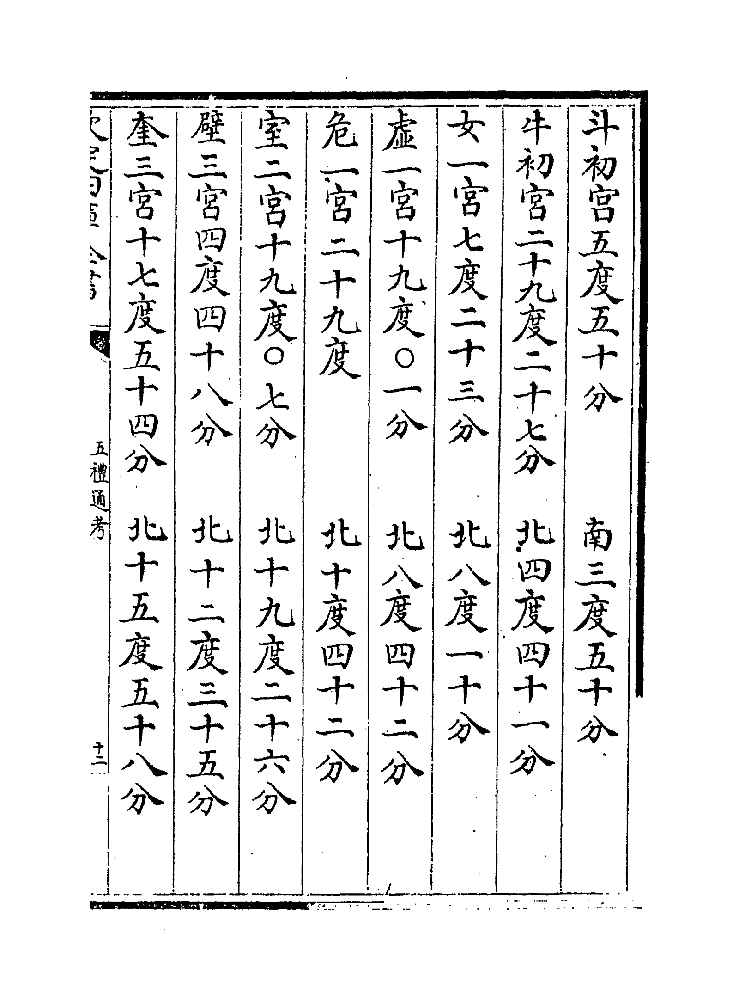

影印来源为公有领域 CADAL 扫描，下载文件共165页，SHA-256为 `dd793fdb790b73fd1f992b227e6e6276236ae6b41dd3bd4abb471edec37423b2`。直接查阅时选第126页。本文保存的是该整页的渲染图，可直接核对牛行。[原扫描文件](https://commons.wikimedia.org/wiki/File:CADAL06066771_五禮通考·卷一百九十四~卷一百九十五.djvu?page=126)

另以《中西算学丛书初编》整度表逐宿复核相邻距星差值。将网站 28 个起点换算成整角分，沿黄经东行相减，并在最后一宿补一周，26 项吻合。仅鬼、柳有相反的 4′ 差值。网站鬼宽 4°36′、柳宽 17°00′，整度表为鬼 4°32′、柳 17°04′，两宿总宽同为 21°36′。若固定鬼、星两个起点，整度表反推柳起点为 125°52′，网站为 125°56′。《五礼通考》卷一九五亦载柳起七宫 5°52′，与整度表反推一致。将程序更正为 125°52′ 后，二十八项宿宽全部吻合。历元黄经 125°54′ 从原程序的鬼宿更正为柳宿，已加入回归测试。[《中西算学丛书初编》整度变日度表](https://ctext.org/wiki.pl?chapter=368864&if=gb) [《推步法解》另一底本](https://www.shidianguji.com/zh/book/CADAL08000348/chapter/1l0an8pwbe2of)

《五礼通考》同时给出固定岁差 51″/年。由 1684 年初推至 2026 年初，旧法累计 4.845°，网站的现代岁差多项式累计约 4.77422°，相差约 4′15″。以订正后的柳宿起点 125°52′ 为例，两法推得现代界线约为 130.71167° 与 130.64088°。输入 130.68°，按旧法仍属鬼，按网站口径已入柳。当前实现采用古表定历元、现代多项式推移，因此应将这两类差异分别列出。[《五礼通考》卷一九五](https://ctext.org/wiki.pl?chapter=544336&if=en)

## 结论

可判定的程序错误主要出现在三处。第一，历算把钟面当作绝对时间，导致交节随输入时区漂移。第二，直接合并不同坐标历元的星体向量，造成冥王星黄经偏差。第三，离散区间的编号与显示越界，例如太乙第 72 局及十三月历的无时间日。以上各类均可用固定输入复算修订前后的差值。文本差异则应逐项注明采用的规则和版本，例如壬年化科、奇门九星旺相、太乙起宫及夜盘福点。对同一个案给出两套输出，比直接把其中一套判成计算错误更便于复核。表中列明的独立证据缺口限制了各项结论的适用范围。

## 复现环境

在项目根目录以锁文件安装依赖，再运行 `npm test` 和 `npm run build`。测试与构建的前置脚本会应用同一组依赖修订。直接调用 Vitest 之前，须先执行 `node ops/patch-chart-dependencies.mjs`。外部语料测试需将 `FATE_BENCH_CASES_PATH` 指向本文给定提交下的 `data/cases.json`。星历对照以 `pyswisseph==2.10.3.2` 调用 `calc_ut` 并指定 `FLG_MOSEPH`，角差按 360° 周期折到 −180° 至 180°，避免在白羊零度附近把小角差算成近一整周。

## 《石榴园》数值法原表的独立核验

通过 Sefaria 原文接口核读 Moses Cordovero《Pardes Rimmonim》30:8:3 的 הקדמי 表，逐字从 Alef 到 Tav 的累进值为 1、3、6、10、15、21、28、36、45、55、75、105、145、195、255、325、405、495、595、795、1095、1495。22项与站内 Kidmi 完全一致。原文从 Bet 的3开始列示，Alef 的1由正文的逐字起算定义确定。此表可作为独立于移植软件的数值证据。[《Pardes Rimmonim》30:8:3](https://www.sefaria.org/Pardes_Rimmonim.30.8.3)

同书30:8:6的 כללית 平方以 דוד 总数14为基数，逐项乘14后相加得到196，等于总数的平方。站内 perati 的界面标签明确写各字平方，其结果为4²＋6²＋4²＝68。这两种平方对象不同，使用时应保留名称与算式。上述两组案例已纳入 src/lib/qabalah/gematria.test.ts。[《Pardes Rimmonim》30:8:6](https://www.sefaria.org/Pardes_Rimmonim.30.8.6)

## 符文名、诗节释义与现代占义的对照

继续核对 Dickins 1915 所收三部符文诗，发现词义栏把异地诗节、重建词源和现代占义直接并列。现已在七项资料中逐一标明来源。Thurisaz 的刺与巨人来自不同诗；Ansuz 在古英语诗节关联言语，挪威诗为河口，冰岛诗为神；Kaunan 分别为火炬与疮。Perthro 词源未定，骰杯属后世解释。Algiz 的古英语对应项是沼泽植物，麋鹿属于重建词名。Tiwaz 在古英语诗节关联运行不移的标志，在北欧诗关联独臂神。Ingwaz 诗节中的 Ing 是东丹人的人物，种子来自现代象征。页面、资料库及结构化导出均已标明这些差异。[三部符文诗及译文](https://en.wikisource.org/wiki/Rune_poems)

同一字符系统在古弗萨克、古英语和北欧后期字母表中有增减与语义变化。这里以不同诗节做版本对照，古英语 Eolh-secg 也不能单独证明古弗萨克 Algiz 名称的词源。现代抽取的正逆位规则已有来源说明，词义校勘依据独立诗节，二者分别记录。

## 转忌链的证据范围

梁氏飞星教学材料将化禄转忌与化忌转忌分述，并以命宫飞禄入财帛、再转忌入田宅，以及命宫飞忌入财帛、再转忌入田宅作为两个路径案例。网站目前计算的是第一落宫的宫干再飞忌，和该层几何步骤一致。已有用例逐项检查第二星取自落宫天干的忌星，另有子女宫自化天机禄、转太阴忌入疾厄的固定盘例。教学材料还区分追禄追权的同星曜要求与追忌的非必同星曜要求。现有单步链不表达这两种多步汇流，论文据此限定已核验范围。[梁氏飞星教学材料](https://www.transtar-csft-liang.url.tw/hot_225415-cn.html)

来因宫属于现代流派术语，本次依据明确公开的教学取法修正。古籍四化口诀能支持十干化星表，对现代来因宫和转忌串联的定义仍需分别使用对应流派资料。

## 时辰起运折算与子时跨日

《三命通会》〈论大运〉用五日三时的间隔演示折除，计六十三个时辰，折为六百三十日，即一年九个月。用两个受控钟面承载这个间隔，现行时辰折算法得到一年九个月。测试中的公历2000年1月24日巳时和29日申时只承载间隔，节气端点按书中条件设置，并非声称2000年立春在该日。[《三命通会·论大运》](https://www.shidianguji.com/zh/book/SK1610/chapter/1kf5v6ol1vhnp)

核对依赖实现时发现，时辰折算法把23时的索引强制设成11，实际与亥时相同。上海2024-02-03 23:15和次日00:15同在子时，却得到相差十天的起运偏移。修正时，将23时视为当日第12个时辰边界，结合原有跨日减法计算，次日00时仍取0，因此跨午夜的同一个子时偏移相同。22时到23时仍正确前进一个时辰。顺排与逆排两种性别路径均已通过产品入口验证。该修订处理的是以时辰为粒度的离散折算。[《三命通会》卷二](https://zh.wikisource.org/wiki/三命通會/卷二)

另按卷三〈论十干禄〉逐项核对十干，甲乙丙丁戊己庚辛壬癸对应寅卯巳午巳午申酉亥子，十项一致。土干寄火禄也与正文说明一致。[《三命通会》卷三](https://zh.wikisource.org/wiki/三命通會/卷三)

## 三诈的三奇条件与盘层

《遁甲演义》三诈五假条以三吉门合三奇、再下临太阴、六合或九地分真诈、休诈、重诈。旧实现中真诈缺少三奇条件，休诈和重诈把三奇查在地盘，形成同一组规则内部的盘层不一致。修订统一取天盘乙丙丁与开休生同宫，再按三神分类。地盘单独出现三奇不构成该版本的三诈；天禽寄宫造成天盘多干时，只要其中有三奇仍可匹配。已分别加入缺三奇、仅地盘三奇、天盘多干及非吉门的对照用例。[《遁甲演义》下卷扫描](https://upload.wikimedia.org/wikipedia/commons/e/ec/SSID-12326982_遁甲演義_2.pdf)

实际入口以2026年1月1日至8日、每天十二时辰共96盘复跑，逐项比较宫内标记、全盘吉格汇总与格局清单的位置集合，三处与按天盘干、门、神独立重算的集合一致。引擎原始输出在产品归一化入口同步修正，因此结构化导出也使用同一套条件。

## 九遁条件的版本与整句判定

《奇门遁甲秘笈大全》〈奇门吉格〉所列九遁，天遁为丙生临丁、地遁为乙开临己、人遁为丁休合太阴、风遁为乙合三吉门临巽、云遁为乙合三吉门下临辛、神遁为丙生合九天，主式与现行条件相符。该篇还收若干“一云”变式，例如天遁另见开丙，风遁另见开丙巽，云遁另见乙开坤。本站此三类暂采用主式，资料中分别记录变式。[《奇门遁甲秘笈大全·奇门吉格》](https://www.shidianguji.com/zh/book/SDZJ0630/chapter/1lx9g2dlhzj17)

“人遁”还有影响判定的异式。《古今图书集成》艺术典705卷写丁、休门与太阴，707卷三遁条则写上盘丁、中盘休门、下盘丙；二者不能默认为同一式。网站当前检测丁、休门与盘面太阴，不要求地盘丙。上海时间2026-01-02 12:00的默认阳四盘，一宫为天丁、地丁、休门、太阴：当前条件命中，707卷的地丙条件不命中。2026-01-04 20:00默认阳四盘，二宫为天丁、地丙、休门、白虎：地丙条件命中，当前条件不命中。705卷关于“前二太阴”的起法需按其全套排神法另校，这里的比较仅检验产品现有太阴标签，不能将两套排神口径直接等同；707卷文本亦未明确排除太阴并存。测试固定两盘的实际字段，页面说明列出地丙异式，未擅自更换本盘判据。[艺术典705卷·释人遁](https://zh.wikisource.org/wiki/欽定古今圖書集成/博物彙編/藝術典/第705卷) [艺术典707卷·三遁](https://zh.wikisource.org/wiki/欽定古今圖書集成/博物彙編/藝術典/第707卷)

核查格局证据显示时发现，原天遁、地遁只列天地盘干而漏列门；人遁及三诈五假只列门神而漏列天盘干，读者无法从证据行复核完整组合。现对九遁、三诈五假及三奇之灵统一展示落宫的天盘干、地盘干、门和神，寄宫双干按实际列表展示；判定条件本身未改。受控案例核验天遁、地遁、人遁、真诈四类证据行包含所需字段。这改善可复核性，不把同宫出现的所有字段都声称为每个格局的必要条件。

龙、虎、鬼三项原实现存在条件过宽或式子串接错误。本轮按上述篇目修订。龙遁限乙休，临坎或下临癸。虎遁分别判完整的乙加辛、休门、艮宫，辛生临艮，以及该篇“一云”丙加辛生门。旧条件将艮宫与地辛拆成“或”，使乙休临艮无辛、乙辛休不在艮也成立，另含未在所核篇目找到的庚开兑式。鬼遁采用丁生九地临艮、乙杜九地，以及“一云”丁开九地。旧丁杜九地式与本次选用篇目不同，改以明确有文的整句条件判定。[同篇龙、虎、鬼遁条](https://www.shidianguji.com/zh/book/SDZJ0630/chapter/1lx9g2dlhzj17)

新增14个正反条件样例，并对96张实际盘逐项核对这三类在宫内标记、全局列表与格局清单的成立位置。上述版本选择是本次实现采用的规则，其他传本出现不同组合时，应作为完整条款对照，不能从几条不同句子各抽一个条件重新合成。

## 三奇升殿与奇游禄位的盘层

《奇门遁甲秘笈大全》升殿条分别取乙临震、丙到离、丁临兑。《奇门法窍》卷六另列奇游禄位为乙震、丙巽、丁离，并要求三吉门。两组不能因同称三奇得地而合并。这里的三奇是随天盘移动而临各地宫，旧代码却检查地盘乙丙丁；同一地盘在各时辰不动，会把天盘三奇已离开的宫位继续记作升殿或游禄。本轮将两项改为天盘干，游禄继续要求开休生，升殿的结构标签与门迫、奇墓等取用条件分列。多干寄宫逐干匹配，地盘单有三奇不再触发。[《奇门遁甲秘笈大全》升殿条](https://www.shidianguji.com/book/SDZJ0630/chapter/1lx9g2dlhzvob) [《奇门法窍》卷六诸格吉例](https://libokang.com/zh-hant/classics/qimen/奇門法竅/)

古例还能提示布局版本的边界。《奇门法窍》阳遁一局甲子旬辛未时列震方升殿与奇合，按乙庚相合可读为天乙地庚。本站当前转盘布局以2026年1月5日14时承载同一辛未时，强制阳遁一局，震宫却为天癸地庚，天乙在乾。故该古例不能记作当前整盘布局通过的回归例；它提示飞宫、转盘布局需要另行比较，不能为了命中古例而改动输入。此次测试用10组受控宫位分离盘层、两种宫位表、门条件及寄宫多干，再对96张实际盘按天盘字段独立重算，核对宫内、汇总和格局清单三处输出。

五假另见文本异文。《遁甲演义》识典本的人假为惊门合六合、下临九天；《奇门遁甲秘笈大全》传本注出一作六壬。惊门、壬、九天不能声称已由前者逐字证实。《奇门法窍》六壬读法及本次采用的天盘条件见下节；六合与九天在当前单神字段内不能同时出现，该异文的上下神盘含义及原扫描仍须核查，不将两种读法拼成新规则。[《遁甲演义》三诈五假](https://www.shidianguji.com/zh/book/SK1616/chapter/1l9lopdnnthc0)

## 五假盘层与人假的异文取舍

继续核查发现《奇门法窍》卷六人假条明确取惊门、六壬、九天，故“六壬”并非程序自行补出的替代字；《遁甲演义》的“六合”读法仍是另一条文本证据。本站本次明确采用前者的人假读法，不把六合与九天强行塞入同一个单神字段。该篇的五假名单还包含物假，鬼假又称神假，与《遁甲演义》分列神假、鬼假的五项名单不同。本站保留原有五项登记，不能声称覆盖了《奇门法窍》的全部五假。[《奇门法窍》卷六五假条](https://libokang.com/classics/qimen/奇门法窍/) [《遁甲演义》三诈五假](https://www.shidianguji.com/zh/book/SK1616/chapter/1l9lopdnnthc0)

盘层另有明确的现代作者原著可供核对。肖殿中《遁甲之学》三诈五假条将地假所需丁己癸列为天盘，把人假列为天盘壬、惊门、九天；伤门六合的物假与伤门九地的神假也分别注明。此次能够核读搜索服务抽取的原著段落，PDF直链在网页工具和本机下载中分别失败，未目验原页。因此用它作为盘层的明文证据，证据等级限于电子抽取；不将其视为古籍影印，也不把物假混入既有神假。鬼假的干层沿用同组门、干、神结构，古籍所列死门丁己癸九地条件保持。[肖殿中《遁甲之学》PDF](https://vr-d.com/pdf-file/奇门遁甲/遁甲之学-肖殿中.pdf)

本轮将地假、人假、神假、鬼假所查干统一改为天盘，天假原已使用天盘，保持不变。受控用例逐个遍历三干及神的组合，分别核对天盘命中、仅地盘命中、多干寄宫、错误门及错误神。另以96张实际盘逐条从天盘干、门、神独立算位置集合，核对宫内标记、全局汇总和格局清单。它验证程序与所选条件一致；古籍六合读法的上下神盘解释仍未解决。

具体盘例可固定上海2026年1月5日02:00，手动冬至阳遁一局。当前转盘的震三宫为天盘丁、地盘庚、死门、九地，按死门丁己癸临九地的天盘读法构成鬼假。旧代码检查地盘庚，漏掉此宫。这个案例用强制局数隔离定局法，检验盘层修订，不用来证明该时刻自然定局也为一局。

## 结构成立、旺衰赋分与取用限制

《奇门法窍》卷六在五假条后要求避迫墓，升殿条又以门不迫、奇不墓为取用条件。因此门、干、神构成某格，与该宫是否满足取用条件是两层判定。本轮保留结构成立标签，为已成立五假与升殿分别列出本宫门迫、成立所用天盘干入墓的限制；无关寄宫干入墓不移植到另一成立干，其他宫位的门迫也不影响本宫记录。入墓支表沿用当前登记的干墓口径，未将其宣称为所有传本共有。[《奇门法窍》五假与诸格吉例](https://libokang.com/classics/qimen/奇门法窍/)

原有“有力、中平、无力”是本站把门星旺衰赋成数值后的分档，未找到古籍逐项给出这个加分模型。现将算法公开为旺3、相2、休1、囚0、死或废负1，两项相加，成立宫位取最高分，4分起有力、1分起中平，其余无力。门迫、入墓不计入此分，独立展示；所以有力标签不能替代古籍的无迫无墓条件。该数值模型仅用于界面整理，尚无外部效度验证。AI导出同时携带算法和实际取用限制，避免只有一项档位而省略相反条件。

受控案例取震宫天乙、开门门迫、门星均旺：升殿结构仍成立、旺衰仍为有力，但同宫明确未满足无迫条件。艮宫天丁、死门、九地、支含丑则鬼假结构成立，所用丁同时入墓。另一例以天壬、惊门、九天成立人假，同宫寄丙临戌入墓，仅丙入墓不应给壬加限制。UI与两种导出均有回归；十二盘紧凑导出继续通过原80,000字符接口限制，省略的空限制及重复旺衰说明可由公共说明与各宫字段恢复。

## 紫微安星表的独立逐项回归

《紫微斗数全书》卷二的安星诀可以拆成不依赖移植软件的独立算式。以子为0至亥为11，文昌为戌逆数生时，文曲辰顺数生时，左辅辰顺数生月，右弼戌逆数生月；禄存按十干表，擎羊顺一宫、陀罗逆一宫。空劫均亥起子时，劫顺空逆。另核对年支三合取天马、酉起正月顺安天刑、丑起正月顺安天姚、午起子年哭逆虚顺、龙池辰顺与凤阁戌逆，以及三台从左辅顺生日、八座从右弼逆生日。测试期望逐项从本卷写出，没有引用iztro的内部位置表。[《紫微斗数全书》卷二安星诀](https://zh.wikisource.org/zh-hant/紫微斗數全書/卷二)

样本以农历1990至1999年逐年取十二个月，第m月取2m−1日、第m−1个时辰，换算公历后通过产品正式排盘入口。120张盘实际覆盖十年干、十二月与十二时辰，对十八颗辅杂星共2160项位置断言全部通过。这里各维度为分层配对覆盖，并非年月日时的全部笛卡尔积。另以1990年5月20日十二时辰，核对紫微系天机、太阳、武曲、天同、廉贞的逆行间隔，和天府系太阴至破军的顺行间隔；十四主星每颗在每盘恰有一个落宫。此组只验证两系内部相对排列，不独立证明每个生日的紫微起点或天府定位。

魁钺须分开列版本差异。维基文库卷二电子本作丙丁猪狗，另一资料的明代南阳堂刊本索引作猪鸡；当时扫描直链未能打开，尚未目验原叶。后续核对日本国立公文书馆所藏明刊七卷本影像第75张，原页安天魁天钺诀确为丙丁“猪鸡”、六辛“马虎”。维基电子本分别作“猪狗”“虎马”。当前产品1996丙年、1997丁年均为魁亥、钺酉，1991辛年为魁午、钺寅；若按口诀所列先后分别理解为魁与钺，三盘与该明刊用字相合。先后与星名的对应是本比较明示采用的解释，不把简称顺序和星名对应当作影像独立写明的事实。两传本用字及顺序不同不能简单当成一个底本的排版差错。[馆藏明刊影像75](https://www.digital.archives.go.jp/api/content/item/da12/C102812185800/iiif/M2019050811103249305_0075.jp2/full/max/0/native.jpg) [电子本](https://zh.wikisource.org/zh-hant/紫微斗數全書/卷二)

同一馆藏本影像76的〈安禄权科忌四星变化诀〉，壬年可见“梁紫府武”的顺序；按本诀禄、权、科、忌的次序，第三项为天府化科。它与前述电子本同为“府”，与产品及《捷览》“左辅化科”不同。2022-06-01壬年实盘现存于 `src/lib/ziwei-flying/chart.test.ts`：产品左辅化科，替换为此明刊口径则是天府化科；没有因取得原页便擅自替换产品所选流派。第75、76张影像副本 SHA-256 分别为 `eb711a4260ce9e9c074082563726a7bd1ad661df575a7b1300a56eb2b66c3a65` 与 `a34b67a3a4bc5ff2d5b64c1dc40fb56692a1fcab0fe10f6a405ee4aba26ec60f`。[馆藏明刊影像76](https://www.digital.archives.go.jp/api/content/item/da12/C102812185900/iiif/M2019050811103249305_0076.jp2/full/max/0/native.jpg)

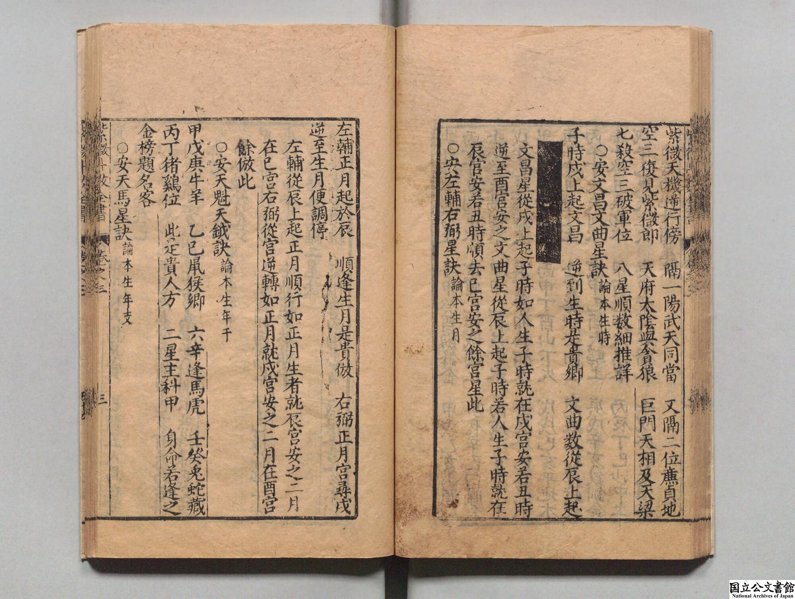

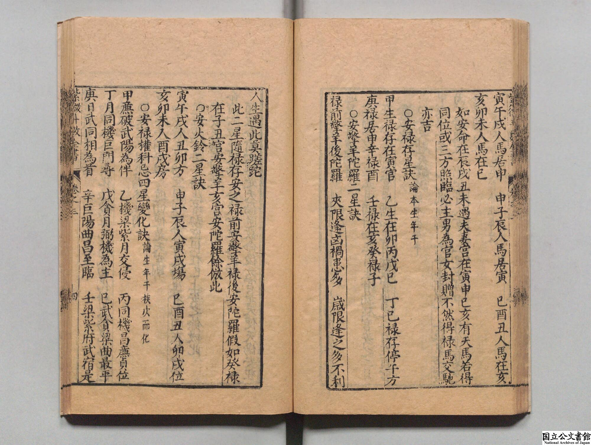

### 紫微星十二宫亮度：明刊表与正文（2026-11-12）

馆藏明刊上册影像88、89的庙旺表中，紫微星按子至亥依次列为：平、庙、庙、旺、得地、旺、庙、庙、旺、旺、得地、旺。为与引擎标签比较，测试中仅把表头“得地”记作“得”，不把其他等级合并。取庚午年二月的木三局，每个落宫选一日，从产品入口读取实际紫微落宫和亮度，十二宫中十一宫与表格一致；寅宫是唯一差异：图表为庙，产品为旺。

同一刊本紧接着在影像90紫微条又把寅、申称为“旺地”，与影像88图表在寅宫的“庙”不同；产品寅宫“旺”与该正文相合。图表和正文在该位置各自分开保存，不能只凭其中一处将另一处或产品断为计算错误。以上只比较紫微星，不代表该表其他星曜已经验证；也不验证亮度或格局对现实事件的预测。十二宫案例在 `src/lib/ziwei/chart.test.ts`，馆藏扫描副本按馆方利用说明留存，影像88、89、90的 SHA-256 分别为 `5d0eb5fffee3681600f72148ef204a83f362c0bfe4efbfb22985389b53e20352`、`b3dff41579c2aee07d264ef480f5ca171096ba1b13a1a3bc029afc466a81a3d9`、`2c5e44b622c12c82e75805b5491691c60ddb9cd2a21c57b6e59bd07f1e3fae47`。[馆方影像88](https://www.digital.archives.go.jp/api/content/item/da12/C102812187100/iiif/M2019050811103249305_0088.jp2/full/max/0/native.jpg) [馆方影像89](https://www.digital.archives.go.jp/api/content/item/da12/C102812187200/iiif/M2019050811103249305_0089.jp2/full/max/0/native.jpg) [馆方影像90](https://www.digital.archives.go.jp/api/content/item/da12/C102812187300/iiif/M2019050811103249305_0090.jp2/full/max/0/native.jpg)

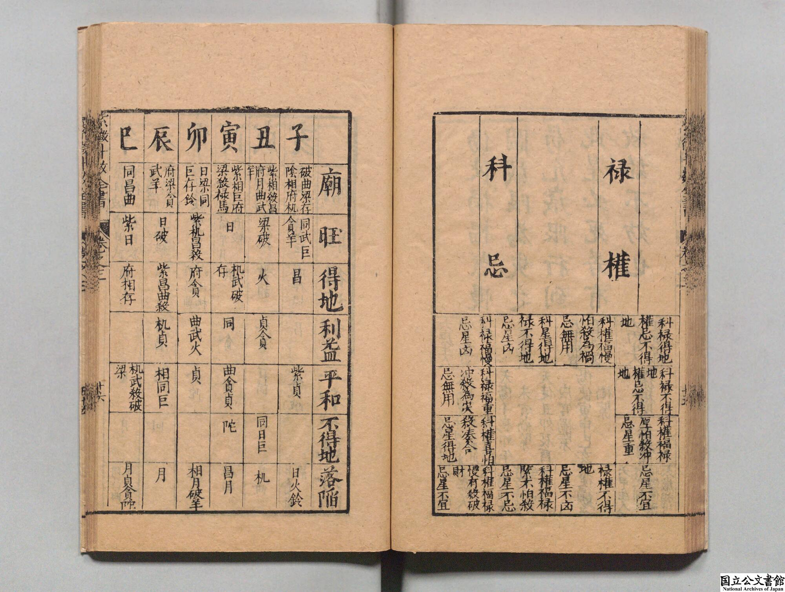

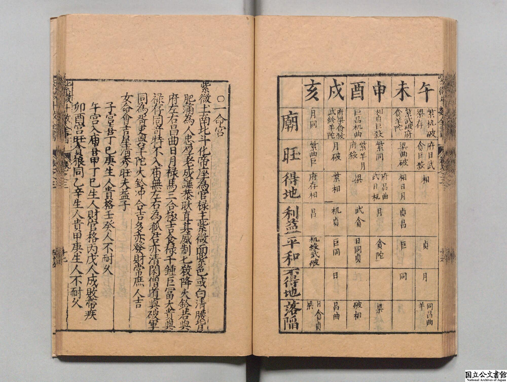

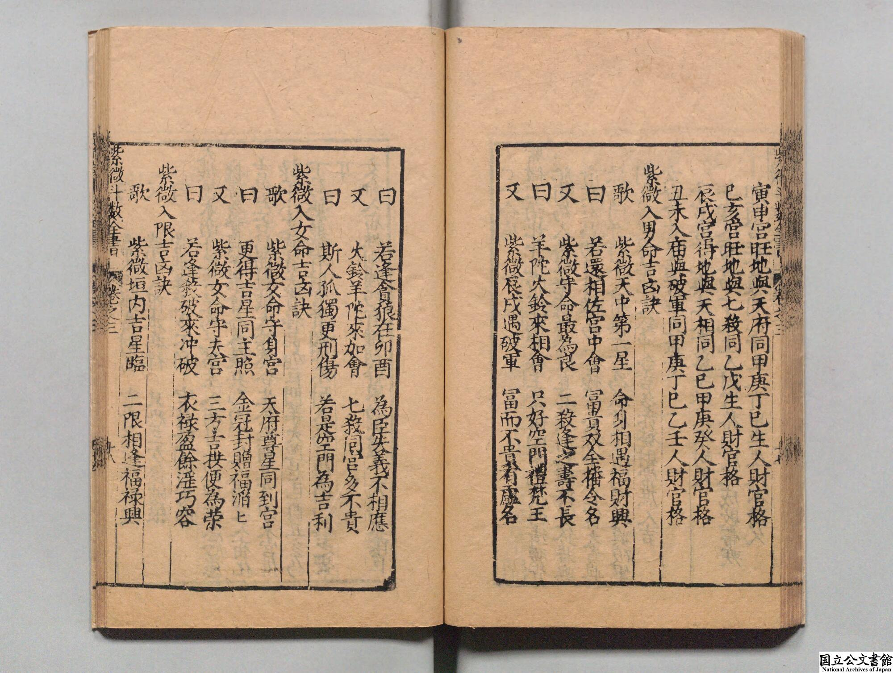

天府定位另由《全书》安天府图核对：寅申紫府同宫，其余宫位斜作对，且明确举紫微丑、天府卯为例。在子0至亥11的编号下对应天府=(4−紫微) mod 12。上述120盘实测紫微十二宫均出现，天府逐盘符合此镜像。这里的天府定位因此可列为十二宫覆盖通过，紫微起点全生日表仍待独立核验。[《新锓希夷陈先生紫微斗数全书》安天府图](https://www.shidianguji.com/mid-page/7356346222862516234)

## 紫微起点：全月水局与四局起日

本轮找到可下载的《紫微斗数全书》141页电子PDF，PDF第55至61页保留五局图表的文字。下载文件是ASCII框线重排，图表跨页且列距失真，不能当作原刻影印；另有网页把歌诀与现代解释混排，需分开读取。可明确按水局口诀复算的全月表为初一丑、初二初三寅，随后每宫两日顺布，三十到辰。木、金、土、火的起日分别为辰/丑、亥/辰、午/亥、酉/午。火初一酉另与卷二安身命例相合。后四局复杂的进退歌诀和完整图仍需逐项校读，不凭现代补数公式生成预期再宣称古表吻合。[完整电子PDF](https://download.s21i.co99.net/12045409/0/1/ABUIABA9GAAg9v_ssAYoiJDLjAU.pdf) [《全书》歌诀及解释分列](https://libokang.com/classics/ziwei/紫微斗数全书/)

以庚午年农历1990年二月大月承载生日1至30。固定午时为水二局，申时为木三局、戌时为金四局、子时为土五局、寅时为火六局。每项先由产品入口自行生成五行局，再核对局名及紫微落支，没有向引擎强制传入局数。水局30日、另四局各初一初二共38项全部通过。比如1990年农历二月初一午时为水二局、紫微丑；同日寅时为火六局、紫微酉。该结论不覆盖木金土火其余112个生日格。

## 五局日表的跨页还原与缺日、重日

本次逐页查看前述电子PDF第56至62页的图表，把同列上下两字组成日期，并以每宫原有日期列表存档，没有先按引擎算出结果再填表。木三局初九在辰与寅各出现一次，初五未见；金四局缺三十日。土五局与火六局均列齐1至30且无重日。这里指出的是这份电子重排文件的可见缺陷，尚不能追溯为原刻错误。原表转录、PDF页码、下载链接和文件SHA-256已存于 `docs/research/sources/ziwei-quanshu-start-tables.json`，便于复核同一文件。PDF第56页木局辰栏初一/初九/十一，与第57页寅栏初三/初九构成具体的同日两宫案例。

按唯一可读格子，木局28项、金局29项、土局30项、火局30项共117项通过产品入口比对。结合水局三十日，共147个明确位置通过。测试另断言来源中恰有木初五、金三十两处缺日，以及木初九两宫冲突；这些条目没有用现代补数法静默修复，也不计为该重排本的古表验证通过。程序当前木初五为寅、初九为辰，金三十为亥；后续另一明刊本对这三格的独立核对见下文。整套紫微解释规则仍不由安星表验证代替。[所核电子PDF](https://download.s21i.co99.net/12045409/0/1/ABUIABA9GAAg9v_ssAYoiJDLjAU.pdf)

## 紫微贪火：会照事实与定贵局条件

《全书》卷一〈定贵局〉把贪火相逢解释为二星守命、同居庙旺。旧程序在命宫三方四正分别找到贪狼与火星，就给出“火贪格”，未要求二星同守命宫，也不查亮度。这项条件扩张不能由该条原文支持。修订后，原来的三方会见事实仍列为“贪狼会火星”，另按命宫同时有贪狼、火星且两星亮度各为庙或旺，判“贪火相逢”；缺亮度、平、利或陷均不满足本条。亮度表仍取当前已选iztro版本，其他传本亮度差异需另校。[《全书》卷一·定贵局](https://zh.wikisource.org/zh-hant/紫微斗數全書/卷一#定貴局)

同书的另一层文字不可省略。《骨髓赋》有贪铃并守之说，卷三又称贪狼遇铃火在四墓、守照俱可论吉。这支持某些会照另有解读，但不等于卷一“二星守命同居庙旺”的条件可以删去。铃星原来也只做三方共见，曾改为显示“贪狼会铃星”，不把单纯共见命名为已成铃贪格；这一名称随后仍因歧义而修正，见下段。铃贪完整版本条件仍待核对，不能由火贪直接类推。[《全书》卷三贪狼条](https://zh.wikisource.org/zh-hant/紫微斗數全書/卷三)

再复核发现，上段“贪狼会火星／铃星”这一旧名称仍有歧义：程序只要求两星各自在命宫的三方四正，并未核验两星互相之间的宫位关系。例如以命宫为0，贪狼在4、火或铃在6，两星虽均在命宫四宫范围内，彼此却相隔2宫，并非同宫、三合或对宫。现更名为“命宫三方四正见贪狼与火星／铃星”，并列两颗星的具体宫位，作为中性结构事实；不因此推定两星互会或《骨髓赋》的“并守”。另一受控例将两星置于命宫，才有同宫事实，是否符合特定格局仍依各版本附加条件分别判断。这里比较的是盘面关系而非吉凶预测。[《紫微斗数全书》卷一](https://zh.wikisource.org/zh/紫微斗數全書/卷一) [三方四正的宫位定义](https://www.chinazwds.com/Home/ArticleDetails/c4c7e9cb715449d399e9e56d38b255fb)

再用日本国立公文书馆藏明刊七卷本影像88、89逐宫比较贪狼亮度：图表丑宫作“利益”、卯宫作“得地”，当前 iztro 表分别为“庙”“利”；其余十宫称谓一致（比较时仅把图表“利益／平和／落陷／得地”简写为“利／平／陷／得”）。图中火星明确可见子宫“落陷”、丑宫“得地”、卯宫“利益”，与产品对应三个值相同；其他宫的火星在此图中未找到明确条目，不能当作图上没有亮度或推断其余九宫都一致。以2000年每月15日的十二个双小时构造真实排盘，覆盖上述十二个贪狼宫位和三个火星宫位，比较锁入 `src/lib/ziwei/chart.test.ts`。

因此，“贪火相逢”的守命和庙旺条件与亮度表必须分别注明出处：产品使用 iztro 的亮度表，并非逐宫使用此明刊图。已经把产品格局说明改成“按现用亮度表套用”《定贵局》条件，避免将不同版本混作古籍直接结论；本次没有更换任何星曜亮度，也没有证明两项具体差异必然改变真实命盘是否成格。[馆藏明刊图表88](https://www.digital.archives.go.jp/api/content/item/da12/C102812187100/iiif/M2019050811103249305_0088.jp2/full/max/0/native.jpg) [图表89](https://www.digital.archives.go.jp/api/content/item/da12/C102812187200/iiif/M2019050811103249305_0089.jp2/full/max/0/native.jpg)

实盘对照均用上海时间、女命。1990年3月15日02:00，命寅，贪狼平、火星庙，同宫但不满足本次庙旺条；1990年7月15日18:00，命戌，贪狼庙、火星庙，满足。两盘的会见事实均保留。另用七组受控条件区分同命、三方分宫、同在非命宫、亮度平/利/缺失。测试验证的是所选古文条件与产品结果，不验证这些格局对现实事件的预测能力。

## 机梁、日月同宫的标签评级

紫府同宫另有同类问题：旧程序只要两星同守命宫便标为最高等级，并将来源写作《全书·紫府同宫格》。所查电子本卷二〈安天府图〉说明寅申二星同宫，是安星位置依据；卷三〈论人命入格〉另要求结合庙旺、吉曜、化忌等条件，不能据此把同宫直接视为最高等级。现保留命宫同宫事实，评级改为中性，来源指明安星图；受控测试覆盖同宫而紫微化忌、另有擎羊，以及移走天府的反例。该测试不对两种情形的实际吉凶作验证。[安天府图](https://www.shidianguji.com/mid-page/7356346222862516234) [《全书》卷三](https://zh.wikisource.org/zh-hant/紫微斗數全書/卷三)

禄存与化禄在《全书》卷一诸星问答中分别成条，不能把一个命宫中的实际证据含混写成“禄存或化禄”。原程序虽分别检测禄存星和生年化禄，却无论哪一种都只输出这句含混文本；化忌则检查所有星曜，却固定写成“命宫主星带化忌”，对文曲等辅星化忌会误报类型。现按实际数据分别列出禄存同宫、各颗生年化禄星和各颗生年化忌星，并保留各自篇目出处。四组受控测试覆盖仅禄存、仅化禄、两者并存及均无，同时用文曲化忌验证辅星名称。此改动提高证据可追溯性，不宣称已实现古文中所有组合取用，也不验证财禄预测。[《全书》卷一·禄存、化禄与化忌](https://zh.wikisource.org/zh-hant/紫微斗數全書/卷一)

原“杀破狼”输出将命宫三方四正三星同时出现写成《全书·杀破狼》出处，未能对应所查《全书》电子本的具体篇目。《全书》卷一破军条确有破军在子午守身命、贪狼七杀相拱的具体论述，其条件比程序现行的三方四正会见更具体，不能拿来证明两者等同。现将名称明确为“杀破狼会见”，出处区分程序结构与古文特例，并逐星记录所在宫；三颗星都在命宫三方时输出会见，将贪狼移至其外则不输出。受控案例验证检测范围，不证明这些人为组合均为合法安星盘，也不据此将具体古格局扩展为无条件结论。[《全书》卷一·破军](https://zh.wikisource.org/zh-hant/紫微斗數全書/卷一)

《全书》卷三天机条把机梁守命加吉与加刑忌分开，太阳太阴拱照条也区分吉凶曜多寡、生时、守照及反背。此前程序在任意宫识别机梁或日月同宫后，统一赋good级别，甚至非命宫或落陷化忌同宫也如此。这是把结构识别不当地扩成了吉格评级。本轮保留两种同宫结构，级别统一为neutral，并补出所在宫支、是否命宫和两星实际亮度。原先类似书名后接“机梁同宫”而未标确切篇目的来源，改为卷三对应条文。没有用“见吉星就good”的另一套简化打分替换旧规则；完整格局取用须按具体篇目继续核对。[《全书》卷三天机及太阳太阴拱照](https://zh.wikisource.org/zh-hant/紫微斗數全書/卷三)

回归样例分别把两组星放在命宫、非命宫，赋第一星陷且化忌、第二星平并加擎羊。四种结构均如实显示同宫及亮度，不再出现由同宫直接得出的good。它检验的是算法不越过已实现的条件；不是把这些盘断为凶，也不从古文的时代性断语推导现代人的身份或命运。

### 天机、天梁亮度与同一明刊本的表文差异

将日本国立公文书馆藏明刊本影像88、89中可辨的天机、天梁条目，分别与产品正式排盘所得亮度比较。2000年逐月15日、每两小时一盘，共144盘覆盖天机11个可辨宫位及天梁12宫；比较将“得地、利益、平和、落陷”分别简写为“得、利、平、陷”。天机酉宫，图表为庙、产品现用 iztro 表为旺；天梁巳宫，图表为平、产品为陷。其余21个可辨星宫条目一致。未在图表未宫找到天机，不能把空白当作明刊给出的陷，也不计入通过数。

同一本影像91的天机正文另列卯、酉为旺地，丑、未为陷地；正文酉旺与前页图表酉庙有差异，前者与产品相同。正文未陷可作为独立文字记载，但不能反填成图表未宫已列陷。因图文并非同一张表的重复，现将出处分列，不仅凭某处不同就修改产品选用的亮度表；机梁同宫目前只是结构事实，未按这两处差异直接判吉凶。复现测试见 `src/lib/ziwei/chart.test.ts`。影像91副本 SHA-256 为 `ec7e38e685ecb2e75284a24ff1900dbcc8c3dcee6915b717eba3d18bbbad543`。[馆藏影像88](https://www.digital.archives.go.jp/api/content/item/da12/C102812187100/iiif/M2019050811103249305_0088.jp2/full/max/0/native.jpg) [影像89](https://www.digital.archives.go.jp/api/content/item/da12/C102812187200/iiif/M2019050811103249305_0089.jp2/full/max/0/native.jpg) [影像91](https://www.digital.archives.go.jp/api/content/item/da12/C102812187400/iiif/M2019050811103249305_0091.jp2/full/max/0/native.jpg)

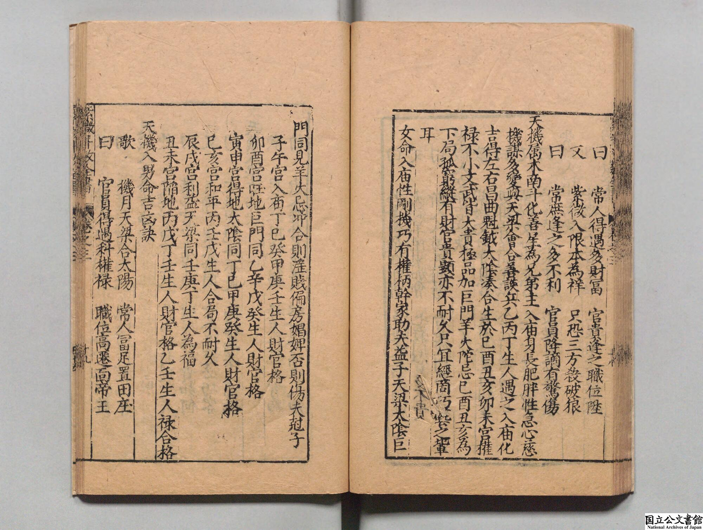

## 运年羊刃的同书异说与主盘一致性（2026-11-06）

《三命通会》卷三〈论羊刃〉同时保留禄前一辰的十干叙述和子平仅五阳干取刃的说明，不能宣称阴干羊刃在所有传统中不存在。站内八字主盘此前已选择五阳干法，但第三方大运、流年仍按十干表标注，乙见辰、丁己见未、辛见戌、癸见丑时便与主盘所用规则不一致。此次为八字运年显式启用五阳干口径，甲卯、丙午、戊午、庚酉、壬子不变；其他共享调用保留原十干表，未将同书另一说删除或判成普遍错误。[《三命通会》〈论羊刃〉两说并载原文](https://www.shidianguji.com/book/SK1610/chapter/1kutiho2qupsj)

回归输入为上海当地正午1990-01-15至01-24连续十日，覆盖庚辛壬癸甲乙丙丁戊己十日干。对每例全部流年确认十二支均出现，再逐项检查羊刃与日干、目标支的关系；各大运及主盘四柱亦按同一规则对照。例如01-20乙酉日，禄前一辰说会以辰为刃，本站五阳干法对其辰流年不报羊刃；01-19甲申日的卯流年仍报羊刃。该改动统一原始资料口径，没有增删K线计分词项，也不据羊刃标签直接推断现实灾祸。

## 运年神煞与本命日柱的作用域（2026-11-06）

第三方`calculateBranchShenSha`在未指定本命柱位时，会附加原命日柱的魁罡、阴差阳错、十恶大败；大运、流年调用原先都省略选项，因而原命一旦命中，之后所有运年均带同一标签，无论目标干支是什么。这不是逐年查得的结果。《三命通会》〈魁罡〉列庚辰、壬辰、戊戌、庚戌四日，另述岁运条件，并不能据本命日柱把每年都标成魁罡。此次通过依赖安装补丁，为运年调用显式关闭附加本命日柱标签，保留默认无柱位接口及六爻调用原行为。未把流年干支另行当作出生日柱套日格，也未借用本命年柱位置模拟运年。[《三命通会》〈魁罡〉](https://www.shidianguji.com/zh/book/SK1610/chapter/1kf5v7gd69ouh)

以上海正午1990-01-15庚辰日、1990-01-11丙子日、1990-02-08甲辰日三例，分别覆盖触发上述附加项的原命。修订后核对各例全部大运和流年，三种本命日标签不再无条件复制；另以己巳年庚辰日案例，遍历十二流年地支，驿马仍只在寅、亥命中，验证并未将运年神煞整体删除。这三个标签不在现行人生K线的支持/复核计分词表内，因此本次修订清理原始运年资料，不声称改变该模型分值。其余神煞查表与古籍异说仍需逐项复核。

## 关系K线中的五不遇时布尔误判

K线评分复核发现，奇门原始结果的wuBuYuShi是一个带isWuBuYuShi布尔字段的对象；未成立时仍可返回该对象。旧关系评分却检查对象是否存在，因此false也触发扣分，并写入“见五不遇时”的证据。此为数据结构使用错误，与五不遇时古籍口径或评分权重的争议无关。修订改查布尔判定，只有true触发既有权重。四种时间尺度分别核对对象缺省、false、true，前两种分数与证据一致，true才扣分。当前全仓检索没有发现另一处同样把该对象直接作为成立条件的活动代码。

这次没有重调K线权重。关系线的五不遇基础权重负2再乘时间尺度的背景系数，人生线的十二长生、神煞与关系加分也仍是产品启发式；算式可重复，不等于它们已由古籍数值表或现实预测检验证实。五不遇时本身的时干克日干规则已在前节按古籍十组案例另行验证。

## 人生K线与八字主盘共用排运口径

后续检查发现人生K线另调用taibu-core默认排运，而八字主盘已使用带节气参考的lunar-typescript及显式换日、换年设置。前者输入接口只有出生钟面及性别，未接收用户的时区、子初/子正、立春/春节选项，因此主盘修订并没有自动覆盖K线。此次抽出主盘原有历算上下文，包含当地钟面、同一绝对时刻的节气参考及EightChar日界设置；人生线复用它的Yun对象，并把所选年柱和日主传给既有大运关系、神煞、长生计算。未改写分值模型，也不通过挪动出生时间模拟另一年界。第三方接入补丁固定在ops/patch-chart-dependencies.mjs，版本结构不匹配时构建失败，避免默默回到默认口径。

具体对照均为男命。上海2024年2月8日12:00在立春后、春节前：立春界为甲辰阳年，顺排首运丁卯；春节界仍为癸卯阴年，逆排首运乙丑。程序逐一核对主盘已有各步大运的干支、起年、起岁，K线与其相同。2024年2月4日UTC08:30及上海16:30表示同一立春后时刻，均顺排首运丁卯，避免把UTC08:30误当北京钟面而落到节前。上海2026年7月3日23:30，子正换日为戊日，乙未运处衰；子初换日为己日，同一乙未运处冠带。后例验证日主真的进入运年计算，不仅换了显示文字。

起运细分也改用共用Yun的年月日时偏移，取代第三方用宿主Date日差再按365日和30日拆年的近似字符串。原始神煞与支关系依然由原有taibu代码计算，具体古籍异说仍按各条另核；此次一致性测试不能证明所有运年神煞已完成校勘。传统顺逆及折除取法的证据见前文《三命通会》大运节。

长生例另有取法差异。本站沿用当前八字引擎的火土同宫表，戊寅起顺行、己酉起逆行。《五行精纪》卷十五引《广信集》却列戊申起逆数至巳临官、己卯起顺数至午临官。若将该段起点与方向用于同一未支，戊未为沐浴、己未为帝旺，与本次测试的衰、冠带不同。因此上述子时用例证明选定日主与当前表同步，不能声称各古籍在长生取法上完全一致；也没有把该段土法塞入现行火土同宫表。[《五行精纪》卷十五论禄](https://zh.wikisource.org/wiki/五行精紀#第十五卷)

## 同支值太岁与自刑的区分

《三命通会》〈论三刑〉分别列寅巳申、丑戌未、子卯等刑，并将辰午酉亥列为自刑；例文还明确写辰见辰、午见午等。原taibu运年太岁函数只检查出生年支与流年支都在某一刑组中，因此子子、丑丑、寅寅、卯卯、巳巳、未未、申申、戌戌也会触发“刑太岁”。这种同组自配并不是该篇给出的自刑。补丁要求多支刑组的两支不同，单支自刑组才允许重复；“值太岁”条件仍独立保留。不同支的方向、两支刑与三刑全的异法不由此次修订代替核验。[《三命通会》论三刑](https://www.shidianguji.com/book/SK1610/chapter/1kf5v6ol1zcpx)

以1984至1995年7月1日正午男命覆盖出生年子至亥十二支，对各自运表中所有同支流年核对：均有值太岁，只有辰辰、午午、酉酉、亥亥同时有刑太岁。另用1984子年遇卯、1987卯年遇子，保留子卯无礼之刑，防止修正误删不同支相刑。当前实现与回归案例只说明关系标签；该古籍自身亦说见刑不可立即论凶，不能把任一标签当成现实灾害预测。

## 运年学堂、词馆的纳音上下文（2026-11-06）

运年接口虽有按年纳音查学堂的分支，调用方却从未提供`yearNaYinElement`，所以所有大运、流年的学堂恒不命中。词馆则直接按日干查一张近似禄位表，和学堂采用不同的基准。《三命通会》〈论学堂词馆〉先以纳音长生、临官说明两者，另列会禄、会食、官贵及子平等取法，不能混成一张通用表。此次为八字运年明确选择生年纳音的支位法：金学堂巳、词馆申；木亥、寅；火寅、巳；水与土均申、亥。生年柱使用用户所选年界，不再缺省为另一排盘口径。[《三命通会》纳音长生、临官原文](https://www.shidianguji.com/mid-page/7426853297409179675) [同篇其他取法与限制](https://www.shidianguji.com/book/SK1610/chapter/1ktkuwj016xhm)

回归以1984甲子金、1986丙寅火、1988戊辰木、1990庚午土、1982壬戌水五个出生年，各取上海7月15日正午，对所有大运及涵盖十二支的流年核对两项命中。例如1990土命，原来完全不报学堂，修订后申流年有学堂、亥流年有词馆。2024-02-08另比较两种年界：立春排甲辰火，学堂寅、词馆巳；春节排癸卯金，学堂巳、词馆申。测试覆盖这两组互换，确保接入纳音时没有丢掉已支持的年界选择。

这里的“学堂”“词馆”只表示所选纳音支位命中，不等同于正学堂、正词馆或完整贵格。原文金命见辛巳、壬申的例子另有目标柱纳音同属金；空亡、冲破、受克也限制取用。本次未把仅满足目标支的流年宣称为已满足这些条件，亦不据此断学历或仕途。原共享接口的其他取法仍按其原调用行为保存，八字运年通过显式选项采用本节规则。两项均不在当前K线计分词表中，本次修订改变原始神煞资料，不重调分值模型。

## 福星贵人的年干歌诀与版本分歧（2026-11-06）

运年旧表按日干各取一支，甲寅、丙子、乙丑、癸卯等，并没有标明其版本依据。《神峰通考》吉神类歌诀的甲、丙涉及寅与子，乙、癸取丑，丁亥、戊申、己未、庚午、辛巳、壬辰。《三命通会》〈福星贵人〉则说明前人该歌以年论，并另论本旬真食神，给甲见丙寅、丙子和乙见丁亥、丁丑。后者带目标干的条件，不等于单查地支。现行八字运年明确采用年干歌诀的支位读法，标注“福星贵人（年）”：甲丙取寅子，乙癸取丑，其余按上述单支；没有把它宣称为已满足真食神条件。[《神峰通考》吉神类电子全文](https://zh.wikisource.org/wiki/神峰通考) [《三命通会》年法与真食神原文](https://www.shidianguji.com/zh/book/SK1610/chapter/1kf5v79fbhfl1)

版本差异不能用同一张网络通行表抹平。《选择纪要》上编另列甲寅、乙丑亥、丙子戌、丁酉、戊申、己未、庚午、辛巳、壬辰、癸卯；其中丁酉、癸卯与本站所选歌诀不同。这是另一个可明确定位的表，未混入本站年干歌诀。《筮箧理数日抄》卷十五又在起例中使用甲日、乙日等称谓，同时解释真食神，说明相似名目下还有日法与择日语境。本文只就当前所选规则修订，不把这些文献一概判为错误。[《选择纪要》上编表](https://zh.wikisource.org/zh-hant/選擇紀要/上編) [《筮箧理数日抄》卷十五](https://www.shidianguji.com/zh/book/NA06425/chapter/1m44zziuobod7)

回归取1984至1993年各7月15日上海正午，覆盖十年干，对全部大运与涵盖十二支的流年逐项比对。甲、丙年寅子双命中，癸年丑命中而卯不命中；另以2024-02-08验证立春甲辰年取寅子、春节癸卯年取丑，查法不再跟随日干变动。可见趋势信号保留“年”字，避免读者误认为日干查得。福星是现行K线支持词之一，此次查法会改变部分信号和模型分值，权重本身未重调，不能据古籍名字声称已验证现实预测效度。其他共享领域调用仍用原表，尚不在本节已校验范围内。

## 勾绞二煞的性别、年阴阳与前后三辰（2026-11-06）

《三命通会》〈论勾绞〉规定二煞相对冲：阳男阴女以生年支前三辰为勾、后三辰为绞，阴男阳女交换名称；所举甲子男命卯勾酉绞、乙丑男命戌勾辰绞，可以确定此处“前”为十二支顺行加三，“后”为减三。不能只用一张不分性别的年支表。[《三命通会》〈论勾绞〉原文及两例](https://www.shidianguji.com/book/SK1610/chapter/1kutiho2qwh03)

旧运年调用没有传性别，勾表一律取年支减三；绞表又并非统一加三，例如丑年指向寅，仅差一支，不能与原文的三辰及对冲关系相容。新增两项测试在修订前均失败，甲子男见酉即复现勾煞误标。修订向运年神煞上下文传入实际性别，按生年干阴阳及年支计算前后三位，再决定名称，不再以固定表代替这四类分组。只在具备性别的上下文应用本节规则；其他尚未传性别的共享调用不属于本次已核验范围。

测试以1984至1995年各7月15日上海正午覆盖十二出生年支，男女各一盘，共24盘，独立列出各年男命期望宫支、女命交换，核对全部大运及涵盖十二支的流年，确保二煞不在同一目标支同时命中。2024-02-08男命另对照立春甲辰与春节癸卯：前者未勾丑绞，后者子勾午绞，验证年界切换同时作用于起点和阴阳分组。当前K线支持/复核词表不包含勾绞，此次修订影响原始标签，不调整分值。古籍对是否取用另有不克身、与福同宫等条件，本文的支位判定不等于现实灾害、司法或人身安全预测。

## 天厨食神禄位与飞刃的派生一致性（2026-11-06）

《三车一览命书详论》〈论天厨禄贵〉逐干说明食神所临之禄：甲巳、乙午、丙巳、丁午、戊申、己酉、庚亥、辛子、壬寅、癸卯。旧共享表的戊巳、己午、壬亥、癸子四项不符这一明列规则，例如戊以庚为食神，庚禄申，不能取戊自身的巳禄。本次更正四项，保留其他六项。现行共享调用以日干查该位置，输出名称改为“天厨禄位（日）”，表示日干所生食神的禄支位置，不宣称已经成立古籍的完整天厨禄贵。原文要求食神干与禄支全见，并举甲辰、丙寅、辛巳、癸巳等年命例，本站这项日干查位未取代该年命全局判法。[《三车一览》逐干禄位与成格条件](https://www.shidianguji.com/zh/book/SDZJ0478/chapter/1m0q16q23gsnv)

同名天厨也不可跨体系直接套表。《星学大成》卷一〈论天厨〉列丙在子、庚在寅、壬在酉等星命宫位，和上述食神禄支分别不同。本文明确采用食神禄位，不把星命宫表改写成八字错误，也不把禄位单独命中称为已具足贵格。十干测试采用上海1990-01-15至01-24正午，核对各盘全部大运与流年支位；戊日申、己日酉、壬日寅、癸日卯四个更正点均包含其中。[《星学大成》卷一天厨宫位](https://zh.wikisource.org/zh-hant/星學大成_(四庫全書本)/卷01)

飞刃方面，《三命通会》〈论羊刃〉以羊刃对冲为飞刃。本站运年已选仅五阳干取刃，却仍沿用十干飞刃表，产生阴干无羊刃、仍有其派生飞刃的混合口径。本次使飞刃沿用同一选择：甲酉、丙子、戊子、庚卯、壬午，阴干不在该口径下报飞刃；其他共享调用未选择五阳干法时不随之删去十干表。上述十日干案例同时核对全部大运与流年，并保留同书禄前一辰广义羊刃的另一套解释。天厨、飞刃均不在现行K线计分词表中，本次只修正神煞资料，不添加分值或现实凶吉断语。[《三命通会》羊刃、飞刃与子平五阳干说明](https://www.shidianguji.com/book/SK1610/chapter/1kutiho2qupsj)

## 六旬日空亡与运年空亡的取用边界（2026-11-06）

检查发现，共享函数的空亡分支依赖`context.kongWang`，而大运、流年调用并未传入该字段，因此现行运年神煞不报这项标签。这和本命四柱的旬空字段是两条不同路径，不能据此认定主盘没有计算空亡，也不能仅因分支未激活就直接给每个太岁加空亡。《三命通会》〈论空亡〉以每旬十干配十支、余下两支说明旬空，同时明言空亡不言太岁，重生日旬；同篇又列阴阳分取、前后五年分取、互换、截路及四大空亡等规则。相同名字下的算法与取用对象不同，本轮没有将本命日旬空任意启用为流年凶煞。[《三命通会》旬空定义及诸取法](https://www.shidianguji.com/book/SK1610/chapter/1kutiho2qv2fn)

主盘采用每旬两支并列的日旬空，不选同篇只取一支的阴阳或前后五日读法。由干支配对可独立推出六组：甲子旬戌亥、甲戌旬申酉、甲申旬午未、甲午旬辰巳、甲辰旬寅卯、甲寅旬子丑。新增测试以1990-02-28起连续60个当地正午为输入，逐一核对日柱、旬首及空支对，并确认本旬十个日支均不属于自己的旬空。这里固定的民用日期锚点用于覆盖六旬，不将这一测试另称为该历日的独立古历考证。

另取1990-03-09上海23:30，子正换日为癸酉、甲子旬、戌亥空；子初换日为甲戌、甲戌旬、申酉空。两种设置各自与显示日柱一致，未发现旬首或空支在换日后仍滞留前一日的问题。50项相关定向测试和类型检查通过。本轮只补独立旬表与边界回归、取法证据，没有修改运行算法；运年空亡的具体选法与取用仍列为未完成事项，不通过扩大“空亡”标签掩盖证据不足。

## 红艳乙申与流霞十干：影印页独立核对（2026-11-06）

核读NLC511-027032013020556-10361《神峰通考》卷四，PDF第19页、版心十七，红艳歌写甲乙午申，按逐干对应为甲午、乙申。下一页续戊己辰、壬子；其余条目为丙寅、丁未、庚戌、辛酉、癸申。旧表把乙并入甲而取午，和这份可目验底本不符。本轮明确采用该本的逐干支位，修订乙午为乙申；这是按已定位底本校正，未找到独立影印支持旧乙午表之前，不将旧程序数值称为已确证的古籍异文。[原扫描PDF，第19–20页](https://upload.wikimedia.org/wikipedia/commons/d/d1/NLC511-027032013020556-10361_%E7%A5%9E%E5%B3%B0%E9%80%9A%E8%80%83_%E7%AC%AC2%E5%8D%B7.pdf#page=19)

同页流霞歌可逐字核对甲酉、乙戌、丙未、丁申、戊巳、己午、庚辰、辛卯、壬亥、癸寅，十项均与现行表一致，因此不改流霞。检索中另有同名歌被挂到其他书名作者的结果，本轮以影印卷题与页码为据，不依检索摘要推断作者归属。保存整页渲染图及逐干转录JSON，记录原PDF共168页、SHA-256为`ccb21cf1215a1e487fe79497839f9343534af42a2e3af6c1e7dd04f3faea9289`，测试引用该证据表，而非导入运行表当作预期值。

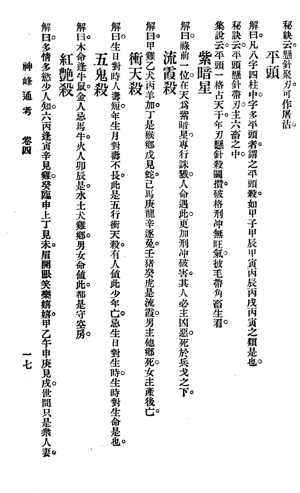

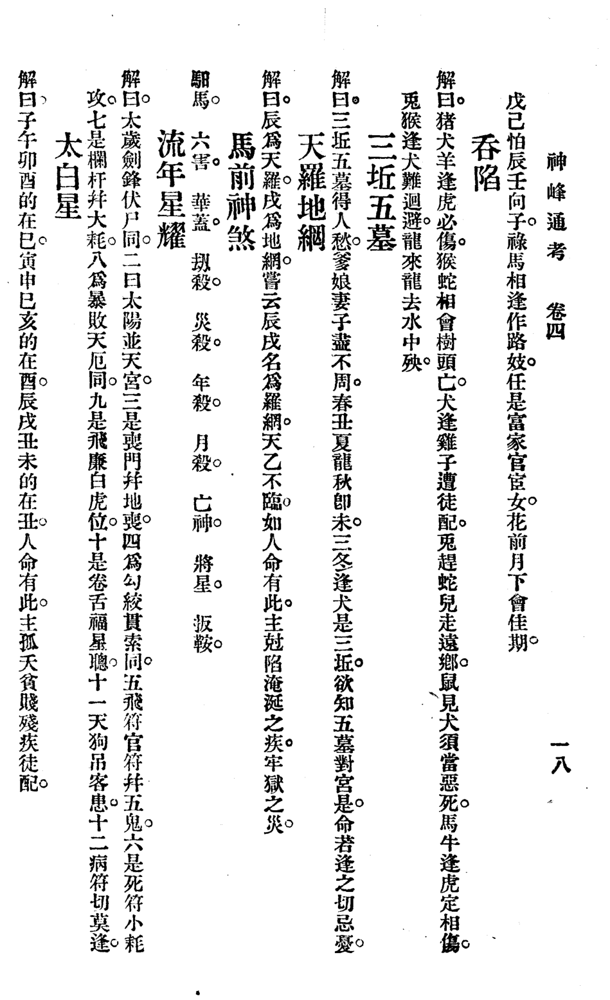

以1990-01-15至01-24上海当地正午覆盖十日干，对全部大运与十二支流年核对红艳及流霞。固定反例为1990-01-20乙酉日：旧程序在2026丙午流年报红艳、2028戊申流年漏报；按该底本修订后两者相反。测试在修订前失败、修订后通过。本站仍以日干查这些运年支位，不将诗歌中的身份、性别或人物断语编码成现实结论；两项均不在当前K线计分词表中，本次不重调分值。

## 紫微三处缺陷的现代对照（2026-11-06）

翁彩瑛《紫微斗数命盘步骤》PDF第4页的教学检索表列出木三局初五在寅、初九在辰，金四局三十在亥；已目验原表并新增三项产品入口回归，结果均一致。[教学表原PDF第4页](https://cc.cust.edu.tw/~wtcbee/index.files/teaching/98-2/Geomancy2/lesson/18.pdf#page=4)

另一个《紫微斗数全书》电子整理页面将木局初九重复、初五缺失解释为原底本可能的抄写问题，对金局三十亦按规则补亥；这与此前电子重排表所见缺陷一致，但该网页也不是独立古刻影印。当时仅凭现代教学表及网页校勘无法宣称古刻必然如此；后续原刊影像核对见下节。[《全书》电子整理与校勘](https://xingge.tw/zh-hant/quanshu/anming-tu)

### 明刊七卷本原页对照（2026-11-12）

日本国立公文书馆藏《新镌希夷陈先生紫微斗数全书》，请求号子060-0001，馆藏上册数字影像第84、85张分别载金四局和木三局图。目验第84张左页：金四局亥宫内列“初一”“三十”；第85张右页：木三局寅宫内列“初三”“初五”，辰宫内列“初一”“初九”“十一”。因此，这套明刊七卷本的三个目标格子分别为金三十亥、木初五寅、木初九辰，与当前产品及此前现代教学表一致。第84、85是馆方数字影像序号，不是原书叶码；此刊本与先前三卷电子转写并非同一底本。其结果支持产品对应三格，但不等于证明全部传本均相同，也不能断言此前重排的缺日必然发生于哪一阶段。

进一步逐宫目验并独立转录影像84的金局、85的木局及86的土火两局，存为 `sources/ziwei-ming-edition-start-tables.json`。四表均每个日期出现一次，合计120格。以庚午年二月、不同生时分别定四局，逐日从产品排盘入口读取紫微落宫，120格全部与此刊本相同。它们分别是对原页的转录和独立程序输出，不能因产品吻合就推定全书其他规则正确。[馆藏影像与版本说明](https://sndmp.com/library/quanshu/scan) [馆方影像84](https://www.digital.archives.go.jp/api/content/item/da12/C102812186700/iiif/M2019050811103249305_0084.jp2/full/max/0/native.jpg) [馆方影像85](https://www.digital.archives.go.jp/api/content/item/da12/C102812186800/iiif/M2019050811103249305_0085.jp2/full/max/0/native.jpg) [馆方影像86](https://www.digital.archives.go.jp/api/content/item/da12/C102812186900/iiif/M2019050811103249305_0086.jp2/full/max/0/native.jpg)

同一馆藏影像85左页的水二局，按可辨字迹转录29个日期并逐日与产品比较，均一致。亥宫右侧可见“二十”，左侧字形似“廿”，但在当前2000像素副本中未见清晰的“一”；故没有把第二十一日作为该印本明确可读值，也不据此断定原刻必有误。维基文库另一电子整理本将亥宫排作二十、廿一，产品同为亥，但其底本不同，不能替代此处对原页字迹的核验。数据把21日列作未决，不计入29格通过数，供后续高分辨率影像或另一传本复核。[另一电子整理本水二局图](https://zh.wikisource.org/zh-hant/紫微斗數全書/全覽)

资料副本按馆方开放利用说明留存；影像84、85、86的 SHA-256 分别为 `5978e595c1ee5c96af7176b5a7b9b98e42d5959fa6d203381bc22cf0353ddd3e`、`5f36f0358ba9d4d59489b12e6f00533947d2a353996c157cca47683ba1e36403`、`8666542ca4f59719962345d1ce712b17a480fcdfd7edf649407dc5415fb06d28`。

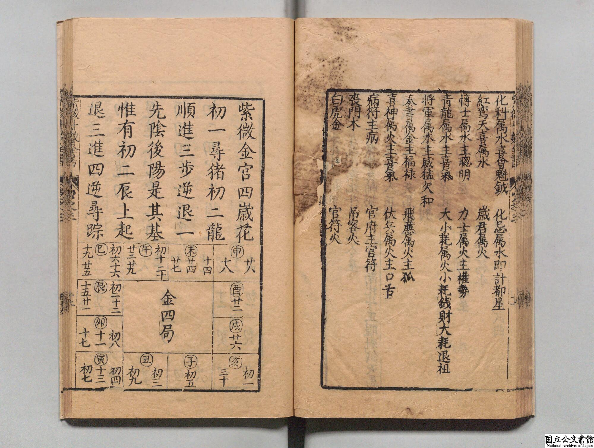

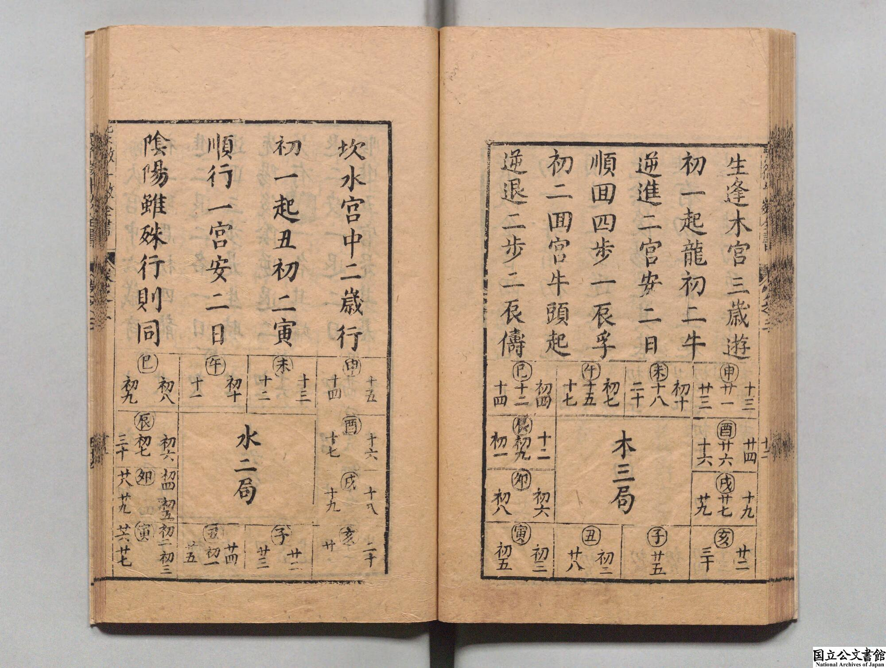

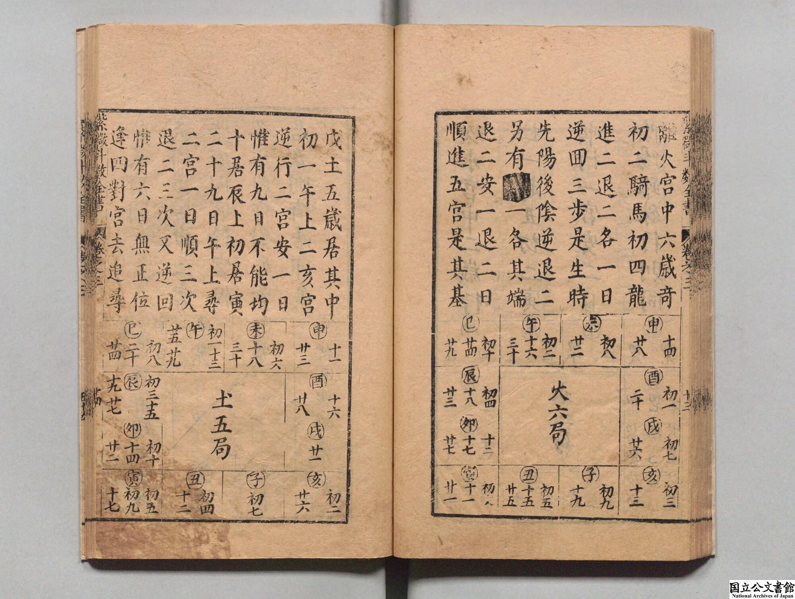

## 八门冬至旺衰的逐项版本对照（2026-11-06）

《奇门遁甲统宗》电子文本〈八节应八门旺相〉给出冬至八门状态：休旺、生绝、伤胎、杜沐、景死、死囚、惊休、开废；另一本影印本杜门作“没”，见下文。以2026-12-22上海正午为例，网站子月五行法依次显示休旺、生囚、伤相、杜相、景死、死囚、惊休、开休。其中生、伤、杜、开四项不同，已加入八门逐项回归。两套名称与计算依据不同；这组比较用于标明口径差异，不能将本站“囚”解释为古表“绝”，也不能说冬至例已经验证其余七节的完整状态。[《奇门遁甲统宗》卷二](https://zh.wikisource.org/wiki/奇門遁甲統宗)

《奇门要略》电子检索文本中的冬至生门读作“相”，与《统宗》的“绝”还有差异；该文本周边有断句和字词不完整；馆藏影印已复核生门确作“相”，详见下文，不据此改动八门程序。本次保留五行月令法，运行算法没有变化。[《奇门要略》电子文本](https://www.shidianguji.com/book/NCL06565A/chapter/1lyrb1xmkfh2m)

## 八节当旺门与月令法对照（2026-11-06）

《奇门遁甲统宗》〈八节应八门旺相〉依次把立春生门、春分伤门、立夏杜门、夏至景门、立秋死门、秋分惊门、立冬开门、冬至休门列为当旺。分别取2026年各节后一天的上海正午，网站对这些门显示死、旺、休、旺、休、旺、休、旺。四分至的四项均为旺，四立的四项不同；八项已通过真实排盘回归。此对照不能将四立的差异直接认作算法错误：古表按八节门序分布，网站按月令与门五行关系定五档。[《奇门遁甲统宗》卷二](https://zh.wikisource.org/wiki/奇門遁甲統宗)

《周易尚占》另提供八卦按八节顺排的表，可与当旺宫序交叉比较，但其旺、相、胎、没、死、囚、休、废与《统宗》冬至首例的个别状态并不完全一致；不能把卦表其余格未经校勘便填成《统宗》八门表。因此本次只验证《统宗》明列的八个当旺门，其余逐节状态仍待独立查证，运行代码保持原口径。[《周易尚占》八卦休旺例](https://www.shidianguji.com/book/HY6394/chapter/1kvincbw0jr53)

## 冬至八门影印复核（2026-11-06）

目验NLC416-12jh003951-48665《奇门遁甲统宗》PDF第30页、印刷页十三，卷一〈八节应八门旺相〉冬至例，生门确为“绝”、杜门为“没”；死门囚亦在原页。此前维基电子文本将杜门写为“沐”，本稿现分列两份材料，不将其直接认定为刻本差异或断定哪一处转录出错。已保存整页渲染图；原PDF共408页，SHA-256为`08b041e0863c2c81ae8be525f68288a81e54fe9b17186716ebe707bb345a0da6`。[影印PDF第30页](https://upload.wikimedia.org/wikipedia/commons/e/e6/NLC416-12jh003951-48665_%E5%A5%87%E9%96%80%E9%81%81%E7%94%B2%E7%B5%B1%E5%AE%97.pdf#page=30)

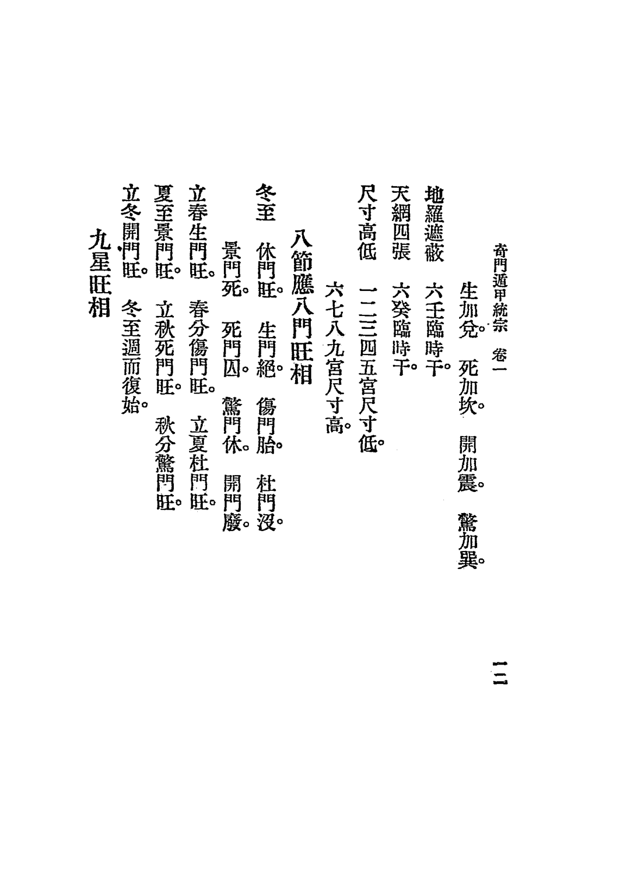

《奇门要略》影印原页的生门为“相”，与此本《统宗》的“绝”确有文字分歧，见下节；不能据一本推定另一传本。回归对照表以影印本“没”为准，网站仍采用此前声明的月令五行法，本次不变更运行算法。

## 《奇门要略》冬至生门影印复核（2026-11-06）

目验台湾国家图书馆藏 NCL-06565《奇门要略》影印 PDF 第 41 页：〈八门旺相休囚〉冬至条依次写休门旺、生门相、伤门胎、杜门没、景门死、死门囚，接下行惊门休、开门废。该页支持电子检索文本中的“生门相”，同时补足了电子文本脱漏的杜、景、死门内容。与前述《统宗》影印的“生门绝”相比，两份可见影印在此处确实不同；不据此推定传本关系或哪种算法唯一正确。网站冬至生门按月令五行法显示“囚”，三者分别记载，不更改现行算法。PDF 共 89 页，SHA-256 为 `3fe65e08628d209522d3e47c53bed7043211aa150388d03f757fc6f7c21730da`。[馆藏影印 PDF 第 41 页](https://upload.wikimedia.org/wikipedia/commons/1/15/NCL-06565_%E5%A5%87%E9%96%80%E8%A6%81%E7%95%A5.pdf#page=41)

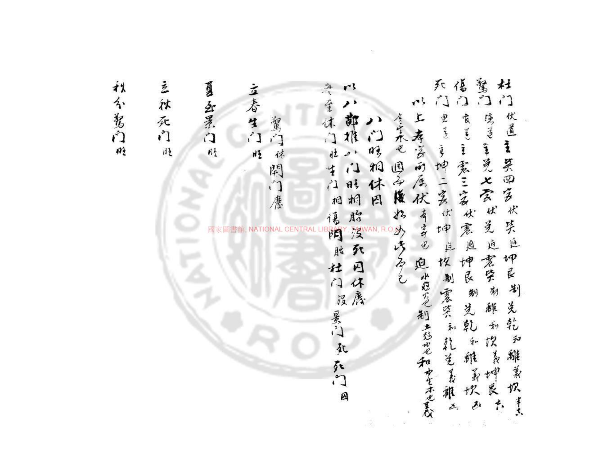

## 七政四余完整性标记修订（2026-11-06）

紫气未计算时，旧版只因已有星曜便输出 `complete: true`，与实际仅有七政和三余不符。现在须七政及四余各项均有有限黄经才标记完整；现有盘输出 `complete: false`，界面及结构化文本显示“部分排盘”，并继续说明紫气缺少可核验历元。这个修订不改变其他星曜或宿界计算；不能将完整性标记视为已验证所有天文或传统规则。

## 七政太阴庙旺与紫气历元的新线索（2026-11-06）

网站目前的七政庙旺陷表来自上游脚本，不应笼统称作《星学大成》表。该书卷十九〈太阴论〉称太阴庙戌、旺酉，同卷〈太阴殿局朝元〉又称巨蟹为本殿。以网站所选的回归黄道配宫固定三个上海正午案例：2026-01-24 太阴在戌，旧版网站标“平”，修订后标“未列”，该书称庙；01-26 太阴在酉，网站标“陷”，该书称旺；01-03 太阴在未（巨蟹），网站标“庙”，该书称本殿。这些例子固定位置并比较命名，暂不以同宫文字推定各种传本的宫界和度制一致，也不将《星学大成》一条自动套用其他六曜。七政现表的出处和实际取法仍须全面逐星核对；相关案例已在 `src/lib/qizheng/chart.test.ts` 复现。[《星学大成》卷十九](https://zh.wikisource.org/wiki/星學大成_(四庫全書本)/卷19)

对紫气，找到比单纯“缺少历元”更具体的研究线索。钮卫星在2015年《自然科学史研究》论文第417页指出，《星学大成》卷十九的总龟法提供10228日周期；他联系卷十四积日推得形式历元，并引嘉靖十年正月十八的紫气躔斗十一度推得儒略历1531年2月4日（JD 2280289.5）位置约284.58°，再与另一历史星命文献对照。该研究可作为待复算锚点，原历表检索文本有缺漏，现已找到并目验馆藏影印，详见下节；论文数值的旧度、时间与现代回归黄经之间的转换仍需重建。故目前仍不把紫气位置重新放进产品；“无可核验历元”的旧说明应理解为本项目尚无完成独立校验的实现，而非断言文献完全不存在锚点。[原文公式](https://zh.wikisource.org/wiki/星學大成_(四庫全書本)/卷19) [研究论文](https://www.scribd.com/document/747493610/) [作者论文目录](https://faculty.ustc.edu.cn/niuweixing/zh_CN/lwcg/64044/content/20711.htm) [嘉靖历表检索文本](https://www.shidianguji.com/book/NGJ89241199902012124918/chapter/1lm8qsittip12)

## 嘉靖十年紫气表的原页核验（2026-11-06）

中国国家图书馆藏《大明嘉靖十年岁次辛卯七政躔度》影印 PDF 第15页左半，标题为“辛卯岁四余躔度”，正月大“紫气”栏依次刊“一日斗十度”“十八日斗十一度”；二月大为“十六日斗十二度”，三月小为“十四日斗十三度”。这直接证实钮卫星论文引述的正月十八、斗十一度不是仅凭 OCR 得来。同页前三个连续整度进入日期，按该表正月、二月均三十日计，相隔分别为 30−18+16＝28 日、30−16+14＝28 日，和《星学大成》卷十九所述约二十八年一周、古度日行约三分五十七秒相容。前后推演验算只说明这些整度记录的间隔；它们未给出当天具体时刻，不足以单独把 284.58° 当成精确瞬时坐标。

研究者将正月十八换算成儒略历 1531-02-04（0 时 JD 2280289.5）；独立按儒略历日历公式也得到相同 JD。28 日每古度是一套历算约定，而将古度及斗宿起点转为现代黄经涉及旧周天度数、距星位置与岁差，不能将其当成每 28 日正好行现代一度。原 PDF 共17页，SHA-256 为 `3af64a8f43235f168e7f3a664487991d0687d665af3739a60775e5cdb7579ca2`。下一步须重建历元下斗宿起点、古度到360°转换和时间尺度，再用非锚定历史年表交叉验证，才能决定是否恢复紫气计算。[原馆藏扫描 PDF 第15页](https://upload.wikimedia.org/wikipedia/commons/9/96/NLC892-411999020121-24918_%E5%A4%A7%E6%98%8E%E5%98%89%E9%9D%96%E5%8D%81%E5%B9%B4%E6%AD%B2%E6%AC%A1%E8%BE%9B%E5%8D%AF%E4%B8%83%E6%94%BF%E8%BA%94%E5%BA%A6.pdf#page=15) [《星学大成》卷十九](https://zh.wikisource.org/wiki/星學大成_(四庫全書本)/卷19)

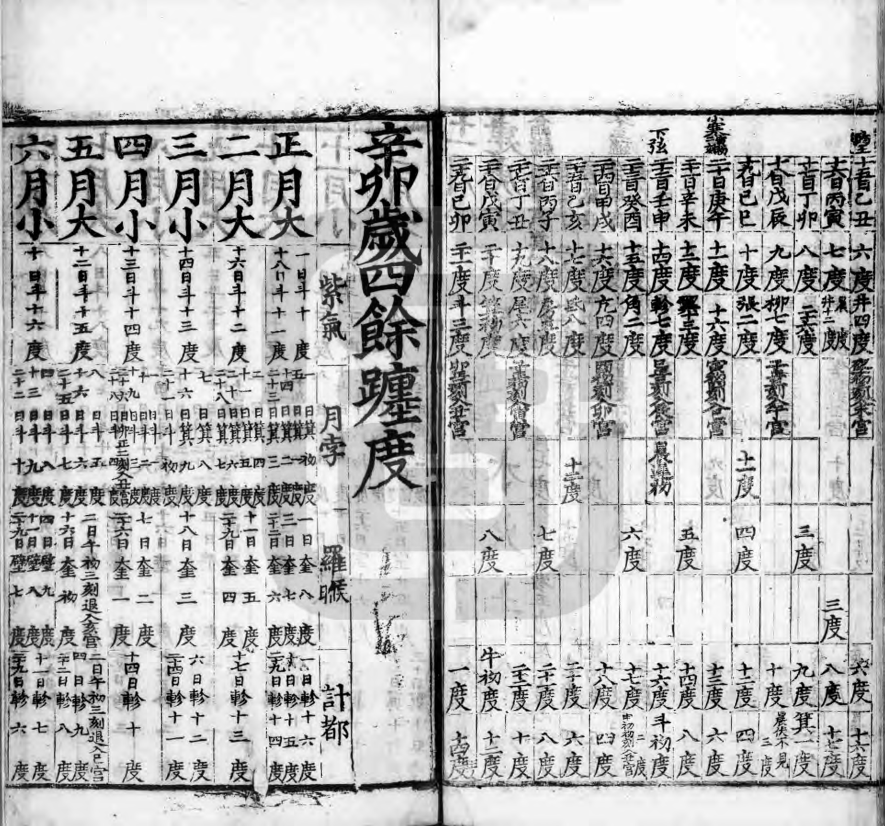

## 紫气跨年代比较与度制限制（2026-11-06）

钮卫星论文另转述康熙六年正月初九紫气在氐十四度，日期为1667-02-01。该条是独立年代的候选比较，但本次尚未取得可目验的故宫原页，因此仍标为论文转引，不能当作已经核对原件的证据。1531-02-04采用儒略历、1667-02-01采用公历，按各自历制算零时 JD 分别为2280289.5、2329950.5，相隔49661日；项目所用历法库对两天也分别给出正月十八和正月初九。

为了检验“拿到锚点便可上线”的假设，先做一个明确标为实验的简化计算：将1684表中的斗、氐起点直接视为固定黄经，两个旧度都按360/365.25换算，并从嘉靖斗十一度以常速推进。周期取10228日时，康熙时点比氐十四度高约0.136°，相当于约3.86日的运行量；若将28日每古度与365.25古度相乘得到10227日周期，偏差约0.307°、8.72日。这两种结果及日历换算可用 `python docs/research/ziqi-comparison.py` 复算。该实验使用了尚未经证明可直接混用的1684宿表，且两份历表的具体交度时刻未明，不能用差值独自裁判任何一份文献；它表明周期舍入和宿度定义都会影响复现，现阶段不应把候选参数包装成精确的生产算法。

黄一农对康熙五、六年新旧法历书的比较指出，传统极黄道宿度与新法黄经宿度的含义不同，不能把前者当成相同的黄经偏移。下一步应先取得1667原页，再逐项重建当年采用的宿度和历法；上面的数值只是一组敏感性计算，不是对该旧法的最终复原。[钮卫星论文及1667记录](https://www.scribd.com/document/747493610/) [黄一农对新旧历书的比较](https://destiny.to/ubbthreads/topic/10377) [《星学大成》卷十九](https://zh.wikisource.org/wiki/星學大成_(四庫全書本)/卷19)

## 按《明史》紫气宿度原表复算（2026-11-06）

前节直接套用1684黄经宿界的假设有更好的替代检验。《明史》卷三十六〈步四余〉的电子整理本明确载紫气周日10227.1792、每古度28日，并给出从箕初起累计的宿度日分表。按表的行末累计值解释：箕行全日268.52即下一宿斗初，亢行末累计8936.3792即下一宿氐初；分别加斗十一度308日、氐十四度392日，得到从斗十一度到氐十四度的正向间隔8751.8592日。以1531和1667两个日期的49661日为实际间隔，扣四周（40908.7168日）后余8752.2832日，相差0.424日，低于一天。

这一计算直接使用同一古表的宿度，不依赖1684黄道宿界，也无需先把旧度转换为现代黄经。它支持两个历史日次与《明史》记录的速率、宿度在日级上相容；但第二个1667年条仍来自研究论文转引，表格使用电子整理本且未目验其影印，原始时刻与历史钟时也未确定。因此此结果不等于精确瞬时校验，更不能直接推出当前日期的现代黄经。代码中的 `ming_history_residual` 用十进制定点复算上述间隔及误差，并保留前节的两个混表假设以对照。紫气生产实现还需历史原页与坐标框架的独立验证。[《明史》卷三十六〈步四余〉和宿次日分立成](https://daizhige.org/史藏/正史/明史/卷036.html) [嘉靖十年历表影印](https://commons.wikimedia.org/wiki/File:NLC892-411999020121-24918_大明嘉靖十年歲次辛卯七政躔度.pdf) [钮卫星论文](https://www.scribd.com/document/747493610/)

## 嘉靖紫气全年连续过度与斗牛交界（2026-11-06）

目验嘉靖十年历表影印第15、16页紫气行，依次为正月十八斗十一、二月十六斗十二、三月十四斗十三、四月十三斗十四、五月十二斗十五、六月十日斗十六、闰六月九日斗十七、七月八日斗十八、八月六日斗十九、九月五日斗二十、十月三日斗二十一、十一月一日斗二十二、十一月二十九日斗二十三，十二月十三日牛初度。表中六月、闰六月和十一月皆小月；将闰六月作为独立月份累计，前13条相邻间隔均为28日，合计12段。

再比较跨宿：从十一月二十九日斗二十三到十二月十三日牛初度，相隔13个历日。《明史》〈步四余〉列斗宿23度47分和紫气28日一古度，从斗二十三度到牛初的余度为0.47古度，按书中百分制合13.16日；历表只记日期而不提供过度时刻，13日与此相容。此例在一年中加入了闰月以及宿界余度检验，支持前节用《明史》日分表作历史口径复算；它尚不能验证康熙历表原页或现代黄经转换，也不验证十二个月所有日子的紫气位置。复算命令：`python docs/research/ziqi-comparison.py`。[国家图书馆影印，第15至16页](https://commons.wikimedia.org/wiki/File:NLC892-411999020121-24918_大明嘉靖十年歲次辛卯七政躔度.pdf) [《明史》卷三十六](https://daizhige.org/史藏/正史/明史/卷036.html)

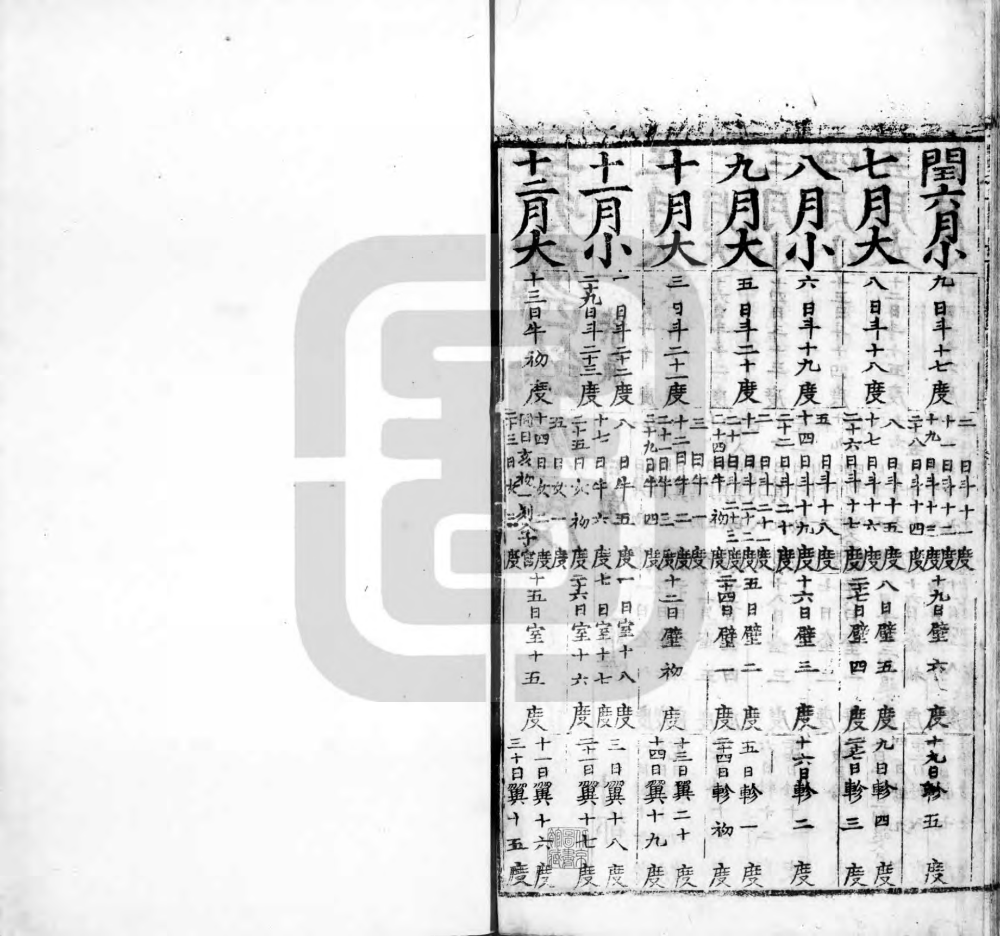

## 930年紫气回推的口径差异（2026-11-06）

钮卫星论文将嘉靖十年记录回推至后唐长兴元年九月初九，写作儒略历930-10-03，称紫气在星宿约一度，并与敦煌 P.4071 对照。按同一输入日期、相同嘉靖斗十一度锚点，却固定使用《明史》卷三十六的宿度日分表与10227.1792日周期，得到另一结果：两日的儒略日分别是2061015.5及2280289.5，间隔219274日；由斗十一度的表内相位576.52向前回退后，相位为6300.4624。该值落在柳初6182.0192与星初6546.0192之间，距柳初约4.230古度；距星一度的表内相位尚差273.5568日。`python docs/research/ziqi-comparison.py` 可以复现这些数字；历法库对930-10-03亦给出九月初九。

这个差异说明此前嘉靖和康熙两个晚期记录的近合，不能直接外推成《明史》表适用于930年且与论文选用的历史宿界一致。研究论文的斗宿、星宿坐标如何从原表还原、P.4071原始盘面及历史时刻仍需独立核查；本比较未证明论文有误，也不能把约4.230古度标成现代黄经。产品继续不输出未经统一口径校验的紫气位置。[《明史》卷三十六宿次日分表](https://daizhige.org/史藏/正史/明史/卷036.html) [钮卫星论文](https://www.scribd.com/document/747493610/)

## 宣统三年历书紫气原页与宿界比较（2026-11-12）

已在哈佛燕京图书馆影像阅读器目验《大清宣统三年岁次辛亥七政经纬躔度时宪书》第 44 幅。“月孛罗睺计都紫气”表自上而下列四曜，三月大初一、十一、二十一的紫气分别为鬼三度四十五分、鬼四度六分、鬼四度二十七分。此前机器转录将二十一误作二十，并漏读末项中的“二十”，不能继续采用先前的 1911-04-18 / 鬼四度十七分候选。第 45 幅明确写“诸曜俱从子正起算”。三次读数每十日增 21′；把每度 28 日换算成 20 日行 42.857′，与表上 42′ 相差不足 1′。这是同一宿内的日分一致性检验，并非现代黄经核验。[哈佛馆藏第 44 幅](https://nrs.harvard.edu/URN-3:FHCL:25913718:VIEW?page=53541823) [第 45 幅](https://nrs.harvard.edu/URN-3:FHCL:25913718:VIEW?page=53541904) [识典古籍机器转录](https://www.shidianguji.com/book/HY1767/chapter/1knzinq6xwch4)

历法库将辛亥三月二十一换算为 1911-04-19。仅作条件比较：假定与嘉靖锚点的历日对应无误，从 1531-02-04 斗十一度用《明史》周期及宿度表推进 138856 日，得到柳宿约 10.613 古度，与宣统表鬼四度二十七分不同。《明史》表的鬼宿宽约 2.11 古度，无法直接容纳该后世鬼宿读数；两者采用的宿界和度制尚需分别重建，不能据差异断言其中一个有误，也不能将其作为现代黄经。`python docs/research/ziqi-comparison.py` 固定了这组数据及算术；产品暂不恢复紫气计算。[《明史》卷三十六紫气宿次日分](https://daizhige.org/史藏/正史/明史/卷036.html)

## P.4071 原写本复核（2026-11-06）

已找到法国国家图书馆藏敦煌 Pelliot chinois 4071 的整卷影像，并目验 Wikimedia Commons 的第1、2幅扫描。首幅可读出生干支及申时；第二幅跨页左侧靠中缝的紫气条可读“紫氣在星宿”，后面接狮子宫和分野。原写本此条只明确给出星宿，**没有给出星一度**：星一度是钮卫星基于后世历表与行度推得的结果，不能作为原写本记载的精确度数。前节的“柳宿约4.230古度、距星一度273.5568日”是在指定《明史》表及回推假设下与论文推算值的比较；以原写本自身作为比较时，只能说结果在柳，与其“在星宿”的记载不一致，不能把273.5568日称为对原文精确度数的误差。

钮卫星后续英文研究也将该干支解释为儒略历930-10-03申时，作为对干支与历日对应的研究解释；其对写本末尾成书日期的换算与法国国家图书馆目录存在974/975的分歧，应与本命出生日期分别处理，不影响将930年条标记为历史研究解释而非写本明示的西历日期。历史宿度、历元和论文计算口径仍需继续核算。原始第1幅与第2幅文件的SHA-256分别为 `23d651e943036964deb483d1e1e9eaa97766466bca89eda43ec1ce5a44fd36fc`、`3dedc96fedbb9c6b2ddd4b6274201a0d089b688e7888c1c19b1dab8a7c2b56dd`。[法国国家图书馆藏本第1幅](https://commons.wikimedia.org/wiki/File:Pelliot_chinois_4071_-_btv1b10096956p_(01_of_15).jpg) [第2幅紫气条](https://commons.wikimedia.org/wiki/File:Pelliot_chinois_4071_-_btv1b10096956p_(02_of_15).jpg) [钮卫星英文研究](https://webspace.science.uu.nl/~gent0113/downloads/hs2/TAC/Steele%20-%20The%20Circulation%20of%20Astronomical%20Knowledge%20in%20the%20Ancient%20World%20%282016%29%20%5BTAC%2006%5D.pdf)

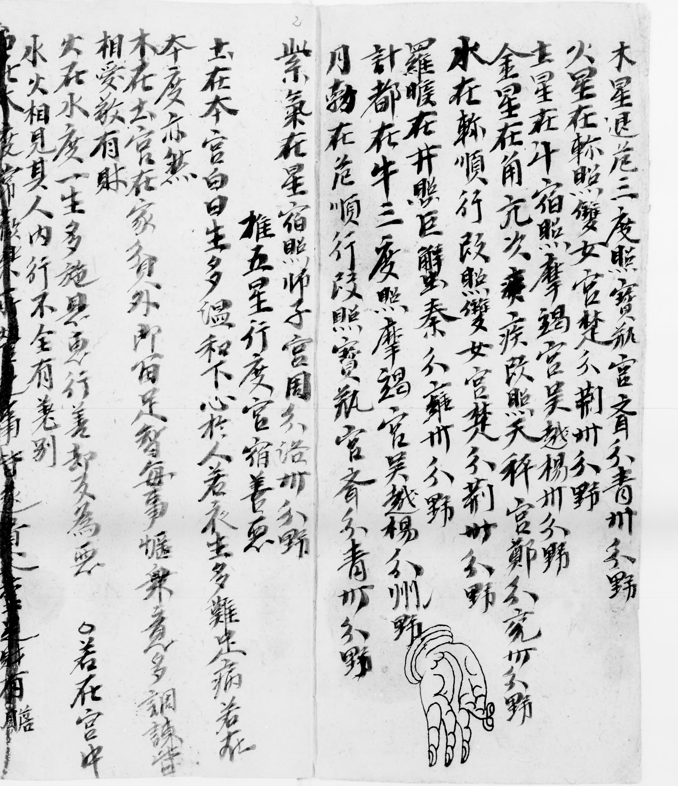

## 日月宫位用语的逐项核对（2026-11-11）

《星学大成》卷十八〈太陽論〉依次列太阳在戌、巳、辰、寅、午、酉的“庙、乐、好、喜、旺、怒”；卷十九〈太隂論〉列太阴在戌、酉、巳、申的“庙、旺、喜、乐”，亥、丑为“顺”，寅为“怒”。本次把这两段可直接归属整宫的条目完整地加入古籍对照栏，其他宫位仍不填。它们是选定段落的转录，不是该书全部篇章的统一表；尤其“好、喜、顺、怒”保留原词，不转换成庙旺陷等级。[卷十八太陽論](https://zh.wikisource.org/wiki/星學大成_(四庫全書本)/卷18) [卷十九太隂論](https://zh.wikisource.org/wiki/星學大成_(四庫全書本)/卷19)

例如太阳在辰时，现用导入表为“陷”，卷十八该段为“好”；太阴在酉时，现用表为“陷”，卷十九该段为“旺”。两个结果分别来自不同表述体系，不能因为名称看似相反就判定其中一书的完整理论错误。2026 年按日取样的回归覆盖太阳和太阴各十二宫，逐宫检查上述条目及未列位置；此测试验证程序按选定文字转录，并不独立验证星历或传统占断。

## 七政庙旺表未列项的展示修正（2026-11-11）

网站承接的上游表对每颗七政只列一个庙、旺、陷位置，旧程序将所有其他位置直接标“平”，并没有对应表项支持。现改为“未列”，保留表中明确列出的标签，同时在页面和导出文本声明该表来源及其与古籍存在差异。例如2026-01-24上海正午太阴落戌：旧版显示平，新版显示未列，而《星学大成》卷十九该宫称庙；2026-01-26太阴在酉，现用表仍标陷，该书则称旺。此改动不声称已经采用该书的全表，也不改变星位；其他星曜和多传本庙旺仍待逐项校勘。[《星学大成》卷十九](https://zh.wikisource.org/wiki/星學大成_(四庫全書本)/卷19)

紫气说明同步改为“历史历元与坐标转换尚未完成核验”，与后文已发现的历史锚点和口径分歧一致，不再笼统表示文献没有可供核验的历元。

## 七政木火庙旺的实盘对照（2026-11-11）

《星学大成》卷十四〈木星庙乐旺〉列木星亥宫为庙、未宫为旺；当前沿用的脚本表恰好相反，列亥旺、未庙。固定上海正午1990-07-15，产品木星在未并显示庙，卷十四对应旺；1998-07-15木星在亥，产品显示旺，卷十四对应庙。卷十五〈火星庙旺乐〉列卯庙、戌乐、丑旺；当前表把戌列为旺，对丑不列。固定1990-06-15上海正午，火星在戌，产品显示旺、卷十五为乐；1990-02-15火星在丑，产品显示未列、卷十五为旺。这四例以同一现代回归黄道落宫比较名称，不将古籍的宿度或实际星历精度等同于现代星盘，也不能因为称谓相同或不同就判定所有派别有唯一正确表。

四个实盘已经进入 `src/lib/qizheng/chart.test.ts`，锁定当前产品表与所引篇目的差异；火星卯庙在两者中一致。卷十五正文对某些喜乐宫又有不同记述，不能把全书不同段落静默拼成唯一表。本次未更改产品既定表，具体来源和选择仍须与剩余星曜及同书异文一并核对。[《星学大成》卷十四](https://ctext.org/wiki.pl?chapter=429330&if=gb&remap=gb) [卷十五](https://zh.wikisource.org/wiki/星學大成_(四庫全書本)/卷15)

进一步核对发现，卷十五〈火星论〉称火星戌宫“好”，而同卷〈火星庙旺乐顺留伏逆〉的乐宫条称戌宫“乐”。此前页面只给卷号和“乐”，会掩盖同卷另有不同用词；现于戌宫同时展示两段标题及各自用语，并写入结构化文本和 JSON。以上述 1990-06-15 实盘为例：现用表为旺，两段分别为乐与好；不据此推断“好”和“乐”是同义或相互排斥。其余宫位不能由这个冲突自动推广，同卷还有以宿度、昼夜等为条件的叙述。[卷十五原文](https://zh.wikisource.org/wiki/星學大成_(四庫全書本)/卷15)

## 金土水宫位的逐项对照（2026-11-11）

《星学大成》卷十六〈金星庙旺乐〉称金星辰宫为“庙旺宫”，同卷〈金星行度〉以亥宫室宿具体度数为正旺；固定1990-10-15上海正午，产品金星在辰且显示未列。亥宫正旺为原书限定宿度的描述，不能据此推断全亥宫所有度数均同判。卷十六〈土星论〉称正庙丑、旺辰；产品1990-01-15土在丑、2009-11-15土在辰，两例均显示未列。以上比较的是宫位和所引章节语词，不能把“庙旺宫”简写成该书只称庙。

卷十七〈水星行度〉列双女（巳）为旺宫、阴阳（申）为本宫，并以参宿为乐；产品1990-08-15水在巳显示庙，1990-06-15水在申显示旺。原文的“本宫”“乐”不必自动合并成同一术语，且涉及宿度时不能扩大为整宫判定。五项实盘对照加入回归，按同一产品星历和回归宫位比较文字口径，现用表不变；太阳、太阴、木、火、金、土、水的局部差异至此均有来源或案例，仍不能声称各星的全宫、全宿度和版本均已校完。[《星学大成》卷十六](https://zh.wikisource.org/wiki/星學大成_(四庫全書本)/卷16) [卷十七](https://zh.wikisource.org/wiki/星學大成_(四庫全書本)/卷17)

## 七政已核篇章的并列展示（2026-11-11）

七政结果保留原脚本有限表作为“现表”，在所选章节明确列出宫位时，额外显示《星学大成》的卷号和原文称谓；包括太阳、太阴、木、火、土、金、水的已核宫位。其他位置不输出该附加标签，不把未列等同于古籍无说。金星辰保留“庙旺”，水星申保留“本宫”，不将词义强行统一；涉及特定宿度的条目未扩展到整宫。页面、结构化文本和 JSON 使用同一字段，实盘测试分别覆盖木、火、金、土、水及太阴差异。此比较固定采用网站回归宫位，不能说已实现古籍完整历法、七曜全表或同书各章节的合并。
## 时柱入墓与天盘时干落宫（2026-11-12）

旧登记项“时干入墓”实际判断天盘时干所在宫是否含其墓支，属于逐宫判断；不能直接当作古书所列时柱干支。现将原项显示名改为“时干落宫入墓”，另登记“时柱入墓（宝鉴六时）”：按所选《奇门宝鉴》版本列出的戊戌、壬辰、丙戌、癸未、丁丑、己丑六组比较时柱，作为全局结果，不赋落宫或宫内旺衰。六十甲子测试覆盖全部组合，并检查落宫命中而时柱未命中的反例。该结果是所选版本的条文转录，不声称所有传统均采用六时。[《奇门宝鉴》文本及解释](https://ichingtrilogy.com/post/qi-men-bao-jian-03/)

版本差异不可忽略：《钦定古今图书集成》艺术典卷704的对应歌诀列戊戌、壬辰、丙戌、癸未、丁丑五时，未列己丑；其三奇入墓的乙未与此处宝鉴六时也不应静默并为同一条规则。网站分别标明判断口径，未把某一版本的未列解释为其他版本不存在。[《古今图书集成》卷704](https://zh.wikisource.org/wiki/欽定古今圖書集成/博物彙編/藝術典/第704卷)

## 九符阵与九界的对应核查（2026-11-12）

《女先知预言》第2节提到九界，但该节未列出九个名称或上下三层的位置。斯诺里《欺骗古鲁菲》论赫尔时提及病死、老死者；不能据此把所有非战死者一概写为其居住者。网站的九界列表与三层是现代示意，九符阵的九位置实际定义为根源、消退影响、近期事件、现状、挑战、隐藏因素、近期发展、建议与结果，并未定义与九个世界逐一映射。此前简介却写“九枚符文对应九界”，会让用户误解计算依据；现修正文案，并在页面与两种导出格式说明。赫尔居者亦改为按该段叙述列举病死、老死者，不声称穷举。测试固定九个实际位置及说明；它检验数据和描述一致，并不能证明现代占法有古代传承。[《女先知预言》第2节](https://www.heimskringla.no/wiki/V%C3%B6lusp%C3%A1) [《欺骗古鲁菲》校订本第27页](https://vsnr.org/wp-content/uploads/2021/11/VSNR_Edda-1_prologue_gylfa.pdf)

## 太乙阳局二十五至四十局的字段对照（2026-11-12）

将《太乙秘书》电子本阳局25–40的太乙、天目、主客算、四将、始击和计神，逐项与程序同局比较，保留文献原数，不因不符先行校改。16局共160个候选字段；28局两处都写“主参将”，不能仅凭程序把其中一处改写成主大将，因此两字段暂不比较。其余158项中153项相同、5项不同：25局客参将原文3宫、程序2宫；26局主大将原文1宫、程序2宫，客大将原文6宫、程序1宫；38局客算原文25、程序35；40局始击原文阴德（乾）、程序阳德（丑）。

这些差异不能一概判成程序或原文的笔误。例如25局原文客大将4宫，按选用的“三因大将，满十去之”参将取2宫，与原文3宫不同；26局原文主算32、客算31，其将位也与按个位取将的现行方法不一致。38局两种客算个位均为5，因此都得到客将中宫，若只比较将位会漏掉主客算差异。40局则是始击本身不同，需要进一步寻找其他传本或具体推算证据。该组比较只验证可直接映射的字段，不等于核完各局吉凶或历史原局；复现 `npx vitest run src/lib/taiyi/chart.test.ts`。[《太乙秘书》阳局](https://zh.wikisource.org/wiki/太乙秘書) [《太乙金镜式经》卷二](https://zh.wikisource.org/wiki/太乙金鏡式經_(四庫全書本)/卷02)

## 太乙阳局四十一至七十二局的字段对照（2026-11-12）

继续按同一字段顺序转录《太乙秘书》电子本阳局41–72，电子本缺第60局，因此只比较31局。41局记“天目六宫迫”，未明写客大将，此字段留空；49局记“计辰寅”，没有直接写“计神”，也暂不充作计神字段。余308项中302项与网站计算一致，六项不同：45局主大将原文1、网站2；49局客算原文15、网站25；50局主算原文36、网站16；51局客算原文16、网站13；58局主算原文13、网站12；72局客算原文22、网站31。

例如51局原文列客算16、客大将3、客参将9；网站列客算13、客大将3、客参将9。只看两将宫位会漏掉算数分歧。58局原文主算13但主大将2、主参将6，网站分别是12、2、6；在未取得更强传本依据前，不以将位吻合就把原文13改成12。第60局仍须找其他底本，不把产品推算值当作原书缺文。该批测试对照的是电子转录本的可读字段，并未逐格检查影印或完成各局吉凶格局的校勘。[《太乙秘书》阳局](https://zh.wikisource.org/wiki/太乙秘書)；复现命令 `npx vitest run src/lib/taiyi/chart.test.ts`。

## 阳六十局跨书补证及五十八局异文（2026-11-12）

此前《太乙秘书》电子本缺阳六十局；另查《古今图书集成》艺术典696卷〈太乙阳遁六十局〉，明确记太乙四宫、文昌亥、主算12、主将2与6、始击戌、客算13、客将3与9。九个可映射字段均与本站阳60局相同；该条未明列计神，本次不拿计算结果补成原书内容。它提供另一部书的例证，不能补称《秘书》缺失的原文。同期该卷阳58局写主算12，本站亦为12；《秘书》电子本该局写13，而两者均写主将二宫、参将六宫。这是明确的跨书数字分歧，不能仅据互相吻合就证明任一版本必定无误。两局已加入专项回归。[《古今图书集成》艺术典696卷](https://wk.100ke.info/zh/欽定古今圖書集成/博物彙編/藝術典/第696卷) [《太乙秘书》](https://zh.wikisource.org/wiki/太乙秘書)

## 四郭杜“兼关”的条件复核（2026-11-12）

《太乙金镜式经》卷三〈郭杜法〉列客参将与文昌并、主大将与客大将并，并提到兼掩迫关格提挟。此前程序用两组并且要求上述关系之一，但本仓将主客大将同宫直接记为关，故只要两组并成立，后一个条件必然成立。以前输出“兼之掩迫关格提挟”容易让人以为另检测到独立的第三种关系；现明确显示两组并，注明其中将并本身即为本仓的关，删除无作用的判断。合象的成立范围未因本次简化改变，原文“兼之”的其他解释仍待校勘。

受控例中，太乙乾一、文昌艮三、客参三、主客大将同震四、主参居五、始击寅。程序报告两组并及关，没有另报掩、击、迫、格或提挟，却仍按当前口径报告四郭杜；测试用它防止把同一组主客将并误说成两个独立证据。此例是明确构造的边界案例，并非声称古籍提供了这张具体盘。[《太乙金镜式经》卷三〈郭杜法〉](https://zh.wikisource.org/wiki/太乙金鏡式經_(四庫全書本)/卷03)

## 四郭固参与对象的输出修正（2026-11-12）

站内选定的四郭固合象条件是文昌或始击至少一目与太乙同宫，再加四将中至少两将同宫；旧输出却写“二目掩囚太乙宫，又值四将相关”，会把只有一目命中的盘说成两目皆同宫，也不说明相关的具体将。现保持原判定范围，改为逐项列出实际同太乙的目和所有同宫将组；规则说明同步写明是“任一目”和“至少两将”。这仍是网站选用的合象解释，不把《太乙金镜式经》卷三“或客目临之”等异读视为已完全消解。

受控例固定太乙乾一、主大将和主参将均艮三、客将六与九：文昌在乾、始击在丑时，仅列文昌；交换为文昌丑、始击乾时仅列始击；两目皆乾时列两者；两目都不在乾则不列四郭固。每种命中均列主大将与主参将同在三宫。测试复现 `npx vitest run src/lib/taiyi/chart.test.ts`。[《太乙金镜式经》卷三〈推四郭固法〉](https://zh.wikisource.org/wiki/太乙金鏡式經_(四庫全書本)/卷03)

## 太乙岁计四条历史案例的独立对照（2026-11-12）

《太乙统宗宝鉴》卷四分别给出汉平帝元始五年、建安十九年、晋大宁二年和唐太和四年的岁计字段。将其年号分别对应公元 5、214、324、830 年，以网站的岁计入口计算，不手动指定局数，四年依次得到阳50、43、9、11局，与书中一致。分别核对书中可辨字段：前两年太乙、文昌、主算、主大将为（一宫、大神、16、六宫）和（八宫、帝主、8、八宫）；324年为（三宫、和德、3、三宫）；830年为（四宫、高丛、4、四宫），且主参二宫、始击阳德、客算四、客大四宫、客参二宫均相符。公元5年另核主参八宫、始击大威、客算十五。大神、帝主、和德、高丛、阳德和大威分别对应该式盘巳、子、艮、卯、丑、午位。测试保留逐字段断言，避免只用“关”“囚”标签作为吻合依据。

这些例子来自后出的《统宗宝鉴》，支持所选纪元及其特定字段的复算，不能证明南齐使用同一套完整算法，也不证明历史事件由这些格局造成。原文又并列文昌与太乙同宫称囚和称关的不同说法；本站的同宫宽判需要结合所列参与者理解。[《太乙统宗宝鉴》卷四](https://www.shidianguji.com/book/CADAL02055529/chapter/1l5erikaznzue)

## 清代紫气法元与速率的独立证据（2026-11-12）

《清史稿》卷五十记载，乾隆九年甲子天正冬至次日子正为紫气法元，应数为七宫十七度五十分十四秒五十三微，日行二分六秒、小余七二〇七七七；同卷推算法再次记录这些数。将小余解释为秒的十进制小数，则日行 126.720777 角秒，周天 360 度的周期为 10227.21002 日，和《明史》表的 10227.1792 日相差约 0.03082 日每周。另据《天文算学纂要》，以本年黄道宿钤减紫气平行才得现行宿度。因此不能把不同时期宿表直接视为同一坐标系。[《清史稿》卷五十](https://zh.wikisource.org/zh-hans/清史稿/卷50) [《天文算学纂要》卷八上](https://www.shidianguji.com/zh/book/CADAL02032854/chapter/1l6xxse456k36)

用于排查的条件算例：暂假定法元为公历 1743-12-23 子正、“七宫”为已走过七个 30 度宫，则至 1911-04-19 子正经过 61112 天，平行约为 218.99306 度。这两项坐标解释及历元公历日期均须独立核实；未找到该年度的黄道宿钤，无法把该条件数与 1911 年历书的鬼宿 4 度 27 分作有效的同坐标比较。脚本 `python docs/research/ziqi-comparison.py` 复现计算。清代和明代的速率很接近，只能说明各自记载的周期接近，不能证明其历元、岁差处理和宿度体系相同；紫气仍不加入生产计算。

进一步的跨表对照发现了此前遗漏的坐标原点：仓内已核的康熙甲子黄道宿钤以冬至起初宫，假定紫气法元采用相同原点，则须给上述宫度加 270° 才能与通常的春分起点黄经比较。沿用这张 1684 表的鬼宿距星初宫体系七宫 1°20′，即回归黄经 121°20′；按表载 51″/年推移到 1911 年各日，再以同坐标的紫气平行减鬼宿界，得到下表。两书宫度同原点、1684 历元近似设为该年 1 月 1 日、1743 冬至次日及恒定岁差均为计算假定，不是已核出宣统三年原表。

| 公历日 | 1911 历书鬼宿读数 | 条件计算 | 计算减历书 |
| --- | --- | --- | --- |
| 03-30 | 3°45′ | 3°44′11″ | −0.81′ |
| 04-09 | 4°06′ | 4°05′17″ | −0.71′ |
| 04-19 | 4°27′ | 4°26′23″ | −0.62′ |

三点误差均小于一角分，且间隔趋势相符，表明清代法元、速率和旧宿钤在明确换原点后给出相近结果；这不是逐分完全吻合，也不是已经用当年宿钤验证。原样保留历书记录，不能以它来反向校准再称独立验证。该试验只在研究脚本内实现；要恢复生产紫气，仍须核实清代法元日期与原始宿钤历元及岁差，并对更多年份和边界做独立验算。[《天文算学纂要》卷八上](https://www.shidianguji.com/zh/book/CADAL02032854/chapter/1l6xxse456k36) [1911 年历书原影第 44 帧](https://nrs.harvard.edu/URN-3:FHCL:25913718:VIEW?page=53541823)

宫度原点现有进一步原文支持：《历象考成》下编卷四说明黄道宫度自冬至初宫起算，卷一日躔法也说实行从冬至起算；《清史稿》将紫气平行与日躔平行、宿度与太阳同法，因此将紫气应数放到冬至起点，与采用同样起点的宿钤比较有文献依据。这是跨书同制的推断，不是宣统三年宿钤原件。法元历日方面，《清史稿》注明该冬至在甲子年前的癸亥十一月；《清实录》乾隆八年十一月载庚辰朔、丙戌冬至、次日丁亥，故可确定法元为丁亥子正。用项目所用历法库换算，丙戌为公历 1743-12-22、丁亥为 12-23。干支和月日有史料交叉，西历日期仍是后人换算，并非《实录》直接给出。[《历象考成》下编卷四](https://zh.wikisource.org/wiki/御製厯象考成_(四庫全書本)/下編卷04) [《历象考成》太阳宿度法影印](https://upload.wikimedia.org/wikipedia/commons/2/2e/NLC892-312001039711-281055_御製曆象考成_第9冊.pdf) [《清实录》乾隆朝卷204](https://m.guoxuedashi.com/a/5701twpj/89133f.html)

另逐栏目验宣统三年历书第45帧九月初一、十一、二十一的紫气末行，依次为柳 6°25′、6°46′、7°08′。历法库将其换为公历 1911-10-22、11-01、11-11。继续使用上节相同法元、速度与1684宿钤假设，但取柳宿起点 125°52′，得到柳 6°26′47″、6°47′53″、7°08′59″，计算减书值分别约 +1.79′、+1.88′、+0.98′。这三个读数跨另一个宿、距三月对照约半年，支持口径的近似一致性，同时也揭示柳宿的误差不能概括为先前鬼宿的“均小于一角分”。上表三月结果与此九月结果均为子正，且都不是用1911年原宿钤复算；尚不足以断定所有日期或其他世纪均准确。[宣统三年历书原影第45帧](https://nrs.harvard.edu/URN-3:FHCL:25913718:VIEW?page=53541904)

再核第44帧四月初一、十一、二十一的末行，依次为柳初度14分、35分、56分，对应公历 1911-04-29、05-09、05-19；同一模型分别算得柳 0°15′29″、0°36′35″、0°57′41″，比书值高约 1.48′、1.58′、1.68′。此前三月二十一是鬼 4°27′，10日后已为柳 0°14′，因此原表确实跨宿，不能只检验宿内速度。按该模型10日相对恒星前进约21.10′，从两条读数反推原表鬼宿宽约 4°34.10′，比所用1684旧钤的4°32′宽约2.10′；这一差与跨宿前后残差变化一致，但两端读数仅记到分且旧钤按年初近似，不能把反推数当成1911年原钤的精确值。脚本将四月三个读数纳入回归，显式保留残差而非调参强行吻合。[宣统三年历书原影第44帧](https://nrs.harvard.edu/URN-3:FHCL:25913718:VIEW?page=53541823)

对上述宿宽差，找到独立于1911读数的另一组清代原文：《清史稿》卷二十八的乾隆甲子黄道十二次表称鹑火初在井 28°16′50″；《大清会典》卷六十三所列二十八宿度中，井 30°26′34″、鬼 4°34′19″、柳 16°58′56″。以鹑火初为回归黄经120°，可推鬼初 122°09′44″、柳初 126°44′03″，相距4°34′19″，与上段由历书读数反推的约4°34.10′接近。这里《会典》电子稿有 OCR 错字，所用分秒应再据影印校勘；两书是否使用完全同一张宿钤也仍需确认。[《清史稿》卷二十八](https://zh.wikisource.org/zh-hans/清史稿/卷28) [《钦定大清会典》卷六十三](https://www.shidianguji.com/book/CADAL02027852/chapter/1lm8uu3z0h1ym)

作为敏感性比较，将乾隆甲子宿界近似锚定公历1744-01-01、仍用51″/年推移，紫气法元保持不变；九个1911读数的残差由旧康熙表的约 −0.81′至 +1.88′，变成约 −0.07′至 +0.83′。这支持跨宿残差与两套宿界不同相容，但所引表并非宣统三年原钤，数值相近不能单独证明其使用了同一版本；样本也只覆盖同一年度两宿。两套结果均保留在复算脚本中，未以历书读数调整新宿界。

上述柳初可由不同路径独立核对：同一《清史稿》表列鹑尾初在七星 6°17′01″；将鹑尾初置于黄经150°，再减去这一入星宿度及《会典》所列柳宿宽 16°58′56″，得到柳初 126°44′03″，恰与从鹑火、井宿和鬼宿连续相加的结果一致。脚本现对两条路径逐秒相等作断言。两路径共同依赖《会典》电子稿，仍不替代影印校字，也不因此证明1911年用了该表；但它可检出转录、单位或宿次累加时的内部矛盾。[《清史稿》卷二十八黄道十二次](https://zh.wikisource.org/zh-hans/清史稿/卷28) [《大清会典》卷六十三](https://www.shidianguji.com/book/CADAL02027852/chapter/1lm8uu3z0h1ym)

进一步查到《醒世一斑录》转录道光九年《七政四余万年书》的鬼宿 4°34′、柳宿 16°59′，在所载到角分的精度下与《会典》OCR 的 4°34′19″、16°58′56″一致。但该段开头称“赤道周环”，没有足够信息确定它所引每项与《会典》表完全同属黄道，所以只能作为数值层面的旁证，不能视作已独立验证黄道坐标或角秒。已在识典古籍定位《会典》卷六十三第48/61页，但当前页面影印图与检索到的文字对应关系及字迹仍未目验到足以校验秒位；暂不把 OCR 当成影印校勘结果。[《醒世一斑录》所引道光九年表](https://www.shidianguji.com/mid-page/7521111396970725426) [《大清会典》卷六十三](https://www.shidianguji.com/book/CADAL02027852/chapter/1lm8uu3z0h1ym)

## 紫气平行研究模型的产品实现（2026-11-12）

综合上述法元、日行和1911年两宿九个样本，在产品中实现清代紫气平行，并在盘面、资料和 AI 输入中标出模型口径。法元取丁亥日子正，计算时暂将其按 UTC+08 转成现代时间戳；该约定不等于当年北京地方真太阳时。宫位由平行黄经计算，宿位继续沿用本产品康熙旧钤及现代岁差，不偷换为乾隆宿钤。因此宿界附近的宿名可能与宣统历书不同；1911年以外的年代表外推，没有逐年原书验证。四余有结果不表示所有断语、历代版本或宿界都已核完。此前“未加入生产计算”的段落是研究当时的状态，不再描述本实现。

九条历书读数还通过产品入口测试：按上文乾隆甲子宿界及51″/年推移，将历书宿度换算为同一回归黄经，再分别输入九个子正时间；允许 0.025° 误差以覆盖历书角分取整、宿钤历元近似及产品输出保留两位小数。它测试入口的日期、时区和计算结果，并非假设不同宿钤输出的宿名必然一致，也不扩充时间或宿位的历史验证范围。复现 `npx vitest run src/lib/qizheng/chart.test.ts`。

《推步捷例》上卷亦明确写紫气每日平行126.720777秒、以乾隆甲子为元，与实现所选速率和法元相合，是对同一清代法系的另一本书的对照，并非额外年代的观测样本。新增紫气后，表格曾因缺少五行、吉凶映射显示“无 · 无”，容易被理解为已有规则判定二者均不存在；现改为“未列 · 未列”，表示本仓未提供这两项，不推断古籍没有论述。JSON和结构化文本同用该字段，回归测试检查页面及数据。[《推步捷例》上卷](https://zh.wikisource.org/wiki/推步捷例/上)

同一条原文还列平年行 12°50′53.083605″、闰年行 12°52′59.804382″。在产品入口分别取近似法元 1743-12-22 16:00 UTC、次日、366日后和其后365日，比较相邻黄经差；每日、闰年及平年的增量均在 0.011° 容差内。两端黄经各保留0.01°，所以该容差包含显示舍入误差。此项检验速率、跨年天数与入口时区，不能代替不同年份的历书观察，也不能把公历年初当成古书每年冬至次日的年根。[《推步捷例》紫气法](https://zh.wikisource.org/wiki/推步捷例/上)

## 交司来源页面的文字勘误（2026-11-12）

交司刻序实现后，来源详情仍称“不推定交司时辰”，且把“始春”和“正月朔日候气”标成两种交年派，均与上文已经核明的范围不符。现改为分别列明两段原文，并说明传统刻序的等时钟面换算不是历史精确时刻。来源摘录中“呟其位”也改按《素问补注释文》所录的“睹其位”；《类经》作“覩其位”，保留具体版本区别，不再声称呟字是可靠原文。此项修正文献展示，并未改变六气算法。[《素问补注释文》](https://www.shidianguji.com/zh/mid-page/7530759015338541083) [《类经》卷二十六](https://zh.wikisource.org/wiki/類經_(四庫全書本)/卷26)

## 日格与伏干格的重复计数（2026-11-12）

《古今图书集成》艺术典705卷引《三元经》，以六庚加日干称伏干格；所选现代奇门资料将相同盘层条件称日格并注明别名伏干格。旧登记表对“日格”和“伏干格”分别使用完全相同的天盘庚加地盘日干判断，造成同一宫位的同一条件计为两个凶格。现合为一项“日格（伏干格）”，保留原日格标识及条件；飞干格的天盘日干加地盘庚仍单独计算，不能混同。

实盘取上海时间2026-01-01 02:00，日干乙，旧表第3宫同时报告日格和伏干格各一次，新表该宫仅计一次并显示两个名称。受控例也确认时格独立于这一别名。此处消除的是同一规则在本站的重复计数；它不等于宣称不同传本对术语绝无歧义，也不处理甲日隐藏干的另行取法。[《古今图书集成》艺术典705卷](https://www.shidianguji.com/book/GJTS17/chapter/1lpxdtjhdx05l) [《神奇之门》日格条](https://vr-d.com/pdf-file/奇门遁甲/神奇之门-张志春.pdf)

## 甲日伏干与飞干的遁仪（2026-11-12）

《古今图书集成》艺术典704卷的伏干例明确以甲午为日干所代表的六甲；《遁甲演义》卷二飞干例也把甲日六甲用于飞干。旧程序直接在天、地盘查字面“甲”，盘面六甲通常隐于戊己庚辛壬癸，因而甲日的两项会漏判。现按日柱自身取甲子戊、甲戌己、甲申庚、甲午辛、甲辰壬、甲寅癸，再分别判断天庚加地盘日遁仪和天盘日遁仪加地庚；证据显示日柱与所遁之仪。时柱旬首不替代日柱。此项仅修正日格及飞干，年、月、时为甲时的其他格局未据此扩展。

实际案例：上海2026-01-20 22:00为甲午日、乙亥时，日遁辛。网站盘面第6宫天盘含庚、地盘辛，判日格；第8宫天盘辛、地盘含庚，判飞干格。修订前查字面甲，两项均漏报；修订后分别列两宫和“甲午日遁辛”。受控测试另覆盖六种甲日及不同日、时旬首，非甲日仍沿用日干本字。两项可在甲申遁庚时因庚加庚而同宫成立；它们的方向性条件在此重合，不应因此推论所有日子的两项都相同。[艺术典704卷](https://zh.wikisource.org/wiki/欽定古今圖書集成/博物彙編/藝術典/第704卷) [《遁甲演义》卷二](https://zh.wikisource.org/wiki/遁甲演義_(四庫全書本)/卷2)

## 天网四张的两种条件及更宽的天癸口径（2026-11-12）

《遁甲演义》天网条先讲天上六癸所在方，又举天盘癸加地盘癸例；不能将这个例子的癸加癸当作该条唯一条件。《奇门旨归》卷四另写六甲值符加地癸为天网。旧网站只检验癸加癸，却无条件称“天网四张”。现登记项分别检测“癸加癸（演义举例）”和“值符加地癸（旨归）”，在各命中宫列明条件，两个条件同时成立仍只计一个登记项；它们并不能穷尽所有天网说法，例如前者古文更宽的天上六癸所在方并未整体实现为全盘凶格。

上海实盘对照：2026-01-01 00:00只命中癸加癸；同日14:00只命中值符加地癸，旧程序因此未列该条件；01-04 04:00两者均在第9宫命中，仍只计一项；01-01 02:00两项均未命中，不能据此否定书中更宽的天癸所在方。测试固定以上四例，并分别检查证据。旧有癸加癸单项作为独立例子保留，不将其等同《演义》全部天网理论。[《遁甲演义》天网条](https://wk.100ke.info/zh-hant/遁甲演義) [《奇门旨归》卷四](https://www.shidianguji.com/book/CADAL02031557/chapter/1l6y1gl6jszza)

## 门宫和义名称的相反用法（2026-11-12）

网站原按所用现代口径把门生宫称“和”、宫生门称“义”，但《奇门旨归》卷三〈门宫和义〉恰好相反：宫生门为和、门生宫为义。现代《神奇之门》则与网站原名相同。两个来源讨论的生克方向相同，名称互换，不能只凭一部书把另一口径判为算错。现保留原有命中与统计，在每条证据同时标明现用名称及《旨归》名称，规则说明写出分歧，不将两条解释重复计数。

上海2026-01-01 00:00，六宫生门属土、生六宫金，现用称和、《旨归》称义；一宫水生伤门木，现用称义、《旨归》称和。受控测试另覆盖门宫同五行不属于所选相生条件；实盘测试锁定两个方向。旧证据曾只给一个名称，现在可直接看到对应异文；这不等于已经核完全书门宫利弊条件或其他派别。[《奇门旨归》卷三](https://www.shidianguji.com/mid-page/7531869976862441522) [《神奇之门》门宫和义条](https://vr-d.com/pdf-file/奇门遁甲/神奇之门-张志春.pdf)

## 甲己仪合的值符口径（2026-11-12）

《奇门旨归》卷三列奇仪相合，甲己为仪合，并要求吉门；《奇门遁甲统宗》写甲在己上。网站旧实现直接在天盘找字面甲，常规时家盘把六甲隐入六仪，造成这一分支无法匹配。现明确采用《遁甲之学》所述“天盘六甲直符、地盘六己”的解释，且仍须开、休或生门。其他奇仪配对不变；同一宫若因寄宫同时符合多组配对，证据全部列出，但登记项仍只计一次。另有现代资料以值符甲子戊为例表述，本次并不将不同文本都解释为已经明确支持全部六旬。

上海2026-01-02 08:00实盘为甲申旬，值符在第8宫，天盘庚、地盘壬/己、开门。按本次六甲值符口径命中甲己仪合；旧代码找不到天盘字面甲而漏判。此例涉及地盘寄宫的己，保留实际复合盘面而不把壬改成己。受控测试另检查非值符、非吉门不命中，以及多组配对同时出现时均保留证据。[《奇门旨归》](https://www.shidianguji.com/mid-page/7531869976862441522) [《奇门遁甲统宗》](https://zh.wikisource.org/wiki/奇門遁甲統宗) [《遁甲之学》](https://vr-d.com/pdf-file/奇门遁甲/遁甲之学-肖殿中.pdf)

## 三奇受刑的逐项证据（2026-11-12）

本站三奇受刑采用所选现代口径：丙、丁临坎一或加地盘壬癸，乙临乾六、兑七或加地盘庚辛。旧结果只写“天盘某干受刑”，复合天盘时甚至会把未参与受制的戊一并写出，也无法分辨落宫与加干究竟哪项命中。现逐个列出实际满足的“临宫”和“加干”关系，同一宫多条证据不增加格局计数。判定范围与此前相同。

上海2026-01-01 00:00的第1宫证据为“丁临坎”，02:00变为“丙临坎”；受控复合盘另检查丙丁分别临坎、加壬、加癸及乙临六、加庚、加辛全部保留，未参与的戊不写入证据。《奇门秘核》另列乙临乾、庚辛及丙临坎、壬癸等文字，但还涉及惊门、死门和囚死等词，其句读及条件关系须另校；不能宣称网站所选现代判法等同该书全部条件。[《奇门秘核》](https://www.shidianguji.com/book/NCL06614A/chapter/1mdm0ngn7ykna) [《神奇之门》三奇受刑条](https://vr-d.com/pdf-file/奇门遁甲/神奇之门-张志春.pdf)

## 大六壬十二次中气边界的独立核对（2026-11-12）

网站选用交中气换月将。此前独立边界例集中在春分；现取香港天文台2026年公布的全部十二个中气时刻，以其香港时间为基准，在各时刻前后三分钟分别检查月将，覆盖丑→子、子→亥，依次至寅→丑的十二次变换。再把同一批时刻转为 UTC 输入完整大六壬产品入口，检查返回文本的月将，24个入口结果与直接计算一致。天文台表只给分钟，前后三分钟是可核验的区间，不代表两个历表的交气秒数相同。复现 `npx vitest run src/lib/research/liuren-month-general.test.ts src/lib/research/extensions.test.ts`。[香港天文台2026年中气表](https://www.hko.gov.hk/en/gts/astron2026/files/2026SolarTerms24.pdf)

这个时间比较与取将的传统口径是两层证据。《注解大六壬指南》列雨水后登明、春分后河魁等中气换将口径；《五要奇书》卷七〈身壬用度〉另记雨水后四日、春分后六日等月将例。后者属于该篇身壬用度的记法，与本站交气即换的结果并不相同，不能未经论证移植成本站六壬课的默认法，也不能忽略其存在。中气附近几分钟的测试无法检验该书相隔数日的起将方式。[《注解大六壬指南》](https://libokang.com/classics/liuren/注解大六壬指南/) [《五要奇书》卷七](https://www.shidianguji.com/book/SDZJ0483/chapter/1k2kutg8ri42i)

## 大六壬辛丑别责的原例与月份边界（2026-11-12）

《大六壬心镜》别责阴日例列辛丑日、申将，四课为丑辛、辰丑、辰丑、未辰，支前三合取巳为初传，中末同干上丑，即巳、丑、丑。按网站中气换将，上海2026-05-27 10:00自然得到辛丑日、巳时、申将；产品入口四课、别责课名及三传与所引例一致，无须向产品强制指定月将。新增测试逐项比较四课与三传；它验证这一盘的组合，不能推广为九种别责课全部已验。[《大六壬心镜》别责阴日例](https://libokang.com/classics/liuren/大六壬心镜/)

## 别责七日九课的完整枚举（2026-11-12）

以子将固定、遍历十二时辰，覆盖每一日天地盘的十二种相对位置；再对连续六十日执行，共检查 720 盘。按《六壬大全》所载别责取传法，预先列出九组「日、干上、三传」作为独立预期：丁酉巳丑巳巳；辛丑未巳未未、辛丑丑巳丑丑；丙辰午亥午午；戊午午寅午午；辛酉酉丑酉酉；戊辰午寅午午；辛未未亥未未、辛未丑亥丑丑。引擎恰好命中这九组，未多出其他别责课。此项覆盖取传分类与天盘相对位置，不覆盖各月将下的昼夜天将、神煞或所有历史传本。在线《六壬大全》歌诀明言七日九课，但其译注把两辰之一释为壬辰，与此次逐盘结果不同；这里不以该译注代替原盘推导。[《六壬大全》别责取传](https://www.shidianguji.com/book/SK1599/chapter/1k1lqkrmpxpgl) [《六壬大全》七日九课歌](https://libokang.com/zh-hant/classics/liuren/六壬大全/)

## 八专课的五行取用与排传（2026-11-12）

《大六壬心镜》列甲寅、庚申、丁未、己未、癸丑五个干寄宫与日支同位的日子；同位不意味着不必比较日干、日支各自的五行。按子将十二种相对盘位遍历六十日，独立用五行相克检查四课，并把伏吟、返吟另行处理：程序有16盘采用八专，其中甲寅2、庚申4、丁未4、己未6；癸丑的12种盘位均未以八专作为取传法。对16盘逐一按阳日干上顺数三位、阴日第四课上神逆数三位、中末并日上复算，全部一致。此处的数三位包括起始位；范围是取传分类与三传，不包括神将和课体占断。[《大六壬心镜》八专](https://libokang.com/classics/liuren/大六壬心镜/) [《古今图书集成》艺术典717卷](https://zh.wikisource.org/zh-hans/欽定古今圖書集成/博物彙編/藝術典/第717卷)

例如丁未日辰时子将，首课卯丁不相克，二课亥卯也不相克；但第三课卯未为木克土，应取元首，不能因干支寄同宫而忽略支上克支。丁未日寅时子将则为八专：干上巳，第四课上神卯，逆数卯、寅、丑，三传丑、巳、巳。上述两盘固定月将是为隔离课传规则，真实产品入口的月将仍依中气计算。

所引电子文本又称该例为“正月辛丑日申将”，而网站采用的雨水后正月将为亥，五月小满后才用申；两个条件在这一固定起将口径下不能同时直接等同。因此该对照只固定日干支、月将和巳时得到同构课盘，不把现代案例的农历月份称为原文复现，也不据此断定原文必有笔误。具体抄本、起将口径与月份标注仍待比勘。[《六壬指南》起将](https://libokang.com/classics/liuren/大六壬指南/)

## 大六壬返吟盘与发用法分开显示（2026-11-12）

《六壬粹言》说明返吟有克可按比用、涉害等取传。旧产品只显示引擎返回的课体方法；六十日乘十二时、固定子将的720盘抽查中，有59个午时返吟盘显示“反吟”，乙酉日午时却显示“涉害”，致使同样天地盘六冲的盘面性质不可见。这不意味着该例三传或涉害方法错误。

网站现从月将与时支的关系独立标注天地盘：同支为伏吟，对冲为返吟；原有课式方法与三传保留，文本和JSON都可见。实际上海2024-01-22 12:00为乙酉日、子将午时，课式仍为涉害、三传卯酉卯，同时补出“天地盘：返吟”；2019-04-25壬辰伏吟例仍显示伏吟。十二将乘十二时全部144个位置关系，以及空输入边界，纳入测试。此标签只描述天地盘关系，不替代对课中有克、无克和取传细则的逐条校勘。[《六壬粹言》返吟有克](https://www.shidianguji.com/zh/book/NCL06574A/chapter/1lytk81lo2b03)

### 六壬涉害口径复核：甲辰课的三传差异

《大六壬探原》甲辰日亥将卯时例，四课为戌甲、午戌、子辰、申子；该书明确按历数归家判戌四重、子五重，取子申辰，并特别指出另有取孟上而得戌午寅的说法。本站同构盘四课相同，主引擎目前给出戌午寅，因此此前天将位置对照吻合不代表整课三传吻合。四个昼夜课例现分别锁定天将位置及引擎实际三传，另外三例吻合所引课例；甲辰差异保留为待解决的取传口径，不能把一种异说未经全课检验直接替换主盘。具体回归见 `src/lib/research/extensions.test.ts`。[《大六壬探原》涉害说及课例](https://luckclub.cn/daliuren/003/002/)

进一步追踪依赖源码，三传由 `liuren-ts-lib` 的六十日静态表按日干支和干上神索引，不能从结果反推引擎运行时执行了“见机”或涉害逐宫计数。本站现将《探原》六十日表标注“改正涉害”的 24 条作为独立对照表：当原书所列三传与主盘不同时，文本与 JSON 均提示原书结果，主盘及其天将、六亲、遁干不混入异说。测试遍历六十日乘十二种天地盘相对位置，检查 24 条均能命中且中末传与对应天盘相续；另以 2029-03-15 上海卯时甲辰日亥将，检查两种三传和两个导出。盘面校验不等于证明这 24 条是所有涉害异文，更不代表已独立复原全部取传规则。电子文本的乙卯日干上亥条三传为午丑申，其解释段末句却写取亥，内部存在文字矛盾；目前按六十日表列出，并保留疑点，不据此擅改原文。[《大六壬探原》推演篇](https://luckclub.cn/daliuren/003/002/)

以同一组 720 盘检查这 24 条，主盘与《探原》表的三传有 4 条相同、20 条不同；相同的四条为丁卯干上巳、辛卯干上申、己亥干上亥、乙卯干上亥。此前只在三传不同时显示对照，致使乙卯干上亥虽有原书表文与解释段的矛盾，却因主盘恰与表文相同而没有提示。现单独在该课文本与 JSON 提示这一疑点，2024-02-21 08:00 上海时间为实际排盘回归。这里比较的是两份表的字面结果，不把“相同”扩大为算法及理由一致，也不能凭电子文本确定底本究竟如何写。

### 《探原》六十日表全面比对及电子文本缺行

为避免只挑已知异说案例，现将《大六壬探原》六十日表中可以明确读取的条目另存为测试资料 `src/lib/research/fixtures/tanyuan-60-days.json`，逐一保存「日干支、干上神、三传、原书课名」。来源是古籍典藏电子文本，重复的相同条目去重；此资料是可核查的转录，不是影印版校勘。再以 60 日、每日日上十二种相对盘位生成 720 盘，逐项比较主引擎三传：712 项可比较，其中 692 项相同、20 项不同，20 项均在电子表中标“改正涉害”；另有 8 项缺文，不能算作相同。

这 8 项分别是丁卯日干上午、未；甲申日干上申、酉；丁亥日干上寅、卯；戊申日干上寅、卯。该电子文本在这些位置重复前一行，并非原样给出对应条目。另一份太乙书局电子转载也重复相同行，可能同源，不能作为独立底本证据。比如《探原》甲辰日干上戌，主盘戌午寅而书表子申辰；甲子日干上子，两者均戌申午。测试以完整差异清单固定这些结论，并明确保留八处缺项；覆盖的是日干支与相对盘位下的三传地支，不等于核实课名、神将、六亲、占断或这些数据的历史底本。[古籍典藏电子文本](https://luckclub.cn/daliuren/003/002/) [太乙书局电子转载](https://book.taiyi.me/卜/大六壬探原/大六壬探原(推演篇)-下)

对于上述八处缺行，另检《御定六壬直指》而非用程序补写《探原》：丁卯日干上未，书述初卯、中子、末午；丁卯干上午，书称退茹三奇丑子亥；丁亥干上寅，书述初午、中丑、末申；丁亥干上卯，书列未卯亥。四组按相同日干支和干上神在本站各自复现相同三传，已加入独立案例测试。前两项与后两项分别引自《直指》丁卯日、丁亥日原文；《六壬粹言》另列丁亥日午丑申，可交叉验证三传，但其原句未直接列干上神。它们证明这些案例与《直指》的记述一致，不能当作《探原》缺失条目已经找到，也不填入其电子表。甲申与戊申各两条仍需进一步独立核对。[《御定六壬直指》丁卯日](https://daizhige.org/易藏/术数/六壬直指御定.html) [《御定六壬直指》丁亥日](https://shuyuan.zhiming.life/read/御定六壬直指/47) [《六壬粹言》卷三](https://ctext.org/wiki.pl?chapter=443906&if=gb)

《直指》戊申日干上卯另明列丑亥酉；干上寅条明言寅发用，依据同盘天盘顺推中亥、末申，两项也与本站相同。故《探原》电子表八处缺行中已有六处获得另一部书的独立案例或盘式推导，甲申日干上申、酉两项尚未完成三传逐字对证；这些都不填回《探原》转录。[《御定六壬直指》戊申日](https://shuyuan.zhiming.life/read/御定六壬直指/89)

现又找到《古今图书集成》艺术典737卷甲申六局及七局：干上酉一课明列戌发用、中传巳、末传子；干上申一课直接列三传寅申寅。两条均与本站同构盘一致。至此《探原》电子表的八处缺项全部有其他古籍课例或依据其盘面推导的三传交叉核查；其中戊申干上寅的中末仍由发用与天盘推导，不是原文连续写出三字。由于底本不同，这不等于已补齐《探原》缺行，更不能断定该书原表相同。八例已纳入固定月将、六十日十二盘位回归。[《古今图书集成》艺术典737卷甲申六、七局](https://zh.wikisource.org/wiki/欽定古今圖書集成/博物彙編/藝術典/第737卷)

### 七政宫位来源补核：木土金水

《星学大成》卷十四〈木星论〉明列乐寅、好申、喜未，另称子丑为怒；同卷〈木星庙乐旺顺留伏逆〉则称未为旺。现在木星未宫同时列旺与喜并标明篇目，不将“喜”和“旺”擅自判为互斥。卷十六〈土星论〉补入子乐、戌好、午喜；〈金星论〉补入亥旺、巳好、午喜、寅怒。金星辰宫在〈金星论〉称庙，另一节称庙旺，现保留两种原文标签及篇目，不将庙与庙旺直接当成逻辑冲突。卷十七〈水星论〉补入午庙、辰喜、亥子好、戌怒。以上是各段明确提到的宫位说，并非扩写未列宿度或判定所有同书段落一致。

测试按月取 1990–2020 年真实星历，覆盖新增星曜宫位，核对对应原文标签和木未、金辰的双篇输出；这检验程序的宫位索引、标签和导出，不独立验证三十一年每颗行星的天文位置。[卷十四木星论及木星庙乐旺](https://zh.wikisource.org/wiki/星學大成_(四庫全書本)/卷14) [卷十六土星论与金星论](https://zh.wikisource.org/wiki/星學大成_(四庫全書本)/卷16) [卷十七水星论](https://zh.wikisource.org/wiki/星學大成_(四庫全書本)/卷17)

### 七政火星论补录

《星学大成》卷十五〈火星论〉明确列未乐、申喜、寅好，另称辰酉为怒；这些此前未进入古籍宫位对照，现逐项补入并标明篇目。卯庙、丑旺、戌乐继续标注同卷〈火星庙旺乐顺留伏逆〉；戌宫仍另列〈火星论〉的“好”，两种词语并存，不强称互斥。1990–2020 年逐月样本覆盖新增五个宫位并检验标签和篇目，文本与 JSON 沿用同一结构；未在原文所列范围内猜补其他宫位或宿度。[《星学大成》卷十五](https://zh.wikisource.org/wiki/星學大成_(四庫全書本)/卷15)

### 七政宫界附近黄经精度

七政按上游星历输出的六位小数黄经确定十二宫与宿位，旧版却把 JSON 中的黄经再次四舍五入到两位。以 2026-03-20 14:32 UTC 的太阳为例，计算输入为 359.995077°、仍在双鱼对应的亥宫，但旧 JSON 显示 360°，照此复算会归零进入戌宫。四余也在判宫后做了同样的两位舍入，存在同类边界不一致。现 JSON 和结构化文本保留判宫使用的黄经数值；页面保留两位小数但标为约数。逐分钟覆盖该 UTC 日，对所有实际输出的七政四余检查导出黄经与宫、宿一致，并验证旧两位数确实在至少一个宫界例中失配。上游七政仍只有六位小数，此修正不声称消除了上游更细精度的舍入或星历误差。瑞士星历文档也专设保留星座的舍入选项，表明显示舍入与分界判定需要分开处理。[Swiss Ephemeris 编程文档](https://www.astro.com/swisseph/swephprg.htm)

### 星盘上游六位舍入与七政输入

继续追踪上例发现，星盘适配层先把原始行星、四轴、宫头及阿拉伯点黄经四舍五入到六位，再交给其他模块。若原值略小于分界，舍入可跨界：测试在 UTC 2000-01-01 12:00、赤道附近，以二分经度构造上升点约 179.9999998°，Celestine 判在处女，旧导出 180° 则落到天秤。现保留引擎原始数值用于星盘导出和下游计算；原有宫内度数仍采用保星座的显示舍入。回归直接比较引擎的太阳、十二宫头、阿拉伯点和上升点，以及 JSON 值与边界星座；具体输入经度是为边界测试构造的，并非历史观测案例。这也更新前文“上游七政仍只有六位小数”的状态：七政七曜现在取得原始浮点值，但其天文模型及历元误差不因保留位数而消失。[Swiss Ephemeris 分座及舍入接口](https://www.astro.com/swisseph/swephprg.htm)

### 吠陀分盘地理极点的上升

网站的西方星盘已对南北地理极点不输出常规上升，但吠陀分盘以前只检查经纬度是否存在，仍把引擎在纬度 ±90° 返回的数值当作 Lagna，并由此派生全部十六分盘命宫。在地理极点，恒星日周运动平行于地平圈，没有通常意义上由地球自转带来的升起与落下；本网站因此与西方星盘采用同一边界处理。现在 ±90° 不输出 Lagna 及各分盘命宫，九曜地心位置保留，界面、文本和 JSON 将极点与缺少出生地区分。回归分别覆盖南北极、全部十六分盘，以及九曜同一时刻与无地点盘的一致性；此结论仅适用于精确地理极点，不将临近极点一律当作无效。[OpenStax《Astronomy 2e》天空运动](https://openstax.org/books/astronomy-2e/pages/2-1-the-sky-above)

### 吠陀分盘导出与宫内角度

吠陀分盘以未舍入的恒星黄经判断星座、宿足和各分盘，但旧紧凑 JSON 将黄经舍入四位、宫内度数舍入两位；极靠近边界时，导出数值可能进入下一宫或宿足而标签仍停留在原处。文字和界面另将宫内度数按分四舍五入，可能显示不可能的 30°00′。现 JSON 保留计算所用的黄经与宫内度数、交点黄经；界面和文本共用保留原星座的分位显示，最多显示 29°59′。例如 2026-02-23 06:00 UTC 火星宫内约 29.99413°，原界面可显示 30°00′，现显示 29°59′，原始精度仍在 JSON 和文字黄经内。回归从 2026 年按小时搜索边界样本，核对导出原始数值、星座、宿足及格式；显示格式不改变计算，也不意味着分位显示就是精确黄经。[Swiss Ephemeris 边界舍入选项](https://www.astro.com/swisseph/swephprg.htm)

### 星历缺失不再冒充真实星位

吠陀分盘之前在依赖库缺少某颗行星时，把回归黄经默认为 0°，继续生成该星的恒星黄经、宿足及十六分盘；真交点缺失时也会用平交点顶替并标成真交点。七政太阳缺失时则假定白羊起点，派生命宫。上述值都可能看似正常但没有相应星历依据。现在吠陀盘遇缺失或非有限行星／交点、缺少逆行状态时明确报错；七政遇缺失或非有限太阳时停止生成命宫，其他无效星位不列入结果。测试用依赖替身分别移除火星、注入无效真交点和移除七政太阳，并检查合法的真实 0° 行星仍可使用。这些是异常输入与错误传播测试，不声称依赖库在日常日期已发生缺失。[Swiss Ephemeris 错误返回说明](https://www.astro.com/swisseph/swephprg.htm)

工作台会同时准备多个体系的数据，因此上述异常还需隔离：现将七政和吠陀的计算错误限制在对应面板，其他体系仍可打开，错误面板明确显示原因；复制结果也返回错误而非伪造星位。界面测试分别模拟两种星历故障，确认奇门入口仍可使用并在切换后显示相应错误。

七政允许太阳之外的星位缺失时输出部分盘，此前仅给“部分排盘”，并未指出哪颗缺失；四余若产生非有限值还会被用于宫宿计算。现过滤无效四余，按十一曜逐一列出缺失项，界面、文字和 JSON 同步显示；太阳缺失仍不能计算命宫并明确报错。测试分别模拟火星缺失和非有限值，确认其他十曜保留、完整性标为部分、缺项名称可见。上述属于依赖异常注入，不表示某个实际历史盘已发生星历缺失；“完整”只表示十一曜均有数值，不等于所有理论和模型精度已经验证。

### 甲申日十二局的另一电子文本对照

《太白兵备统宗宝鉴》甲申日十二局的识典电子文本可识读十一组三传；以十二干上神顺序对应盘式，本站十组相同。伏吟干上寅一组，电子文本写“寅、已夘”，按“已”为巳、“夘”为卯读取即寅巳卯，而本站为寅巳申。另检《御定六壬直指》同局，原文明确中传巳、末传为申，与本站一致。前者尚未核到影印，不能认定差异源自原刻、传抄或电子识别，也不据此修改计算。第三局电子文本首字作“干”，未把它猜成午，故不纳入十一组统计。测试锁定十组吻合和一组分歧，未声称确认课名、占断或全部原版。 [《太白兵备统宗宝鉴》甲申旬](https://www.shidianguji.com/book/SDZJ0646/chapter/1kg32r7axqwij) [《御定六壬直指》甲申日](https://shuyuan.zhiming.life/read/御定六壬直指/41)

对第一局再检一般规则：《六壬大全》卷七伏吟自任条直接列甲日三传寅巳申，《六壬粹言》卷二亦明确六甲日均如此；《太白》卷四十二同一电子本的甲子、甲戌、甲午、甲辰日伏吟也列寅巳申。因此甲申电子条的“夘”与其所处规则及多条同类案例不一致，属于需要核对影印的文本疑点；这些证据支持本站取申，但仍不能断言源头究竟为抄写还是识别。现枚举六个甲日、十二月将及十二时支，按伏吟盘位筛得 72 个组合，三传均为寅巳申；测试只证明这些规则和输入组合一致，不证明占验。识典两套页面同见“夘”，但可能共享文本，不计为独立原始见证。书格所列哈佛燕京咸丰钞本可作为后续影印核查线索，当前尚未目验目标页。[《六壬大全》卷七](https://zh.wikisource.org/zh-hans/六壬大全/7) [《六壬粹言》卷二](https://shuyuan.zhiming.life/read/六壬粹言/3) [《太白》卷四十二电子本](https://www.shidianguji.com/book/HY5849/chapter/1l1buo4orl9ts) [书格馆藏说明](https://old.shuge.org/ebook/tai-bai-bing-bei-tong-zong-bao-jian/)

### 卢恩字名和诺恩牌阵的历史层次

卢恩页原把三位诺恩直接标为过去、现在、未来，也把符文名和组名笼统称为传统。比较《女巫的预言》中的三名与 Bek-Pedersen 对古诺斯文本的研究，时间三分是对名字及相关传统的一种解释，不能直接等同原诗逐一授予三位神明的职掌。现保留产品牌阵的过去、现在、未来位置，明确这是现代对应。另据 Salomon 关于文字传播的研究，较完整符文名见于较晚材料，原始日耳曼语名称依材料重建，个别还有不确定性；三组八字的字序结构不能自动证明现代神名组名及主题来自古代原文。界面与文本、JSON 均标记重建与现代解释；来源页保留上游原话，但加以限定。抽取规则和数据不变，测试检查这些说明及牌阵。 [《女巫的预言》](https://en.wikisource.org/wiki/Poetic_Edda/V%C3%B6lusp%C3%A1) [Bek-Pedersen 爱丁堡大学博士论文](https://era.ed.ac.uk/handle/1842/29143) [Salomon 文字传播研究](https://lexlep.univie.ac.at/images/5/53/Salomon_2021b.pdf)

### 太乙和数异文的来源说明纠正

此前太乙页面和导出仍称另一系和数清单“出处待考”，与本文已有的来源线索不一致。现找到《太乙秘書》〈主客算〉电子转录，完整列上和十四、十八；次和二十三、二十九、三十二、三十六；下和十二、十六、二十一、二十七、三十四、三十八，恰对应站内异文表。与《太乙金鏡式經》卷二相比，三十三仅在后者上和表，三十六、二十一分别仅在前者次和、下和表。以三数为回归例，两表并列而不推断哪版为唯一正确；电子转录仍待与相应影印页核对，不能声称已核原刻。页面、导出与出处库的旧说明已统一修正，算数与判定不变。[《太乙秘書》〈主客算〉电子转录](https://libokang.com/zh-hant/classics/taiyi/%E5%A4%AA%E4%B9%99%E7%A7%98%E6%9B%B8/) [《金鏡式經》卷二](https://zh.wikisource.org/wiki/太乙金鏡式經_(四庫全書本)/卷02)

### 甲年、甲月、甲时的六仪与庚格

此前日格已处理甲日遁仪，但岁格、月格、时格仍直接查地盘是否有字面“甲”；本站盘面以戊、己、庚、辛、壬、癸分别代表甲子、甲戌、甲申、甲午、甲辰、甲寅，所以甲柱会漏判。《遁甲演义》岁格条明确以甲子年为例，《奇门秘核》记六甲随六仪；本次将这一处理推广到年、月、时柱，并分别采用该柱自己的干支，不以时旬代替年旬或月旬。这是基于上述规则的跨柱推导，并非所引文本逐一列出全部十八个案例。程序现在将所用的甲柱及其遁仪写入证据；例如甲午年在天庚、地辛同宫时按本站口径列岁格，甲辰时则查地壬而非地戊。对六种甲分别覆盖三柱的 18 个受控盘，并检查不同遁仪不误中；非甲柱仍查原干。此修订针对格局登记的成立条件，不代表完成所有古籍流派比较。[《遁甲演义》卷二](https://www.guoxuedashi.com/a/22584kvvh/285789l.html) [《奇门秘核》六仪](https://www.shidianguji.com/book/NCL06614A/chapter/1mdm0ngn7ykna) [《古今图书集成》艺术典707卷](https://zh.wikisource.org/zh-hans/欽定古今圖書集成/博物彙編/藝術典/第707卷)

在 2024 年逐月四日、每两小时抽取实际排盘，对其中甲年、甲月和甲时分别核验宫位格局、总览格局和登记表结果一致。连续十二盘的精简载荷曾因新增格局描述超过接口阈值；现只在精简载荷的庚格汇总中省去重复描述，保留标识、宫位、四柱及登记证据，结构化文本仍保留完整内容。载荷长度回归和整套测试通过。

### 日干格局的汇总一致性

前文甲日伏干、飞干的遁仪修正只在格局登记表生效，上游盘面和汇总仍直接查字面甲，并可能把日格和伏干格重复列出。现让盘面、汇总采用同一判据：伏干／日格合为一项，飞干按日柱遁仪反向匹配。上海 2026-01-20 22:00 甲午日以辛为遁仪，登记表、宫位与总览分别在六宫列日格、八宫列飞干；另以 2026-01-01 02:00 的乙日核对别名不重复。《遁甲演义》伏干条列庚加日干、飞干条列日干加庚，且分别举甲申日与六甲例；本次修复输出一致性，不消除不同传本对同类名称的可能差异。[《遁甲演义》四库本](https://zh.wikisource.org/wiki/遁甲演義_(四庫全書本)/全覽)

### 天网四张两口径的输出一致性

格局登记表已并列《遁甲演义》癸加癸例与《奇门旨归》值符加地癸，但盘面和原始汇总此前仍采用上游独立判据，可能与登记表不同。现三处共用同一判据并在汇总记录实际命中口径。上海时间 2026-01-01 00:00 为癸加癸例、14:00 为值符加地癸例，2026-01-04 04:00 两条件同宫；三盘分别核验宫位、汇总及登记表一致，且同时命中只记一项。此处保留两种文本口径，不把它们证明为同义或穷举天网的所有古法。[《遁甲演义》](https://zh.wikisource.org/wiki/遁甲演義) [《奇门旨归》](https://www.shidianguji.com/zh/book/CADAL02031557/chapter/1l6y1gl6jszza)

### 三奇入墓的盘面与证据一致性

在已记录的两套墓宫说法中，本站继续采用乙在二或六、丙在六、丁在八的登记口径；《遁甲演义》扫描本王璋条列乙二、丙六、丁八，《古今图书集成》艺术典707卷则列乙二、丙丁六，乙六还需结合其他所引版本。此前格局表已标明差异，盘面及汇总却沿用上游独立判断。现三处共用本站规则，并仅列实际命中的奇干：如六宫天盘同含丙、丁、戊时，证据只列丙，而不把丁和戊也称入墓。用前文两个人工指定局数的真实排盘，分别检查丙临六命中、丁临六按本站口径不命中，同时核验盘面、汇总与格局表一致；结果不表示其他古籍口径被否定。[《遁甲演义》影印](https://upload.wikimedia.org/wikipedia/commons/e/ec/SSID-12326982_遁甲演義_2.pdf) [艺术典707卷](https://zh.wikisource.org/wiki/欽定古今圖書集成/博物彙編/藝術典/第707卷)

### 三奇受刑输出一致性

三奇受刑登记表此前列明所选受制规则及逐干原因，但宫位和汇总沿用上游另一个判断。现以同一函数计算三处结果，并在汇总列实际命中的宫位或干配；两张相邻实盘分别以丁临坎和丙临坎核对，复合干测试继续核验多项证据。所选规则是现代口径；《奇门秘核》关于乙临乾、丙临坎的文字涉及门和旺衰，其句读及合取条件尚未确定，因此不能将本站完整判据归为该书定论。[《奇门秘核》](https://www.shidianguji.com/zh/book/NCL06614A/chapter/1mdm0ngn7ykna) [《古今图书集成》艺术典704卷](https://zh.wikisource.org/wiki/欽定古今圖書集成/博物彙編/藝術典/第704卷)

### 悖格的盘层与四柱

《遁甲演义》歌诀区分丙加天乙与天乙加丙，《烟波钓叟歌》又称天上丙加地下年月日时干为悖。本站原条件只在天盘值符所在宫检查天地盘是否有丙，将天丙与天盘值符同宫误当作丙加地盘值符原位，也漏掉丙加四柱。现按本站盘层解释分别登记天丙加地盘值符遁仪、天盘值符加地丙及天丙加地盘各柱干，同宫命中多项逐一列出但只计一个格局。若柱干为甲，以该柱六甲所遁六仪定位；这一扩展是本站依据遁甲的推导，不声称以上两书逐项明列全部甲柱。受控例检查两种方向、时干、甲子遁戊和天丙仅与天值符同宫但地盘未满足时不命中；另以2026年1月1日十二个时辰检查盘面、汇总和登记表一致。不同传本对悖与格的命名和判定仍需分别校勘。[《遁甲演义》四库本](https://dharmamitra.org/zh/db/zh/ZH_KR3g0048/text) [《烟波钓叟歌》影印](https://upload.wikimedia.org/wikipedia/commons/d/de/NLC416-12jh005336-45222_%E7%85%99%E6%B3%A2%E9%87%A3%E5%8F%9F%E6%AD%8C.pdf)

### 人类图 64 门的原始索引对照

进一步以 Ra Uru Hu 1992 年《The Human Design System》的 Rave I Ching Astrological Index 原扫描第 73–85 张（印页 34–40）逐页转录门号顺序：由 25 门起顺行至 36 门，末页再次出现的 25 门只算一次；64 门各出现一次。原书在双鱼 28°15′ 开始 25 门、每门跨 5°37′30″；依据此起点与等分间隔，在每门第二爻中点取一个黄经样本，64 个门号与程序全部一致。原扫描第 78、80、81 张分别复核 OCR 易误的 29、57、43 门，避免把识别的空缺或 37、3 当作原书门号。前文的 384 爻边界和 69,120 个细分中点测试仍负责检查数值分区；本次门号表比较不等于逐一转录核验原书每条角度，也不等于验证实际行星星历或占断效度。[1992 年原扫描第73–85张](https://www.barlenoble.nl/_downloads/e766a7aa93e8612f0556f063c8a180e3#page=73)；复现命令 `npx vitest run src/lib/human-design/chart.test.ts`。

原始索引的逐页检查还发现一处内部数字矛盾：PDF 第75张在45门总区间将终点印为双子 22°27′30″，但同页45门第六爻终点印为双子 22°37′30″，下一张12门起点也为双子 22°37′30″。若照总区间终点直读，两门之间会出现10角分空档；若按同页爻位和下一门起点，则空档归45门第六爻。程序在双子22°30′返回45.6，在22°37′30″返回12.1，并在边界前极小量仍返回45.6；这与两条相互印证的索引行一致。该矛盾可在扫描页直接复核，但不能仅凭内部一致性判断印刷错误发生的原因，也不据此认定整本书没有其他错字。[1992年索引PDF第75张](https://www.barlenoble.nl/_downloads/e766a7aa93e8612f0556f063c8a180e3#page=75)
